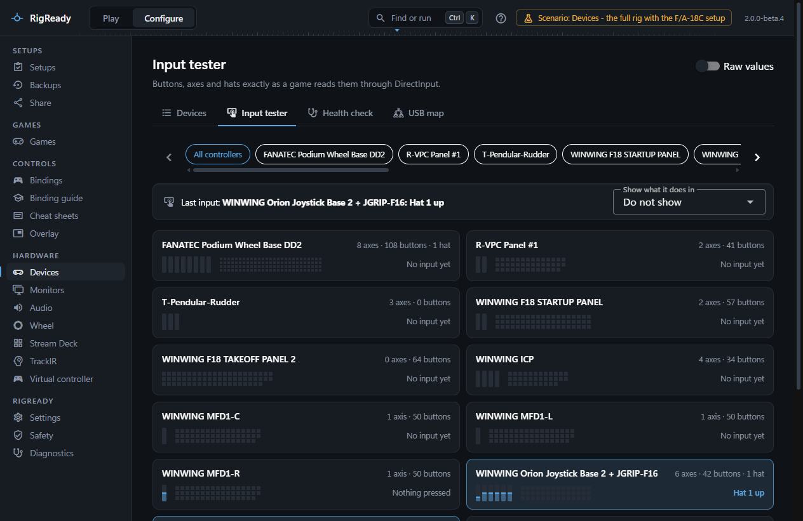
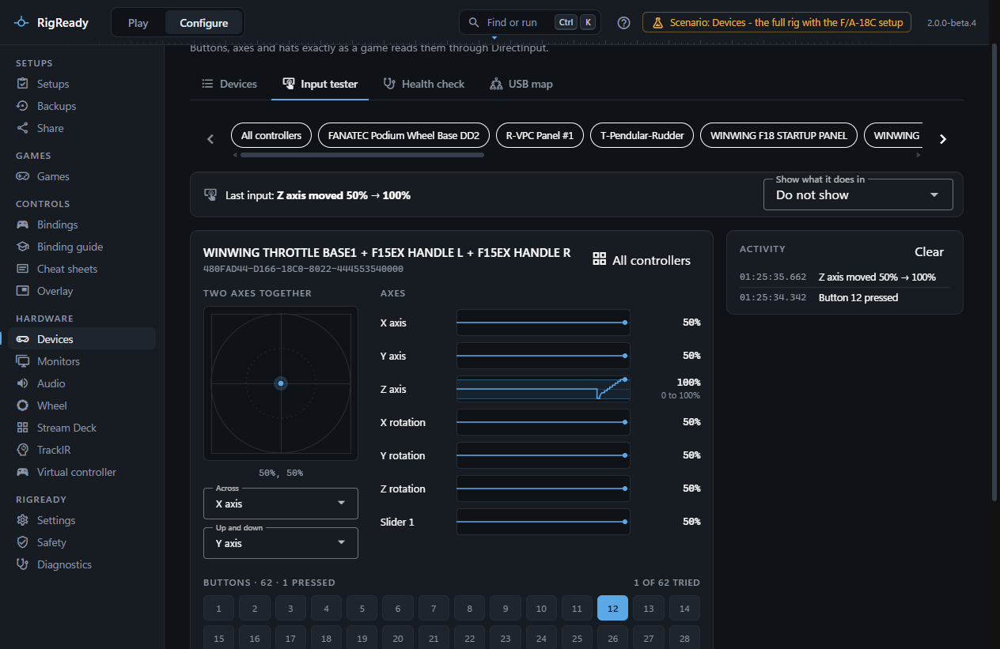
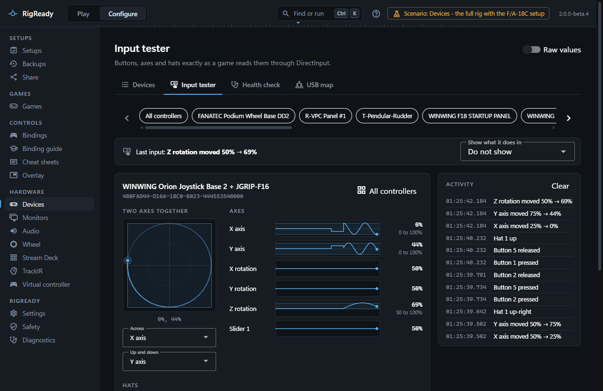
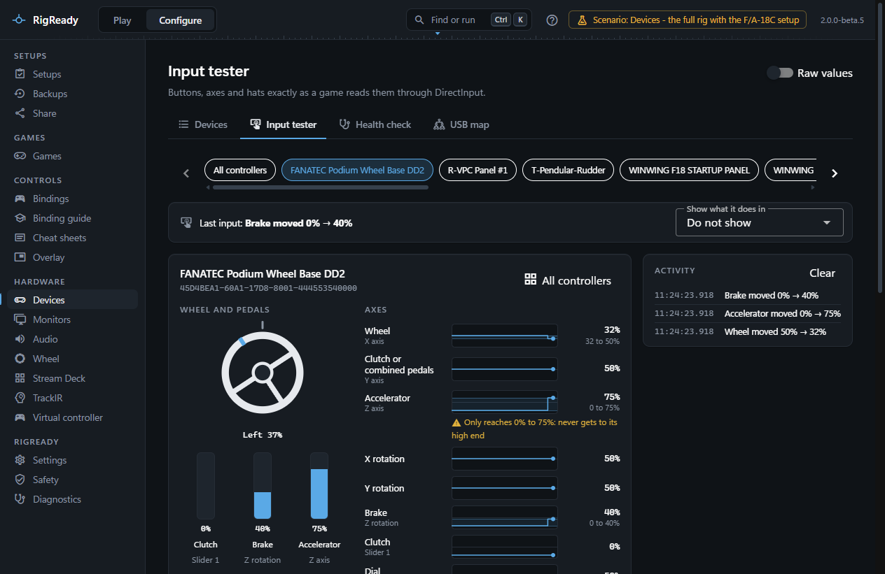
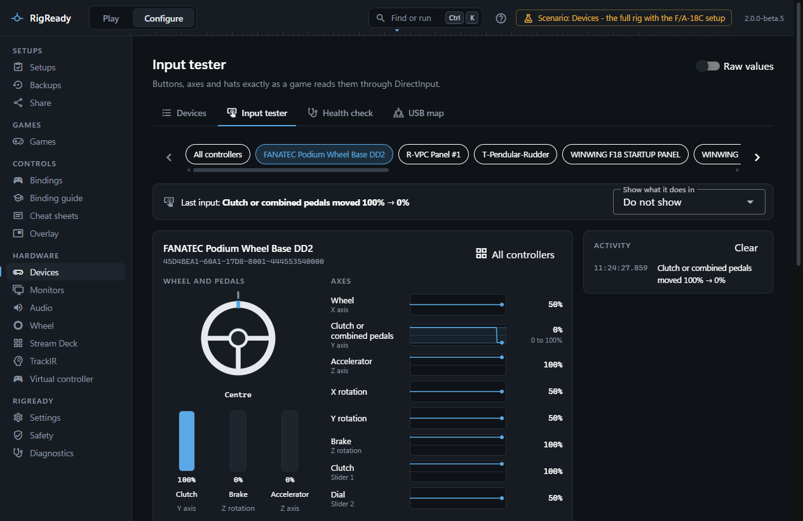
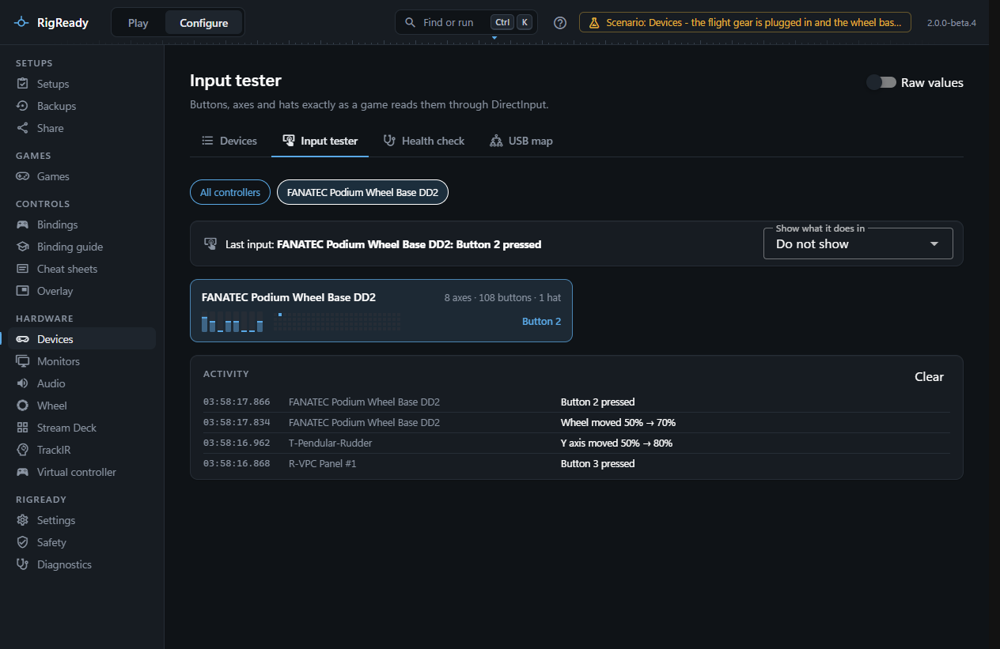

The **Input tester** tab of **Configure > Devices** shows what every game controller reports, live, through DirectInput, the same way a game reads it. Use it to check that a button works, that an axis reaches both ends, that a hat points where it should, and to find out what a control does in a game.

## Choosing what to see

A row of chips at the top has **All controllers** and one chip per controller, by the name you gave it on the [Devices](devices.md) tab. A chip lights up while its controller is being used, so an unlabelled box identifies itself when you press something on it.

**Raw values** switches every reading to the form games and binding files use: axes as the unsigned 16-bit number Windows shows (0 to 65535, centre 32767) beside the percentage, axes and buttons by their DirectInput names (JOY_X, JOY_RZ, JOY_SLIDER1, BTN12), hats as POV1 with direction codes.

## All controllers at once

With **All controllers** chosen, each controller is a card with a strip that shows every axis as a level bar and every button as a small square, filled while the button is down and outlined once it has been pressed. Beside the strip the card says in words what is held right now ("Buttons 3, 5", "Hat 1 up", or "Nothing pressed"). The card lights up when the controller is used. Click a card to open the controller in full.

## One controller

The single view shows the controller's name and instance ID, and three sections:

- **Axes**: each axis as a strip chart of the last six seconds, running right to left, with the pen at the right edge where the axis is now. A shaded band is the range the axis has reached since you opened the tester: sweep an axis end to end to check it gets to both ends. The number on the right is the current value, with the reached range under it once the axis has moved ("3 to 96%"). An axis that never reaches an end after a full sweep is marked: "Only reaches 3% to 96%: never gets to either end".
- **Hats**: each hat as a compass rose with the direction it is pushed towards lit, and the direction written beside it.
- **Buttons**: every button as a tile, numbered as games number them (the first is Button 1), lit while it is down, and keeping an outline once it has been pressed so the ones you have not tried stand out. The heading counts how many are pressed and how many of the total have been tried. **Start again** clears the outlines and the reached ranges.

**Two axes together** draws a pair of axes against each other the way the Windows controller panel draws a stick: the dot is where the stick is, the trail is where it has just been, and the box is how far it has been pushed in each direction. RigReady pairs the axes DirectInput names as pairs (X with Y, X rotation with Y rotation, Z with Z rotation, the two sliders) and lets you choose any two with **Across** and **Up and down**. The readout under the plot gives the position.

If Windows is set to reduce motion ([Motion](../app/text-size.md#motion)), the traces become still gauges and the stick plot has no trail.

## A wheel base

A Fanatec wheel base is drawn as what it is, in place of the plot of two axes. **Wheel and pedals** shows the steering as a wheel that turns, with the reading under it ("Left 37%", "Centre", "Right 100%"), and the clutch, the brake and the accelerator as three named bars that fill while the pedal is pressed.

The reading is the share of the travel to one side, not degrees. Windows reports the share only, and RigReady does not read the rotation set on the base, so no angle is shown. The picture turns a quarter turn at the end of the travel, whatever the real rotation is. Each pedal bar counts from where the pedal was at its first reading, and names the axis it reads under it ("Z axis"). If a bar looks the wrong way round, let go of the pedals and choose **Start again**.

The clutch can be on one of two axes. The Fanatec driver calls the Y axis "Combined pedals" and Slider 1 "Clutch", whatever the base's pedal mode. With the pedals separate, the clutch is on Y and Slider 1 does not move; with the pedals combined, Y carries the accelerator and the brake together. Windows does not say which mode the base is in, so the **Clutch** bar reads the one that moves: Slider 1 once it moves, Y once it moves from a rest at one end, as a pedal does. A combined axis rests in the middle, so it is never taken for the clutch. Until either moves, the bar reads Slider 1.

The axes below go by the names the [Wheel page](../games/wheel.md#axes) uses (Wheel, Clutch or combined pedals, Accelerator, Brake, Clutch, Dial), each with the name Windows gives it underneath ("X axis"). The activity log uses the same names ("Wheel moved 50% → 70%", "Clutch or combined pedals moved 100% → 0%"). With **Raw values** on, the names are the DirectInput ones as for any controller.

A wheel base of any other make, and one you added with [My wheel is not listed](../games/wheel.md#my-wheel-is-not-listed), keeps the general view and the names Windows gives: no source says what its axes are.

## When a controller is plugged in or unplugged

The tester follows by itself. A controller that is plugged in appears, and one that is unplugged goes, with no visit to the Devices tab and no Refresh.

Windows numbers game controllers in a list, so a controller that is plugged in can get the place another one had. RigReady tells controllers apart by their own ID, not by that place. A controller always shows under its own name, and it starts with nothing held, no ranges reached and no lines of its own in the log. Lines that an unplugged controller wrote stay in the log under that controller's name. If the controller whose single view is open is unplugged, the view says "That controller is not connected any more" and does not pass to another controller.

## What a control does in a game

The panel under the chips shows the **Last input** ("Throttle: Button 12 pressed"). When RigReady can read the bindings of a game on this PC, the field **Show what it does in** lists each game and aircraft or car: [DCS aircraft](../dcs/bindings.md), and [iRacing, Le Mans Ultimate, BeamNG.drive and Assetto Corsa](../games/index.md). Choose one, press a control, and the panel names the action bound to it, with the modifiers it needs, its category, and whether it is yours or the game's default. A control that does several things at once in that aircraft is marked, and **Open its bindings** goes to the page where it can be changed. "Nothing is bound to it" means just that.

## The activity log

**Activity** lists every press, release and hat move, newest first, with a time stamp and the controller's name. A moving axis is one line that keeps updating while the movement goes on ("Z axis moved 12% → 63%", or "moved and came back to 50%"); wobbles smaller than two percent of the travel are not logged. With one controller chosen the log shows only that controller. **Clear** empties it.

## When nothing shows

The tester depends on RigReady's input reader, a small program it starts when needed. If the reader is not installed or did not start, a warning says so and the controllers cannot be read; the Devices tab still lists the USB devices. See [Game controllers could not be read](../troubleshooting/controllers-not-read.md). A controller that HidHide hides from programs not on its allow list is invisible here too, unless RigReady is on that list; see [HidHide](devices.md#hidhide).
