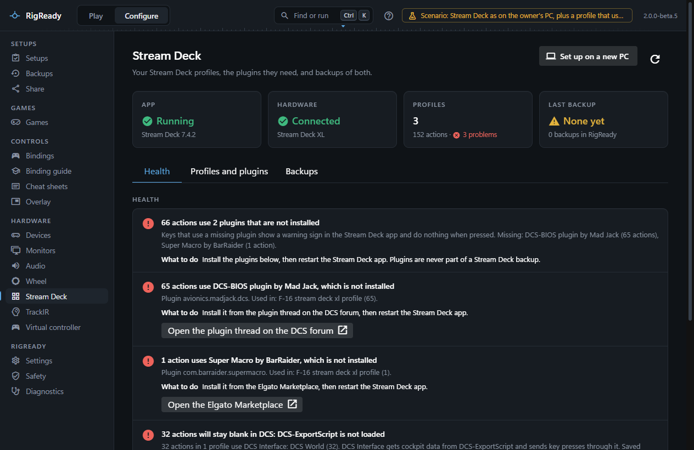
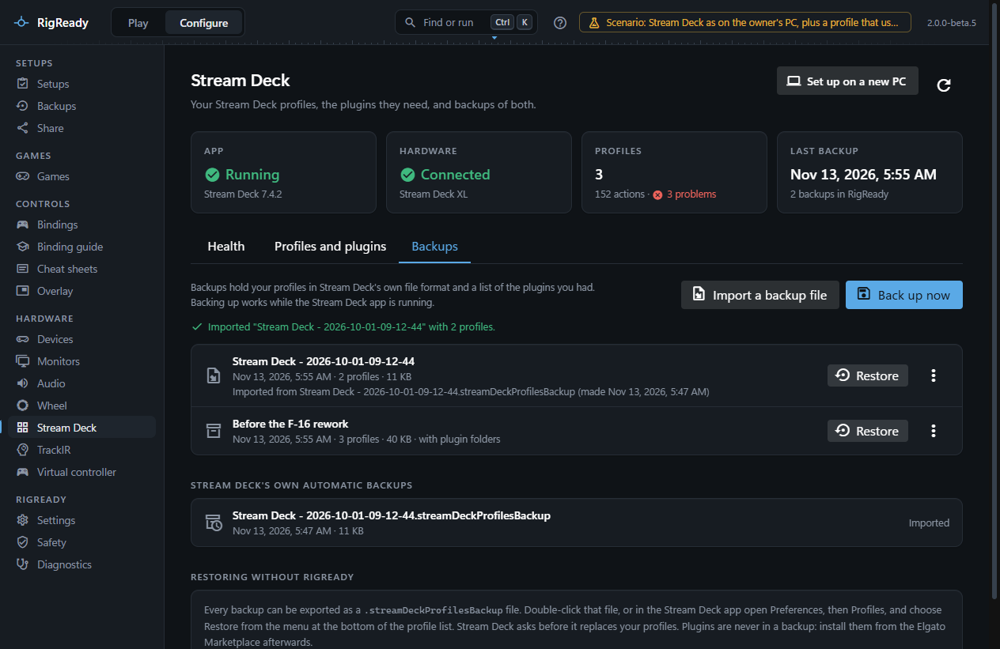
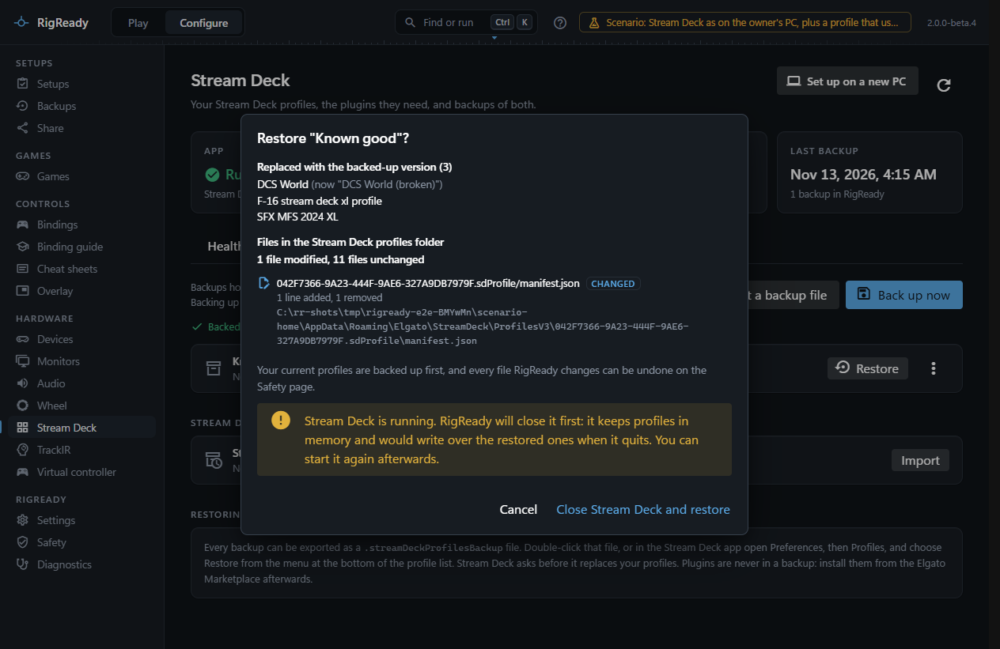
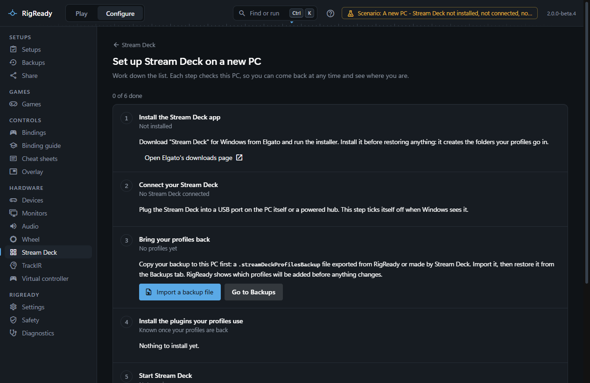

**Configure > Stream Deck** reads the Stream Deck app's profile and plugin folders and tells you what is there, what is missing, and whether it is backed up. It makes backups in the same file format the Stream Deck app uses, restores them, and walks you through setting a new PC up. RigReady never changes a profile except to restore one from a backup.

## The page

Four tiles at the top: **App** (installed, its version, running or not, with **Start Stream Deck** when it is not), **Hardware** (which Stream Deck is connected, by model and serial), **Profiles** (how many, how many actions, and how many problems) and **Last backup**. A PC that never had a Stream Deck shows all of this quietly as absent, not as a problem.

Three tabs follow.

### Health

Findings about the setup, worst first, each with what to do:

- Actions whose plugin is not installed, with the plugin's name, how many actions in which profiles use it, and a **Get it** link for the plugins RigReady knows (DCS Interface, the DCS-BIOS plugin by Mad Jack, Super Macro by BarRaider, otherwise the Elgato Marketplace). Keys that use a missing plugin show a warning in the Stream Deck app and do nothing. Plugins are never part of a backup.
- The DCS Interface plugin in use but DCS not loading DCS-ExportScript: the keys will stay blank in DCS. The finding says whether `Export.lua` is missing, does not load the script, or loads a folder that is not there, and that **Open DCS setup** can add the line with a backup first. When DCS-ExportScript sends to a port other than 1725, the one the plugin listens on, that is reported too. A DCS-BIOS based plugin gets the same treatment for DCS-BIOS. See [DCS World](../dcs/index.md).
- A profile file that could not be read.
- No backup in RigReady, or the newest one older than 30 days.

### Profiles and plugins

Every profile with the Stream Deck it was made for (and whether that one is connected), its pages, its actions, and a chip per plugin it uses with the count; a missing plugin's chip is marked. Then every plugin: installed ones with version and author, built-in actions, and plugins that profiles use but that are not installed, with **Get it**.

### Backups

A backup copies the profiles folder into one `.streamDeckProfilesBackup` file, in the layout Stream Deck 7 uses, plus a list of the profiles and of the plugins they use. It is made while the Stream Deck app runs: RigReady copies, then checks that nothing changed during the copy and copies again if it did. **Back up now** asks for an optional name and whether to **also copy the plugin folders** (larger; some plugins keep their settings there). Each backup can be renamed, exported to a file you choose, or deleted; deleting one never touches your profiles.

**Import a backup file** adds a `.streamDeckProfilesBackup` made elsewhere, by RigReady or by Stream Deck itself, in either the current or the older layout. The automatic backups the Stream Deck app makes when it updates are listed under **Stream Deck's own automatic backups** with an **Import** button each.

## Restore

**Restore** on a backup first shows what would happen: which profiles are **Added**, which are **Replaced with the backed-up version** (with the name they have now), which profiles on the PC are **Not in this backup, left as they are**, and the files in the profiles folder that would be written or removed. A backup with plugin folders offers **Also put back the plugin folders**, with its own file list.

Two ways of restoring exist, and the preview says which applies:

- **By files**, when the backup and the PC both use the Stream Deck 7 layout. The Stream Deck app must be closed, because it keeps profiles in memory and writes them when it quits; RigReady offers **Close Stream Deck and restore**, and if the app ignores the polite request, **End Stream Deck and restore** as a second step. Your current profiles are saved first as a backup named "Before restoring …", every file is written through RigReady's journal, and afterwards the profiles folder is read back: the restore is only reported when every profile of the backup is there under its name. **Start Stream Deck** brings the app back, and **Undo** puts the previous files back (the app must be closed again; if Stream Deck has saved the restored profiles since, RigReady asks before undoing).
- **By the app**, when the backup is in the older format or the PC has an older Stream Deck app. RigReady backs up the current profiles and hands the file to the Stream Deck app, which shows its own "Restore?" prompt. Confirm it there, then **Check result** in RigReady reads the profiles folder and says which of the backup's profiles are now there.

Restoring by files, and closing the Stream Deck app for it, have only been exercised against recorded data, not on a PC with the Stream Deck app running; `CHANGELOG.md` lists this under known limitations.

**Restoring without RigReady**: export a backup, then double-click the file, or in the Stream Deck app open Preferences, Profiles, and choose Restore from the menu at the bottom of the profile list.

## Set up on a new PC

**Set up on a new PC** is a checklist whose every step reads the PC, so you can leave and come back: install the app (with the download link), connect the Stream Deck, bring the profiles back (import a backup file and restore it), install the plugins the profiles use (listed from the backup before the profiles are back, and from the profiles after), let DCS talk to the Stream Deck when a DCS plugin is in use, start Stream Deck, and make a backup of the finished setup.

## In a setup and in a full backup

When a setup is captured from the rig, **Stream Deck app** (optional; its fix starts the app, and it can be closed at Stand down) and **Stream Deck hardware** (optional; a particular unit by serial when several are connected) are offered. A full backup on the Backups page can include the profiles folder, the plugin list (their manifests, so you know what to install again) and the whole plugin folders; restoring them needs the app closed, and RigReady restarts it. See [backups](../protect/backups.md).
