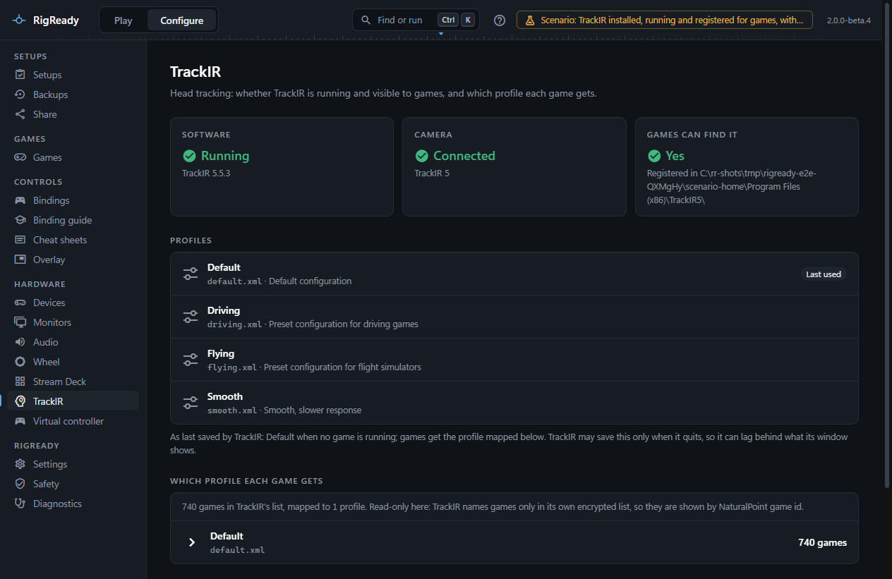
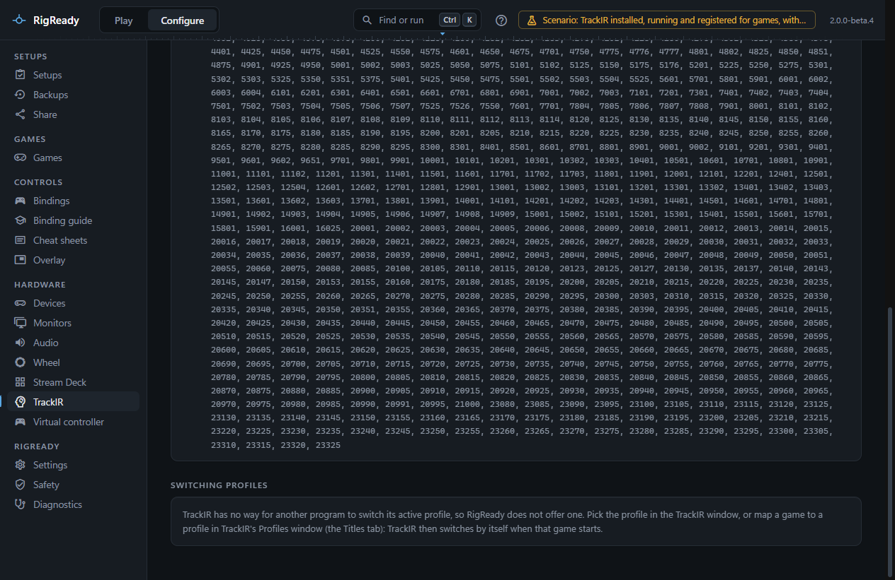

**Configure > TrackIR** reads what the TrackIR 5 software keeps on disk and what Windows knows about the camera. TrackIR has no interface for other programs, so RigReady can tell you the state of things, start the program and back up its files, but it cannot change a profile.

## Status

Three tiles:

- **Software**: installed or not, the version, and running or not, with **Start TrackIR** when it is installed but not running. RigReady starts it and waits until it is running before saying so.
- **Camera**: whether a NaturalPoint device is connected on USB.
- **Games can find it**: whether TrackIR is registered for this Windows user so games find its `NPClient64.dll`. When the registration is missing the tile says to start TrackIR once, which registers it; when it points at a folder without the file, another head-tracking program may have changed it, and starting TrackIR sets it back.

When TrackIR is not installed, a short install guide with the download link appears. A PC that has neither the software nor the camera shows both as absent, not as a problem.

## Profiles

Every profile in TrackIR's data folder is listed by name, file and description. A badge marks the profile TrackIR uses for every game (its exclusive profile) or, otherwise, the one it last used. A note says this is as last saved by TrackIR, which may save only when it quits, so it can lag behind what the TrackIR window shows.

**Which profile each game gets** reads TrackIR's game-to-profile map: how many games are in its list, and for each profile the games mapped to it. TrackIR names games only in its own encrypted list, so games are shown by NaturalPoint game id, and a profile file that is mapped but missing is flagged (TrackIR then falls back to its default).

## Switching profiles

TrackIR has no command line switch or other way for another program to change its active profile, so RigReady does not offer one. Pick the profile in the TrackIR window, or map a game to a profile on the Titles tab of TrackIR's Profiles window: TrackIR then switches by itself when that game starts. `CHANGELOG.md` lists this under "by design, for now".

## Checks in a setup

When a setup is captured from the rig with TrackIR running, it is offered as **TrackIR software**, a required check whose fix starts TrackIR, and which closes TrackIR at Stand down because it is only useful in the sim. The check passes with "Running" and, when games cannot find TrackIR, adds that as a detail. With the camera connected, **TrackIR camera** is offered: any NaturalPoint camera on any USB port.

## Backups

TrackIR's `Settings.xml`, its game-to-profile map `ProfileMap.dat` and every profile under `Profiles` are offered for a full backup, together as one item or one by one. Restoring them needs TrackIR closed, because it writes its settings and profiles when it closes; the restore wizard closes it and starts it again. See [backups](../protect/backups.md).
