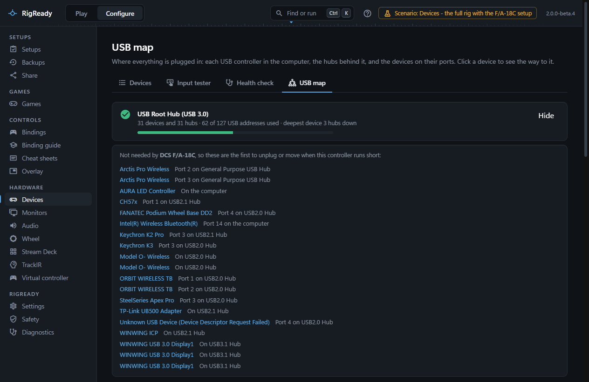
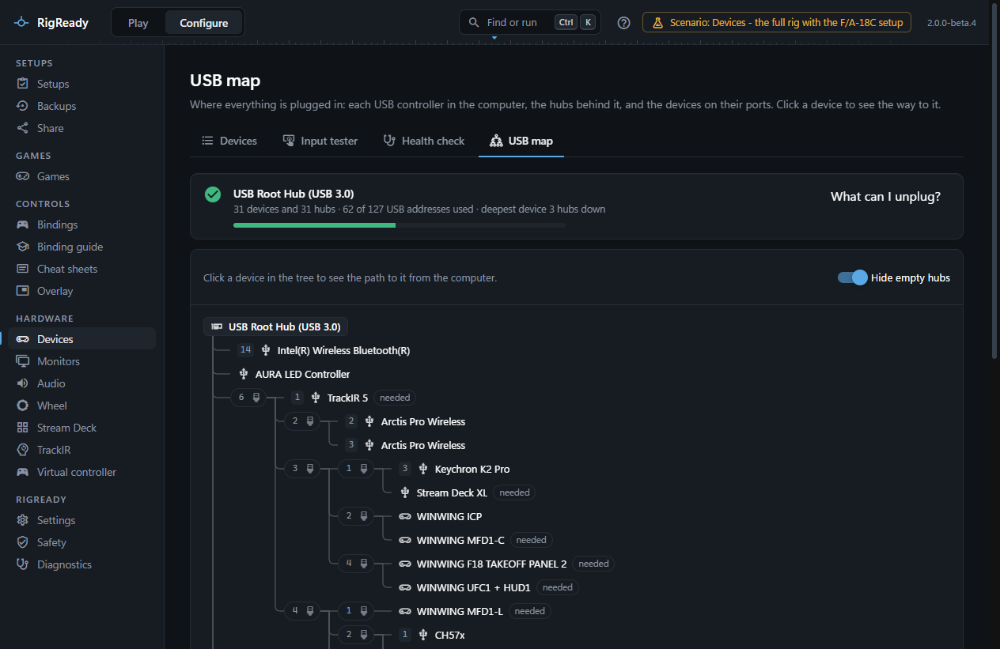
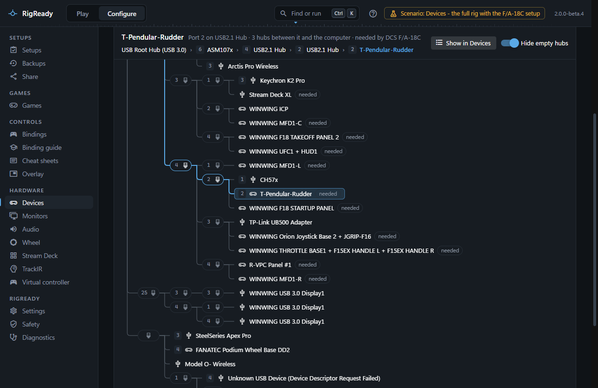

The **USB map** tab of **Configure > Devices** draws the USB tree: each USB controller in the computer at the head of its own tree, the hubs branching off it, and every device at the end of its branch. It answers where a device is plugged in, how many hubs it sits behind, and what to unplug when a controller runs short.

## The controllers of the computer

Above the drawing, one panel per USB controller says how many devices and hubs hang off it, how many of its 127 USB addresses are in use (hubs count too), and how many hubs down its deepest device sits. A controller near 100 addresses is marked as close to the limit, and one over 127 as over it, with advice to move devices to another USB controller (a PCIe USB card adds one) or to unplug what you do not need.

When a [setup is in use](../play/switching-setups.md), **What can I unplug?** lists the devices on that controller that the setup does not need, each with where it is plugged in: the first to unplug or move when the controller runs short. Clicking one selects it in the drawing.

A device four hubs away from the computer gets a warning, and one five hubs away an error: USB allows five hubs between the host and a device, and Windows starts failing at the edge. The advice is to plug it in closer to the computer.

## The drawing

Follow a line from a USB controller to a device. Each round box on the way is a hub, and the number on it is the port it is plugged into on the hub before it. Point at a hub for its name. Devices come before hubs on each level, so the things you care about are at the top of each branch. **Hide empty hubs** (on by default) leaves out hubs with nothing behind them.

Two things about the drawing are true of USB rather than of RigReady: a USB 3 hub appears twice, once for its USB 2 side and once for its USB 3 side, because Windows enumerates it as two hubs; and one hub box on your desk often holds two or three hub chips, so one box can be two or three hubs deep in the tree.

## The path to a device

Click a device and the way to it is drawn through in colour, from the controller to the device. The bar above the drawing says the same in words: the device's name, where it is plugged in, how many hubs are between it and the computer, which setups need it, and the chain from the computer down with the port number at each step. **Show in Devices** opens the device on the [Devices](devices.md) tab, and **Show on USB map** on a device there comes back here with it selected.

Devices that a setup needs are marked in the drawing, as are devices [HidHide](devices.md#hidhide) hides. A device's name in the drawing is the name you gave it. A device that a setup needs and that is missing is the case [A device is not found](../troubleshooting/device-not-found.md) covers.

## What it is read from

The tree comes from the Windows device tree: for every present USB device, the chain of parent hubs up to the root hub of its controller. RigReady does not open the hubs to read port speeds or bandwidth, so the map shows connections and counts, not throughput.
