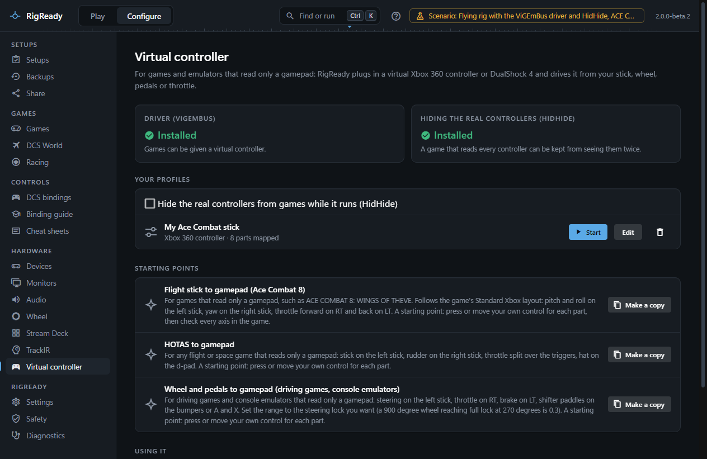
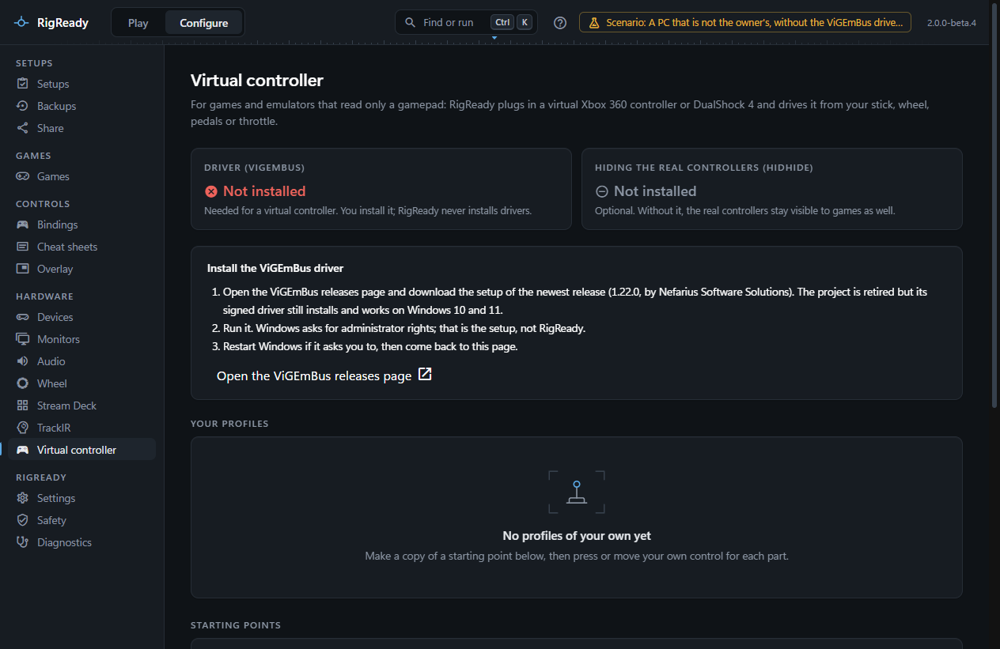
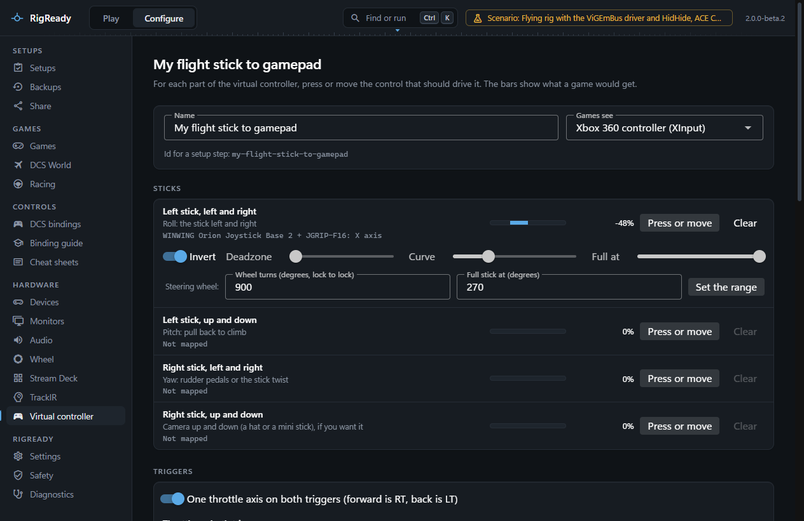
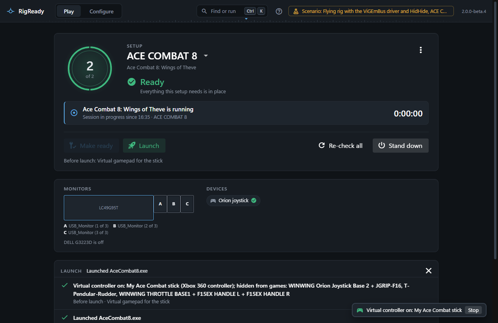

Some games read only a gamepad: Ace Combat 8, many console ports, older driving games, and console emulators such as PCSX2, DuckStation, Dolphin and RetroArch. **Configure > Virtual controller** plugs in a virtual Xbox 360 controller (or a DualShock 4) that those programs see like any other gamepad, and drives it from the controllers you already have: a flight stick, rudder pedals, a throttle, a wheel and pedals, a button box.

## The driver

A virtual controller needs the **ViGEmBus** driver by Nefarius Software Solutions, the driver most tools of this kind use (DS4Windows, x360ce and others). RigReady never installs a driver: you install it yourself, once.

1. On the Virtual controller page, **Open the ViGEmBus releases page** (it asks before opening your browser), and download the setup of the newest release, 1.22.0.
2. Run it. Windows asks for administrator rights; that is the driver's setup asking, not RigReady.
3. Restart Windows if the setup asks you to.

The page then says **Installed**. The project is retired (it gets no more updates) but its signed driver installs and works on Windows 10 and 11. Until it is installed, nothing can be started and the page says why.

**HidHide**, also by Nefarius, is optional. With it, RigReady can hide your real controllers from games while the virtual one runs, so a game that reads every controller does not see your stick twice. Without it, that option is off and the page says why.

## Profiles

A profile says which of your controls drives each part of the virtual controller. Profiles belong to no game: one profile can serve Ace Combat 8 today and an emulator tomorrow.

**Starting points** say what each part is for and map nothing yet, because only you know which controls you have. Press **Make a copy** on one and map your own controls in the copy:

- **Flight stick to gamepad (Ace Combat 8)**: the game's Standard Xbox layout. Pitch and roll on the left stick (the stick pulled back is "stick down", which climbs), yaw from the pedals or the stick twist on the right stick, the throttle on both triggers (forward is RT, back is LT), and the main buttons.
- **HOTAS to gamepad**: the same idea for any flight or space game.
- **Wheel and pedals to gamepad**: steering on the left stick, throttle on RT, brake on LT, paddles on the bumpers. For driving games and console emulators.

Your own profiles are kept in RigReady's data folder and can be started, edited and deleted.

## The editor

For every stick direction, trigger, button and d-pad direction:

- **Press or move**, then press the button, push the hat or move the axis you want for it. RigReady waits ten seconds. Letting go of a stick you just mapped does not count; push the next control away from its centre.
- **Clear** takes the control off again.
- The bar shows, live, what a game would get from the profile as it is now, before you save it.

For an axis:

- **Invert** turns it round. A pedal that reads "full" when released needs it on its trigger.
- **Deadzone**: how much movement near the centre (or, on a trigger, near the start) counts as none. A few percent stops a worn stick from drifting.
- **Curve**: 1 is straight. Above 1 is gentler near the centre and steeper at the end, for fine aiming with full rate at full deflection; below 1 the other way round.
- **Full at**: how much of the real travel gives full output. For a wheel, fill in **Wheel turns** (its rotation, lock to lock, say 900 degrees) and **Full stick at** (the steering lock you want, say 270 degrees) and press **Set the range**: 0.3.

**One throttle axis on both triggers** splits one throttle over LT and RT: forward of the split is RT, behind it LT, and at the split neither. Put the split at your idle detent. The deadzone is on both sides of the split. With it off, LT and RT each take their own axis (two pedals) or a button.

A button can also be an axis pushed past half its travel (a clutch pedal as a button, say); **Other side** turns which half counts.

**Games see** chooses an Xbox 360 controller (what nearly every PC game and emulator expects) or a DualShock 4 (for an emulator or game that prefers a PlayStation pad). On a DualShock 4, A is Cross, B Circle, X Square, Y Triangle, the bumpers are L1 and R1, Back is Share and Start is Options.

## Starting and stopping

- By hand: **Start** beside a profile on the page, **Start virtual controller** in the command palette (Ctrl+K), or the **Virtual controller** entry of the tray menu. It runs until you stop it or quit RigReady.
- **Hide the real controllers from games while it runs** (on the page) uses HidHide. RigReady keeps its own controller reader allowed to see them, so the virtual controller keeps working.
- While one runs, a small strip in the corner of every screen, the Play screen included, says which, with **Stop**. The tray's tooltip says "virtual controller on" and its menu has **Stop the virtual controller**.

When RigReady quits, or stops in any other way, the virtual controller goes with it. Controllers it hid are shown to games again when it stops; if RigReady was ended before it could do that, it does it when it starts next.

## In a setup

Add the step **Start a virtual controller** to a setup's [steps before launch](../setups/launch.md) and choose your virtual controller from the list, by name. If you want, turn on **Hide controllers**. Two virtual controllers of the same name are told apart in the list: each line says what the controller is made of, and its id (the "Id for a setup step" at the top of its editor, such as `my-ace-combat-stick`). A new setup for a game that reads a gamepad offers the step by itself; see [Creating a setup from the rig](../setups/capture.md#before-launch). Make ready and launch then starts it before the game, so the game finds it when it starts. [Stand down](../play/stand-down.md) stops a virtual controller that a setup started and shows hidden controllers again. A step **Stop the virtual controller** exists for a setup's Stand down steps too.

The check **Virtual controller driver installed** fails on a PC without the driver, with the steps to install it.

## In an emulator

Start the virtual controller first, then the emulator, and map it once in the emulator:

- **PCSX2** (PlayStation 2): Settings > Controllers, port 1, choose the "XInput" or "SDL" device for the Xbox 360 controller (or the DualShock 4 through SDL), then **Automatic Mapping**.
- **DuckStation** (PlayStation 1): Settings > Controllers, Controller Port 1, **Automatic Mapping** with the "XInput-0" or "SDL-0" device. For a driving game, an Analog Controller (DualShock) or the NeGcon type gives steering on the left stick.
- **Dolphin** (GameCube, Wii): Controllers > Standard Controller > Configure, Device "XInput/0/Gamepad", then map each button.
- **RetroArch**: Settings > Input > Port 1 Controls, device "XInput Controller (User 1)"; the Xbox layout is mapped by itself.

Hide the real controllers too if the emulator picks your stick as player 1.

## Anti-cheat and online play

Ace Combat 8 uses Easy Anti-Cheat online. Nothing has been reported of it refusing a virtual controller made with ViGEmBus, and RigReady changes nothing in the game itself, but try it offline first. Anti-cheat in some other games (EA's, for one) blocks virtual controllers; when a game refuses to start or warns you, stop the virtual controller.

## What RigReady does not do

- It never installs or updates a driver, and never asks for administrator rights.
- It does not change HidHide's own settings beyond what it added, takes away exactly what it added, and refuses to hide anything in HidHide's inverse mode.
- It plugs in one virtual controller at a time.
- Force feedback and rumble from the game are not passed back to your wheel or stick.
