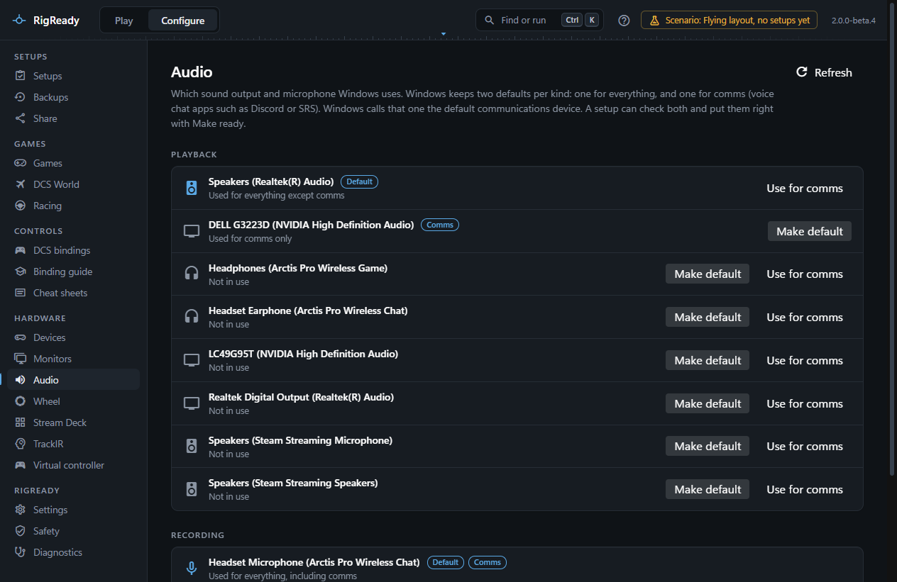
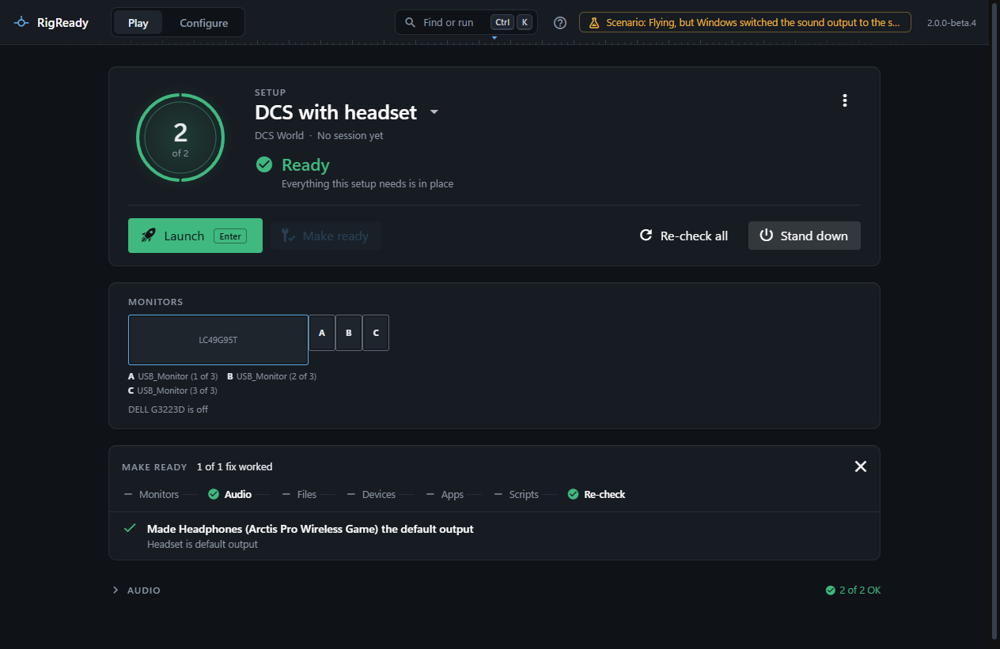

**Configure > Audio** shows every playback and recording device Windows has turned on, marks the ones Windows uses by default, and lets you change that with one button. A setup can include the same choice as a check, so a headset that was unplugged or a microphone that Windows swapped shows up before the game starts.

## What is read from Windows

Windows keeps two defaults for each kind of device: the **Default** device, used for everything, and the **Calls** device, used by voice chat programs such as Discord or SRS. RigReady reads both through the same Core Audio interface the Windows Sound settings use: the list of active devices with their names and ids, the default playback and recording device, and the default playback and recording device for calls.

Devices that are unplugged, or disabled in the Windows Sound settings, are not listed. A setup that expects one of them says so on the Play screen instead of picking another device.

## The page

The page has a **Playback** and a **Recording** section. Each row is one device, with a **Default** badge, a **Calls** badge, or both, and a line that says what it is used for: "Used for everything, including calls", "Used for everything except calls", "Used for calls only" or "Not in use". The defaults are listed first.

- **Make default** makes the device the one Windows uses for everything.
- **Use for calls** makes it the one voice chat programs use.

RigReady sets the default the way the Sound panel does and then reads it back; it reports the change only when Windows really made it. No administrator rights are needed. If a device disappears between reading the list and pressing the button, the page says so and refreshes. **Refresh** reads the devices again at any time.

## The check in a setup

When a setup is created from the rig, the capture screen proposes **Sound output: <device>** and **Microphone: <device>** for the current defaults, selected and required. When the calls device differs from the default, **Sound output for calls: <device>** (or the microphone equivalent) is offered as well, optional and not selected. Each check records the device's Windows id and its name. See [checks](../setups/checks.md).

On the Play screen the check passes with "Default output", "Default output for calls" or "Default output, also for calls". It fails with:

- "<device> is not connected", plus "Windows is using <other> instead" when it can say so;
- "Default is <other>" or "Default for calls is <other>" when the device is there but not chosen.

If Windows gave the device a new id since the setup was made (a driver reinstall, another USB port), the check finds it by its exact name, as long as only one device of that kind has that name, and notes "Found by name: Windows now lists <device> under a different id."

The fix, **Make <device> the default output** or **Make <device> the default for calls**, is what Make ready runs. It fails if the device is not connected.

## Stand down

If a fix changed a default during this session, and the default is still what the fix set, [Stand down](../play/stand-down.md) puts back the device that was the default before. If you changed it yourself in the meantime, Stand down leaves it alone. This memory is kept only while RigReady runs: after a restart there is nothing to put back.
