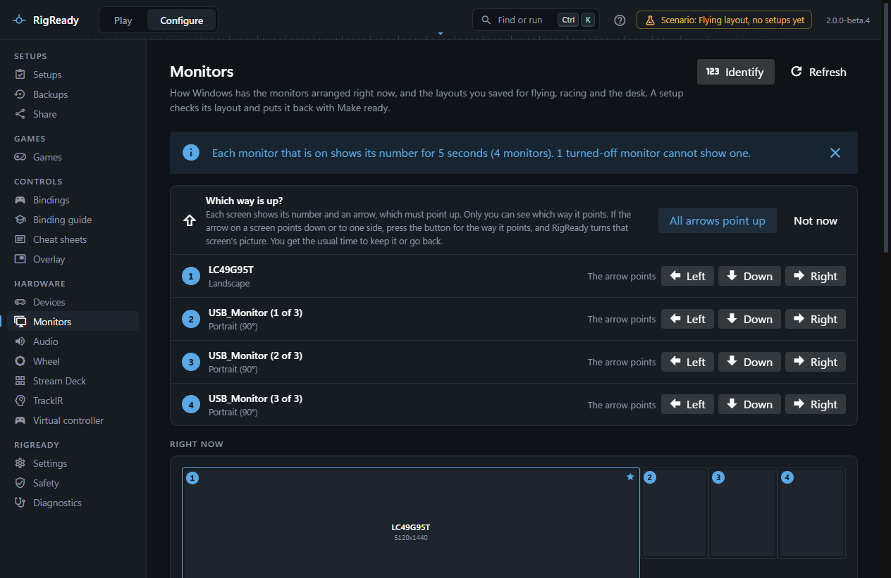
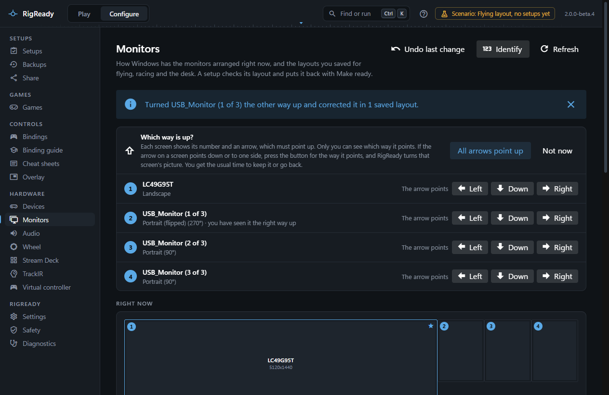

**Identify** on **Configure > Monitors** shows each monitor its own number for five seconds, with an arrow that must point up. It answers two questions Windows cannot: which physical screen is which in the list, and whether a screen mounted on its side is upright or upside down.

## Numbers

Press **Identify**. Every monitor that is on shows a large number and, under it, the name RigReady uses for it. The numbers are the same as on the map and in the list on the Monitors page: enabled monitors from left to right, then top to bottom. A monitor that is off cannot show anything, and the message after Identify says how many could not.

Use the numbers to name identical screens. The three MFD screens of a flight rig all report the same name and usually the same serial, so the list cannot tell you which is on the left. Identify can: find the number on the left screen, then **Name** that row "MFD left". The name is stored with what identifies the screen (the serial of its USB device, or failing that its port), so it stays correct afterwards. See [the Monitors page](index.md) for how identical monitors are told apart.

Identify is also in the command palette (Ctrl+K, "Identify monitors").

## Which way is up

A screen mounted sideways can be upright in two ways: rotated 90° or rotated 270°. Windows reports the rotation it has been given, not which way the screen is physically mounted, so nothing on the PC can say whether the picture is the right way up. Only someone looking at the screen can.

That is why the arrow is there. After Identify, the Monitors page shows a panel headed **Which way is up?** with one row per monitor that is on. Look at each screen:

- If every arrow points up, press **All arrows point up**. RigReady remembers this for each monitor at its present rotation, and the row shows "you have seen it the right way up" from then on. The question is not asked again for that monitor at that rotation.
- If an arrow points down on a screen, press **Arrow points down: turn it** on that row. RigReady turns that one monitor by 180° (90° becomes 270°, 270° becomes 90°, 0° becomes 180°) and asks the usual **Keep this monitor layout?** question with the countdown. If you keep it, every saved layout that had this monitor at the old rotation is corrected to the new one, so the answer is stored where it is used, and the message says how many layouts were changed. If you go back, nothing is changed.
- **Not now** closes the panel without recording anything.

The turn is read back before anything else happens: if Windows accepts the change but the monitor does not turn, RigReady says so and changes no layout.

## 90 or 270

The two portrait rotations are not interchangeable. For the MFD screens of a DCS setup it matters twice: the Windows layout decides which way the desktop is drawn, and the DCS monitor setup places the MFD exports in desktop coordinates. A screen that is upright at 90° on one rig may be upright at 270° on another, depending on which way the frame was mounted. Windows calls 90° "Portrait" and 270° "Portrait (flipped)"; the names say nothing about the physical screen.

This is listed among the known limitations in `CHANGELOG.md`: which way is up on a sideways-mounted screen cannot be read from Windows, so Identify asks you once per monitor and rotation.
