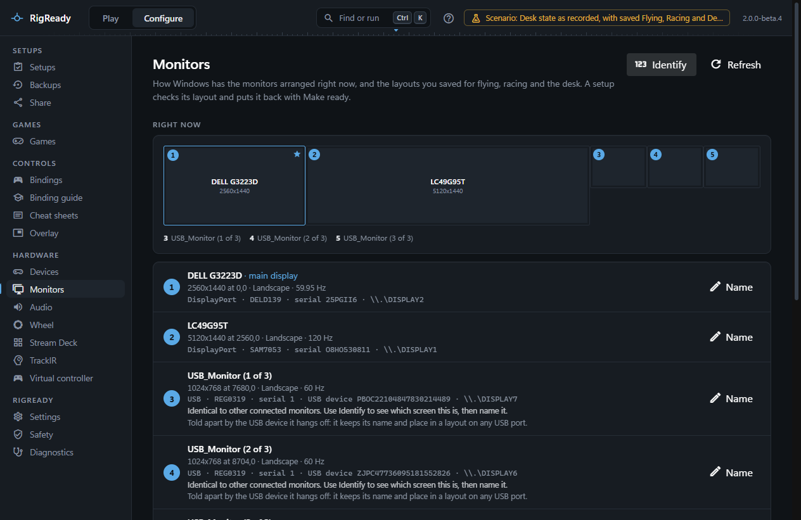

This section covers the two pages under **Configure** that deal with what you see and hear: **Monitors** and **Audio**. Both read the real state from Windows every time they open, and both feed the checklist on the Play screen, so a setup can check the monitor arrangement and the default sound devices and put them right with [Make ready](../play/make-ready-and-launch.md).

The Monitors page is described here. The pages that follow cover [Monitor layouts](layouts.md), [Identify and which way is up](identify.md), [Edit a layout by hand](rotation-and-position.md) and [Audio](audio.md).

## The Monitors page

**Configure > Monitors** opens with the heading **Right now**: a map of the desktop drawn to scale. Every monitor that is on is a box at its real position and size, a rotated monitor is drawn tall, and the main display carries a star. Each box has a number in its corner. Monitors that are connected but turned off are listed under the map rather than drawn, because they have no place on the desktop.

Under the map is one row per monitor:

- The number, which is also what **Identify** shows on the screen itself (see [Identify](identify.md)). Monitors are numbered from left to right, then top to bottom. A monitor that is off has no number, because nothing can be shown on it.
- The name RigReady uses for it: the name you gave it, or the name from the monitor itself, with "(2 of 3)" added when several connected monitors share that name.
- **main display** when it is the one Windows calls primary.
- Its size and position in desktop pixels, its orientation (Landscape, Portrait, Landscape (flipped) or Portrait (flipped), with the angle) and its refresh rate. A monitor that is off says "Connected, turned off".
- An identity line in small type (see below).

**Name** on a row lets you call a monitor something you will recognise, for example "MFD left". A name is at most 40 characters and no two monitors may share one. The name is used in every message, in saved layouts and in the checklist. Leave the field empty to go back to the name the monitor reports.

**Refresh** reads the monitors again. **Undo last change** appears only after RigReady itself changed the arrangement during this session; it puts back the arrangement from before that change, whether or not you kept it at the time.

## What Windows reports

RigReady reads the arrangement through the same display configuration interface the Windows Settings app uses. For each monitor it gets:

- the name from the monitor's own identification data (its EDID), for example "SAMSUNG" or "USB_Monitor";
- position, size, rotation and refresh rate, and for a monitor that is on, every size and refresh rate Windows lists for it;
- the connector (HDMI, DisplayPort, USB and so on) and a short manufacturer and model code from the EDID;
- the serial number from the EDID, when the maker put a real one there, and for a screen driven over USB, the serial number of the USB device it hangs off;
- the Windows device name of the output, such as `\\.\DISPLAY3`.

The identity line on each row shows these: the connector, the EDID code, "serial 12345" or "no serial", "USB device WWIN…" for a USB screen, and the device name. When a monitor can only be told apart by the port it is plugged into, the port is shown too.

RigReady does not read anything from the graphics driver's own control panel, and it cannot see a monitor that Windows does not list.

## Identical monitors

Several screens of the same model are a normal part of a flight rig. Windows gives them the same name, and many of them report the same serial number (often "0"), so they cannot be told apart by what they say about themselves.

RigReady tells identical monitors apart in two ways, and says which one applies on each row:

- **Told apart by the USB device it hangs off.** A USB screen has a USB device above it with a serial number of its own. RigReady stores that serial with the monitor's name and with its place in every saved layout, so the screen keeps both when it is moved to another USB port or another hub.
- **Told apart only by the port it is plugged into.** When there is no serial that is unique among the twins, the monitor is identified by the connector it is on. Keep it on that port; moving it makes it a different monitor as far as names and layouts are concerned.

Until you name them, identical monitors show the hint "Identical to other connected monitors. Use Identify to see which screen this is, then name it." When you name one, the field offers the suggestions **MFD left**, **MFD centre** and **MFD right**.

## What else uses this page

- A setup's monitor check and its Make ready fix are described under [layouts](layouts.md).
- The DCS screen setup places the main view and the MFD exports on these monitors, by the names you give them: see [DCS screens](../dcs/screens.md).
- The Play screen draws the same map, so a wrong arrangement shows as a place on the picture: see [the Play screen](../play/index.md).
