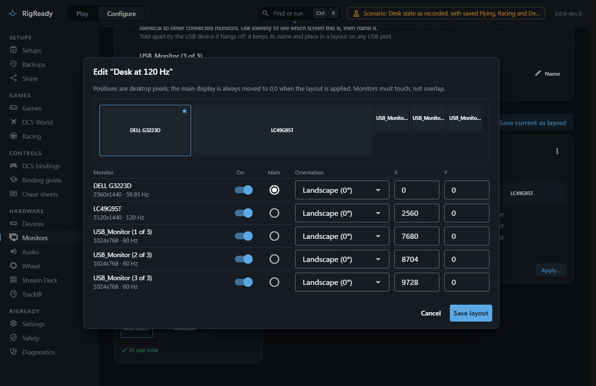
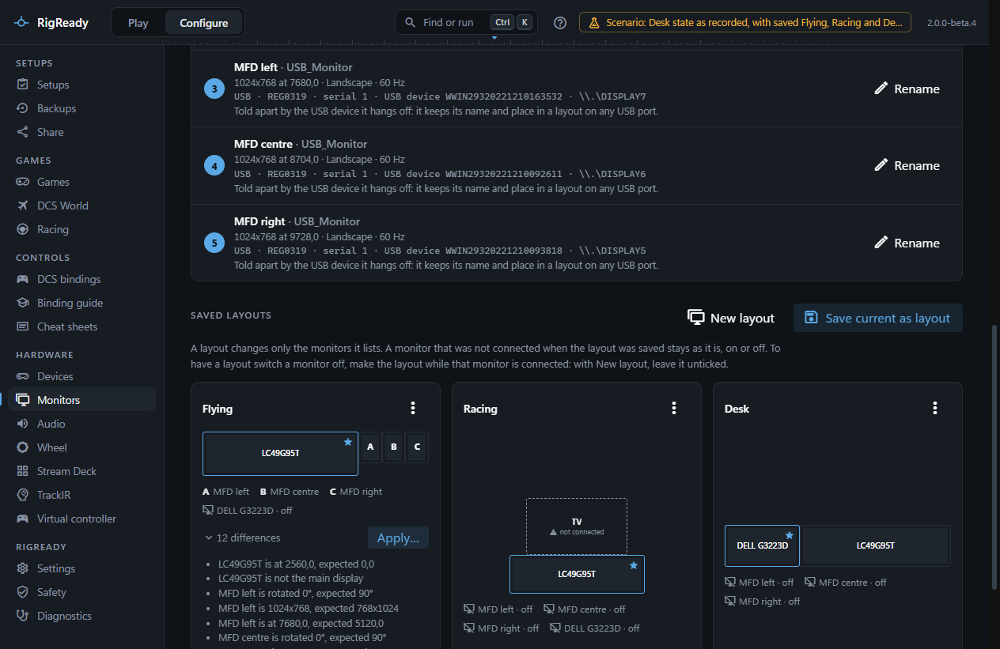
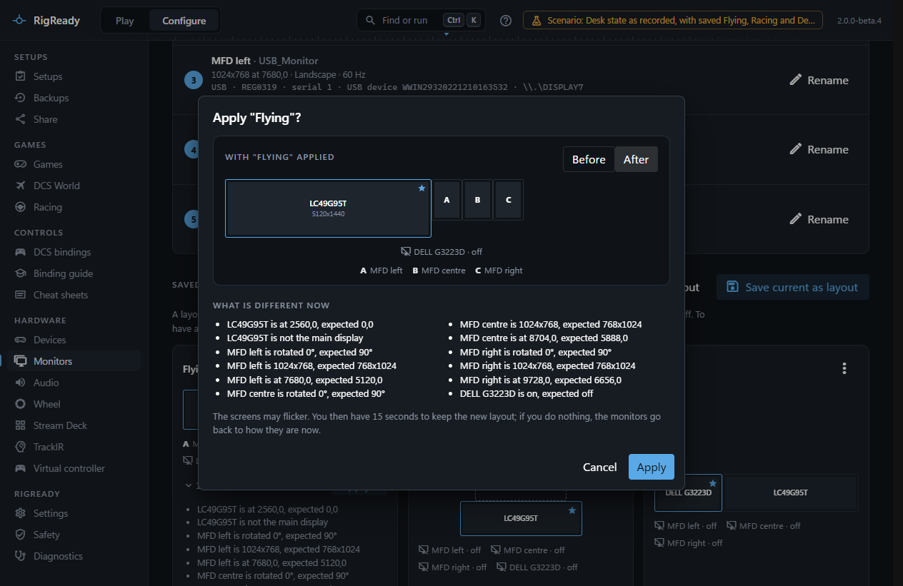
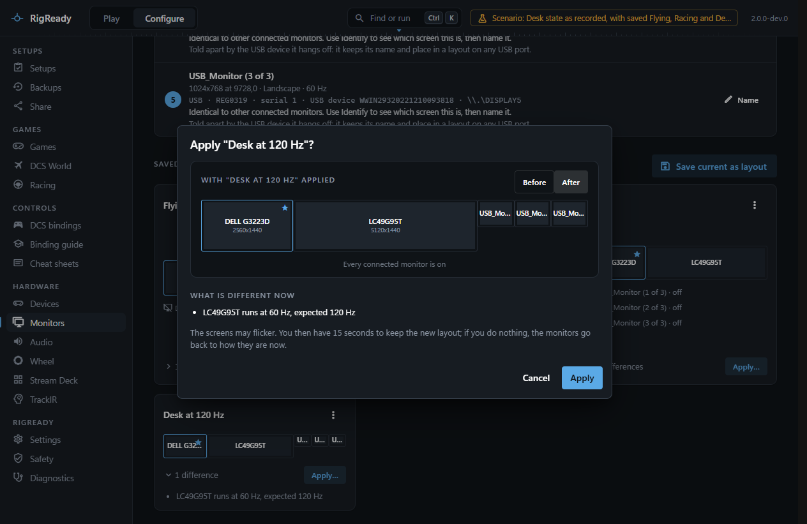
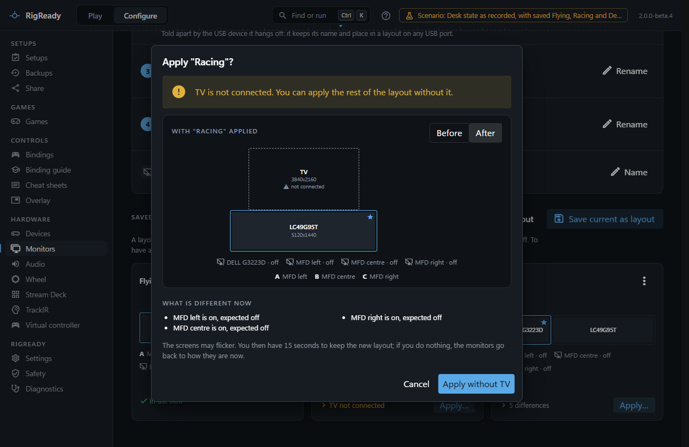
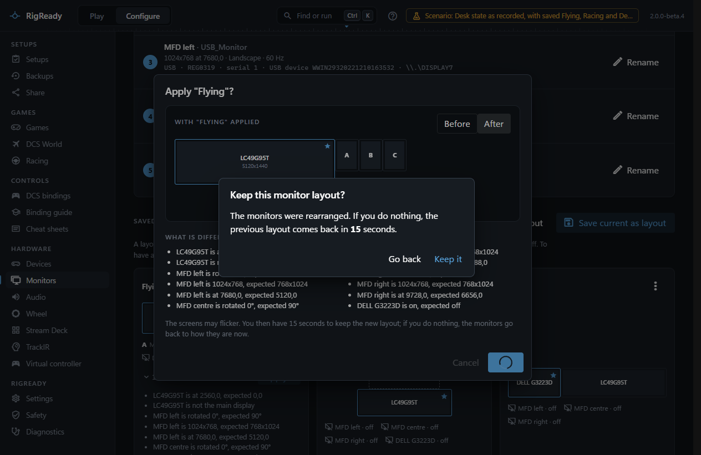
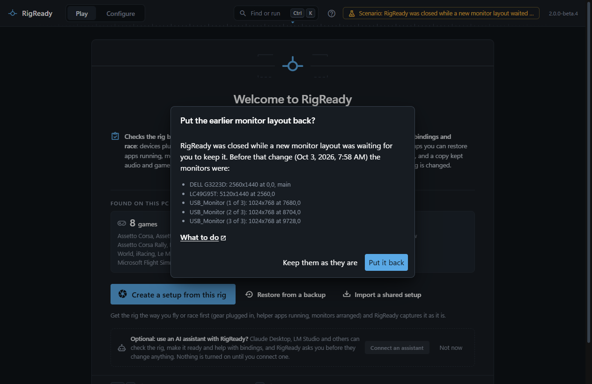

A layout is a saved arrangement of your monitors: which are on, where each one sits, how it is turned, and which is the main display. You save one for each way you use the rig, for example Flying, Racing and Desk. A setup checks that the right layout is in place, Make ready applies it, and Stand down puts the desk layout back.

This page covers saving, applying and the keep-or-revert countdown. Editing a layout by hand is on [Edit a layout by hand](rotation-and-position.md).

## Save the arrangement you have now

Arrange the monitors the way you want them, in Windows or with RigReady's own tools, then on **Configure > Monitors** choose **Save current as layout** and give it a name. The layout stores, for every connected monitor, whether it is on, its position, its desktop size, its rotation and whether it is the main display. It also stores what identifies each monitor (its serial number, or the serial of its USB device), so the layout finds the right screen again on another connector.

The layout also stores the refresh rate Windows reports for each monitor that is on, for example 120 Hz for a gaming monitor. It is compared and applied like the rest: if Windows later runs that monitor at another rate, the card lists the difference ("LC49G95T runs at 60 Hz, expected 120 Hz") and applying the layout sets the saved rate again. A layout saved before RigReady stored rates has none, and applying it leaves each monitor's rate as Windows has it.

Each saved layout is a card with a small map and a status line:

- **In use now**: the monitors are arranged like this.
- **N differences**: click the line to see each difference in words, for example "MFD left is rotated 0°, expected 90°".
- **X not connected**: a monitor the layout wants on is not plugged in.

The card's menu has **Rename**, **Edit arrangement**, **Replace with the monitors as they are now** (which keeps the entries of monitors that are not connected right now, such as a TV), **Use as desk layout** and **Delete**. Deleting a layout does not change the monitors; a setup that used it keeps checking against its own copy.

## Apply a layout

**Apply…** on a card opens a dialog that first shows what would change. A map draws the monitors as they are now and then, after a moment, as they would be: boxes slide to their new places, turn, and fade out when they will be off. **Before** and **After** flip the picture by hand. If Windows is set to reduce motion ([Motion](../app/text-size.md#motion)), the two states are drawn side by side instead. Under the map, **What is different now** lists every change in words. A refresh rate that would change is named on the monitor in the picture ("changes to 120 Hz") and in the list.

Then press **Apply**. RigReady changes everything in as few steps as Windows allows: monitors that were off are turned on, sizes are set, and positions, rotations and the main display are applied in one call. Windows requires the main display at 0,0, so every position in the layout is shifted so that it is.

Some layouts cannot be applied, and the dialog says so before anything happens: two monitors would overlap, a monitor does not offer the size and refresh rate asked for, or every monitor would end up off.

### Monitors that are not connected

If the layout wants a monitor that is not plugged in, the dialog names it and offers **Apply without** that monitor. The rest of the layout is applied as it is. When the missing monitor was the layout's main display, another one becomes the main display and the dialog says which. Make ready does not do this by itself: a setup's fix refuses when a monitor is missing and tells you to connect it or to apply the layout without it here.

## Keep it or go back

The moment a layout is applied, a prompt appears on whatever screen is open: **Keep this monitor layout?** with a countdown. If you do nothing, the previous arrangement comes back by itself when the countdown ends. **Keep it** stops the countdown; **Go back** reverts at once.

The countdown is 15 seconds unless you change **Monitor layout revert timer** in [Settings](../app/settings.md) (5 to 120 seconds). The prompt is there because a wrong layout can leave you looking at a dark screen: you need not find the window, only wait. [The monitor layout went back by itself](../troubleshooting/monitor-layout-reverted.md) is the troubleshooting page for it.

Before any change, RigReady moves its own window onto a monitor that stays on, so the prompt is never on a screen that is about to go dark. If Windows reports that it applied the layout but the monitors are not arranged as the layout says, RigReady says so and leaves the prompt open so you can decide.

Even after you keep a layout, **Undo last change** at the top of the Monitors page puts back the arrangement from before it, as long as RigReady has not been closed since.

## If RigReady is closed during the countdown

The arrangement from before a change is written to disk before the change is made. If RigReady is closed, or crashes, while the countdown is still running, the revert does not happen: the monitors stay as they were applied. At the next start RigReady asks **Put the earlier monitor layout back?**, lists the monitors as they were and when the change was made, and offers **Put it back** or **Keep them as they are**. The question is not asked when the monitors already match the earlier arrangement.

## Layouts in a setup

When a setup is created from the rig, the monitor arrangement is one of the proposed checks. If it matches a saved layout exactly, the check refers to that layout by name, and changing the saved layout later changes what every setup that uses it expects. If it matches none, the [capture screen](../setups/capture.md) offers to save the arrangement as a layout under a name you type. See [Checks and fixes](../setups/checks.md).

On the [Play screen](../play/index.md) the check reads, for example, "Arranged as "Flying" (4 monitors on)" or lists the differences. Its fix applies the layout and then waits for your answer to the keep prompt. Make ready only continues when the layout is kept; if it goes back, the fix reports that the new layout was not kept. See [Make ready and launch](../play/make-ready-and-launch.md).

## The desk layout and Stand down

Mark one layout with **Use as desk layout**. It gets a "Desk layout" badge, and from then on [Stand down](../play/stand-down.md) applies it, with the same keep-or-revert countdown, leaving out any of its monitors that are not connected. The monitors are only reported as back when a read-back shows them arranged as the desk layout says.

Without a desk layout, Stand down puts back the arrangement from before Make ready changed it, if RigReady made such a change in this session; otherwise it leaves the monitors alone.

Applying a saved layout is also in the [command palette](../app/command-palette.md) (Ctrl+K, "Apply layout: Flying"). From there the result is only reported as applied once the keep prompt has been answered with Keep.
