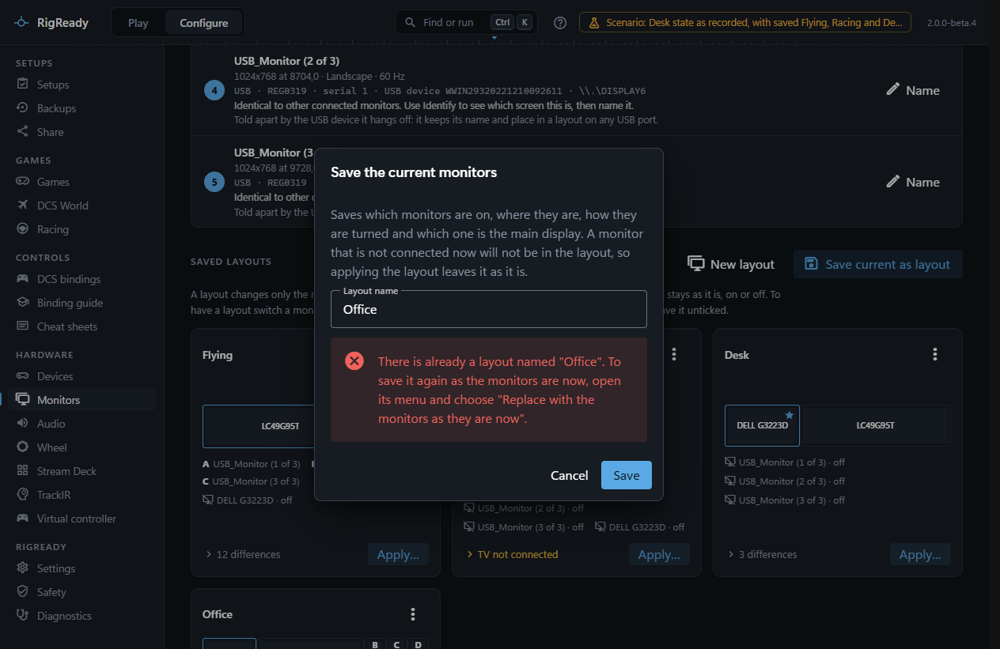
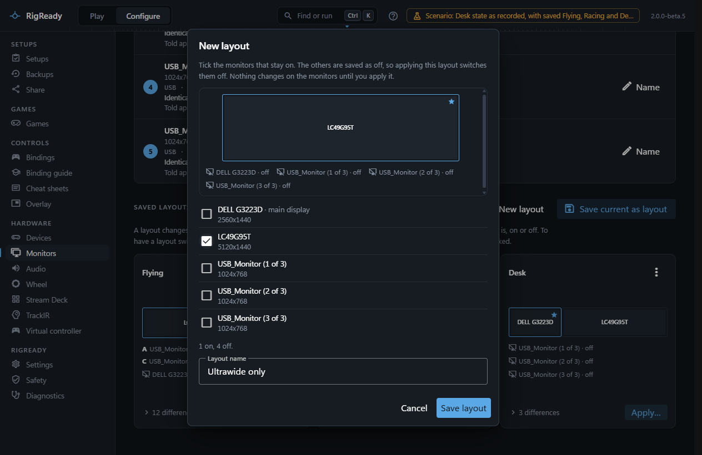
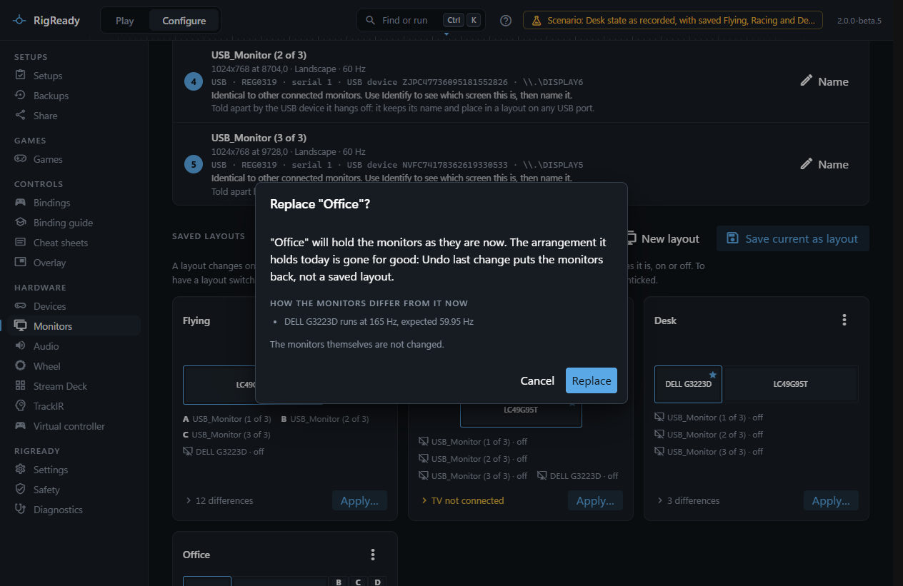
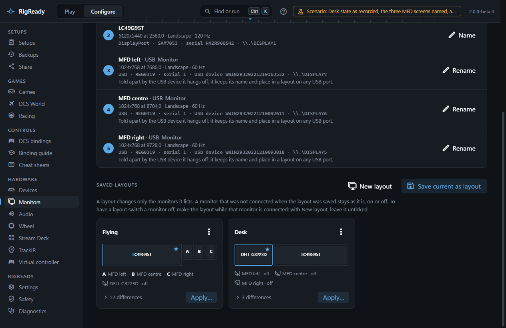
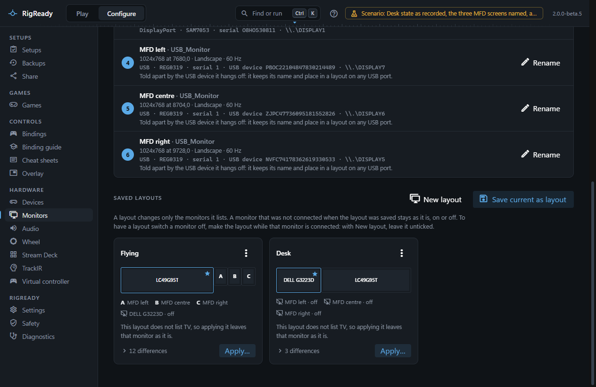
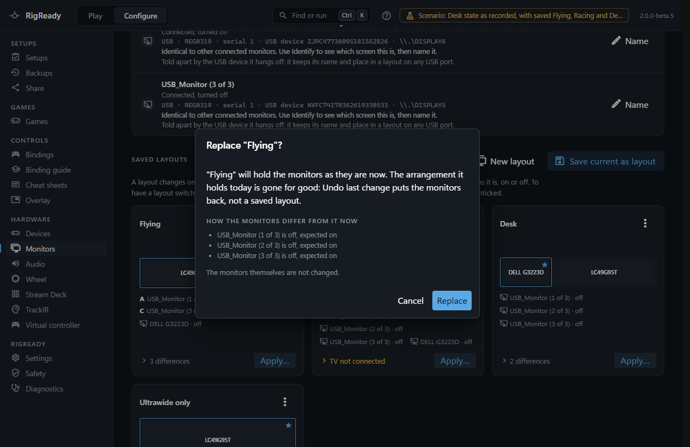
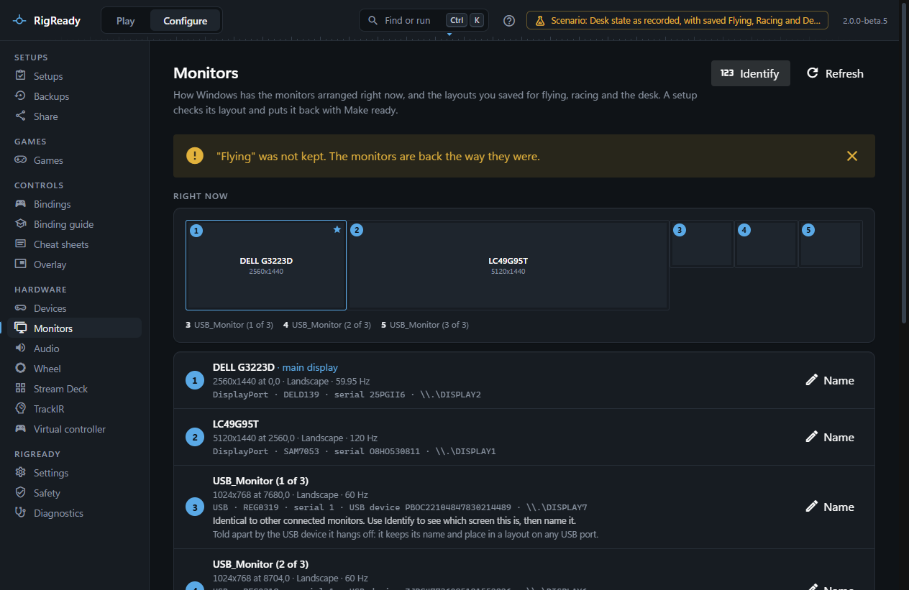
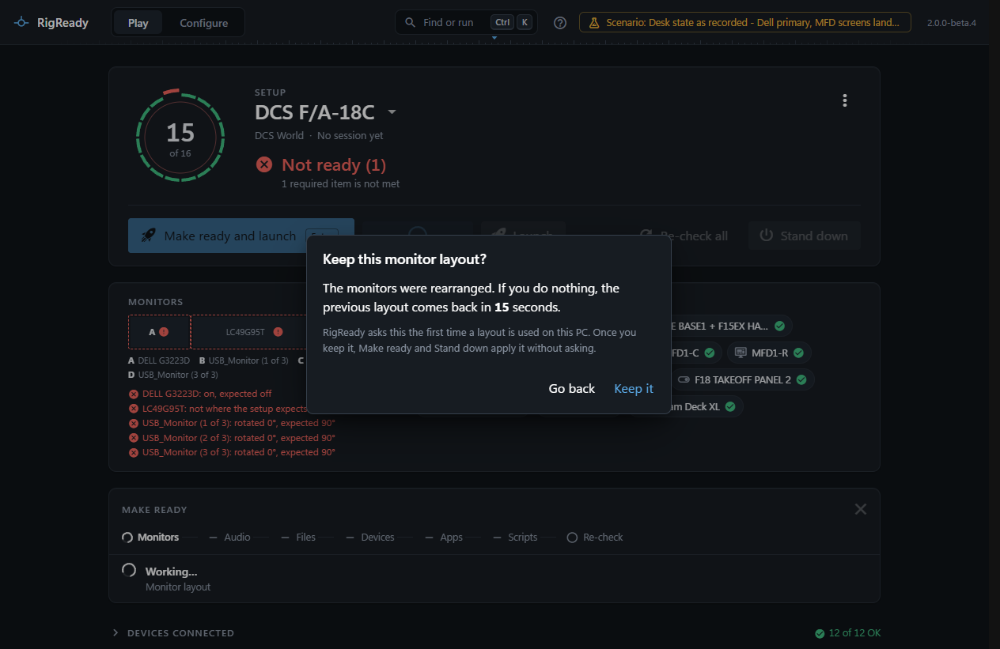
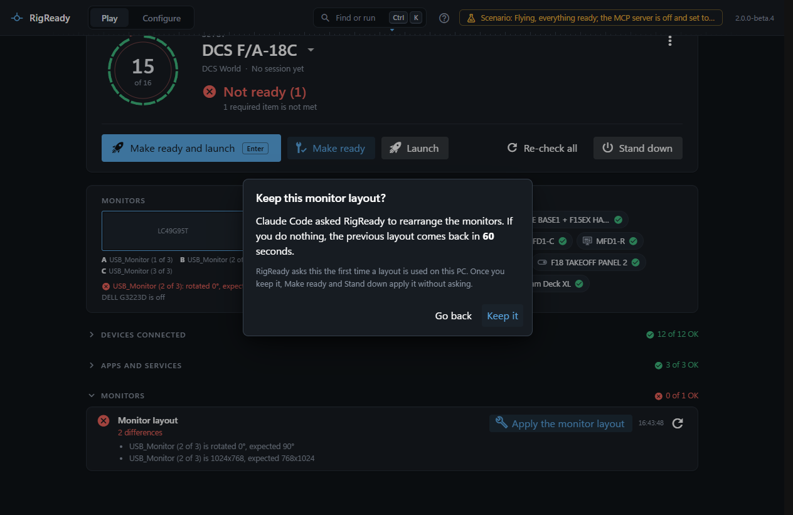

A layout is a saved arrangement of your monitors: which are on, where each one sits, how it is turned, and which is the main display. You save one for each way you use the rig, for example Flying, Racing and Desk. A setup checks that the right layout is in place, Make ready applies it, and Stand down puts the desk layout back.

This page covers saving, applying, and the question **Keep this monitor layout?**. Editing a layout by hand is on [Edit a layout by hand](rotation-and-position.md).

## Save the arrangement you have now

Arrange the monitors the way you want them, in Windows or with RigReady's own tools, then on **Configure > Monitors** choose **Save current as layout** and give it a name. The layout stores, for every connected monitor, whether it is on, its position, its desktop size, its rotation and whether it is the main display. It also stores what identifies each monitor (its serial number, or the serial of its USB device), so the layout finds the right screen again on another connector.

A name can be used once. Saving under a name that is taken is refused, and the dialog says what to do instead: "There is already a layout named "Office". To save it again as the monitors are now, open its menu and choose "Replace with the monitors as they are now"."

### Start from which monitors stay on

**New layout** makes a layout without rearranging the monitors first. Tick the monitors that stay on, type a name, and save. The monitors you leave unticked are saved as off, so applying the layout switches them off. The ones that stay on close up where one between them went, and if the main display is unticked, the one nearest the top left becomes the main display. Nothing changes on the monitors until you apply the layout.

### Refresh rates

The layout also stores the refresh rate Windows reports for each monitor that is on, for example 120 Hz for a gaming monitor. It is compared and applied like the rest: if Windows later runs that monitor at another rate, the card lists the difference ("LC49G95T runs at 60 Hz, expected 120 Hz") and applying the layout sets the saved rate again. A monitor the layout has off holds no rate. A layout saved before RigReady stored rates has none, and applying it leaves each monitor's rate as Windows has it.

RigReady stores the rate Windows runs at the moment you save. It does not pick a faster one for you. If a monitor can run faster than the layout says, raise the rate in Windows (Settings > System > Display > Advanced display), then open the layout's menu and choose **Replace with the monitors as they are now**. The question shows the new rate before you confirm, and from then on applying the layout brings that rate back.

## The layout cards

Each saved layout is a card with a small map, the list of its monitors and a status line. A screen that is wide enough on the map carries its name. A smaller one carries a letter, and the line under the map says which monitor each letter is, from left to right as they stand on the desk. The monitors the layout switches off come last, marked "off".

- **In use now**: the monitors are arranged like this.
- **N differences**: click the line to see each difference in words, for example "MFD left is rotated 0°, expected 90°".
- **X not connected**: a monitor the layout wants on is not plugged in.

### A layout changes only the monitors it lists

A layout holds the monitors that were connected when it was saved. A monitor that was not connected then is not in it, and applying the layout leaves that monitor as it is, on or off. The card says so by name: "This layout does not list TV, so applying it leaves that monitor as it is." The Apply dialog says it again before anything changes.

To have a layout switch a monitor off, make the layout while that monitor is connected: with **New layout**, leave it unticked.

### The card's menu

- **Rename**.
- **Edit arrangement**: see [Edit a layout by hand](rotation-and-position.md).
- **Replace with the monitors as they are now**: the layout keeps its name and takes the arrangement the monitors have at this moment. It keeps its entries for monitors that are not connected right now, such as a TV. RigReady asks first and lists how the monitors differ from the layout, because the arrangement the layout held is gone once you confirm. **Undo last change** puts the monitors back, not a saved layout. The monitors themselves are not changed. Since you are looking at the arrangement you keep, it counts as kept with the monitors connected now ([When RigReady asks, and when it does not](#when-rigready-asks-and-when-it-does-not)).
- **Use as desk layout**.
- **Delete**. Deleting a layout does not change the monitors; a setup that used it keeps checking against its own copy.

## Apply a layout

**Apply…** on a card opens a dialog that first shows what would change. A map draws the monitors as they are now and then, after a moment, as they would be: boxes slide to their new places, turn, and fade out when they will be off. **Before** and **After** flip the picture by hand. If Windows is set to reduce motion ([Motion](../app/text-size.md#motion)), the two states are drawn side by side instead. Under the map, **What is different now** lists every change in words. A refresh rate that would change is named on the monitor in the picture ("changes to 120 Hz") and in the list.

Then press **Apply**. RigReady changes everything in as few steps as Windows allows: monitors that were off are turned on, sizes are set, and positions, rotations and the main display are applied in one call. Windows requires the main display at 0,0, so every position in the layout is shifted so that it is.

Some layouts cannot be applied, and the dialog says so before anything happens: two monitors would overlap, a monitor does not offer the size and refresh rate asked for, or every monitor would end up off.

### Monitors that are not connected

If the layout wants a monitor that is not plugged in, the dialog names it and offers **Apply without** that monitor. The rest of the layout is applied as it is. When the missing monitor was the layout's main display, another one becomes the main display and the dialog says which. Make ready does not do this by itself: a setup's fix refuses when a monitor is missing and tells you to connect it or to apply the layout without it here.

## Keep it or go back

When you apply a layout by hand, a question appears on whatever screen is open: **Keep this monitor layout?** with a countdown. If you do nothing, the previous arrangement comes back by itself when the countdown ends. **Keep it** stops the countdown; **Go back** reverts at once.

The countdown is 15 seconds unless you change **Monitor layout revert timer** in [Settings](../app/settings.md) (5 to 120 seconds). The question is there because a wrong layout can leave you looking at a dark screen: you need not find the window, only wait. [The monitor layout went back by itself](../troubleshooting/monitor-layout-reverted.md) is the troubleshooting page for it.

Before any change, RigReady moves its own window onto a monitor that stays on, so the question is never on a screen that is about to go dark. If Windows reports that it applied the layout but the monitors are not arranged as the layout says, RigReady says so and leaves the question open so you can decide.

The Monitors page says "Applied "Flying"" only of a layout that was kept. When the countdown ends with no answer, or you choose Go back, it says: ""Flying" was not kept. The monitors are back the way they were."

Even after you keep a layout, **Undo last change** at the top of the Monitors page puts back the arrangement from before it, as long as RigReady has not been closed since.

### When RigReady asks, and when it does not

A change you make by hand always asks: **Apply** on the Monitors page, a layout applied from the command palette, a screen turned with [Which way is up?](identify.md#which-way-is-up).

**Make ready**, **Make ready and launch** and **Stand down** ask the first time they use a layout on this PC. The question then adds: "RigReady asks this the first time a layout is used on this PC. Once you keep it, Make ready and Stand down apply it without asking." After that they apply the layout at once, with no question and no countdown.

A layout counts as known to work on this PC only when all of this is true:

1. The same change was applied before: the same monitors on and off, in the same places, at the same sizes, rotations and refresh rates, with the same main display.
2. The same monitors are connected now as then, and every monitor the layout does not list is on or off as it was then.
3. You pressed **Keep it** in RigReady's window. A countdown that ran out does not count, and neither does an answer given by an AI assistant, which cannot see your screens.
4. RigReady read the monitors back right after and found them as the layout says.

**Replace with the monitors as they are now** counts the same as **Keep it**, for the monitors connected at that moment. Nothing is applied: the layout takes the arrangement you are looking at, in RigReady's window, so the four points hold as they do for a layout you kept. RigReady reads the monitors again after saving and counts it only when they are still exactly as the layout now says. A Replace asked for by an AI assistant does not count, and neither does one made while **Keep this monitor layout?** is still open.

When any of it is in doubt, the question is asked. So you are asked once more after you edit a layout, after you add or remove a monitor, and after you move one to another connector (a USB screen that RigReady tells apart by its USB device can change ports freely). A layout kept by hand on the Monitors page counts too. A layout kept or replaced with some monitors connected is still asked about with others: replaced while the MFD screens were plugged in, the desk layout is asked about the first time Stand down runs without them. Before a [Stand down by itself](../play/stand-down.md#stand-down-when-the-game-closes), the countdown says so, so that you know to stay and press **Keep it**. The fact is stored in `displays\proven.json` in [the data folder](../app/index.md); deleting that file makes RigReady ask about every layout once more.

A layout applied without the question is still read back. If Windows refuses it, the step fails with what Windows said, and the earlier arrangement is put back. If Windows accepts it but the monitors are not as the layout says, RigReady asks the question after all, and asks again the next time.

### When an AI assistant asked

An [AI assistant](../ai/index.md) can ask RigReady to make a setup ready, to stand down, or to change the monitors. The person at the screens is then not the one who clicked, so the countdown is never shorter than 60 seconds, and the question names who asked: "Claude asked RigReady to rearrange the monitors." Only your own answer in RigReady's window makes a layout known to work.

## If RigReady is closed during the countdown

The arrangement from before a change is written to disk before the change is made. If RigReady is closed, or crashes, while the countdown is still running, the revert does not happen: the monitors stay as they were applied. At the next start RigReady asks **Put the earlier monitor layout back?**, lists the monitors as they were and when the change was made, and offers **Put it back** or **Keep them as they are**. The question is not asked when the monitors already match the earlier arrangement.

## Layouts in a setup

When a setup is created from the rig, the monitor arrangement is one of the proposed checks. If it matches a saved layout exactly, the check refers to that layout by name, and changing the saved layout later changes what every setup that uses it expects. If it matches none, the [capture screen](../setups/capture.md) offers to save the arrangement as a layout under a name you type. See [Checks and fixes](../setups/checks.md).

On the [Play screen](../play/index.md) the check reads, for example, "Arranged as "Flying" (4 monitors on)" or lists the differences. Its fix applies the layout. The first time, it waits for your answer to the question, and Make ready only continues when the layout is kept; if it goes back, the fix reports that the new layout was not kept, and with **Make ready and launch** the game is not started. Once the layout is known to work, the fix applies it and goes straight on. See [Make ready and launch](../play/make-ready-and-launch.md).

## The desk layout and Stand down

Mark one layout with **Use as desk layout**. It gets a "Desk layout" badge, and from then on [Stand down](../play/stand-down.md) applies it, leaving out any of its monitors that are not connected. The first time it asks **Keep this monitor layout?**; once kept, it is applied without the question, by the same rule as above. The monitors are only reported as back when a read-back shows them arranged as the desk layout says.

Without a desk layout, Stand down puts back the arrangement from before Make ready changed it, if RigReady made such a change in this session; otherwise it leaves the monitors alone.

Applying a saved layout is also in the [command palette](../app/command-palette.md) (Ctrl+K, "Apply layout: Flying"). That is a change made by hand, so it always asks, and the result is only reported as applied once the question has been answered with Keep.
