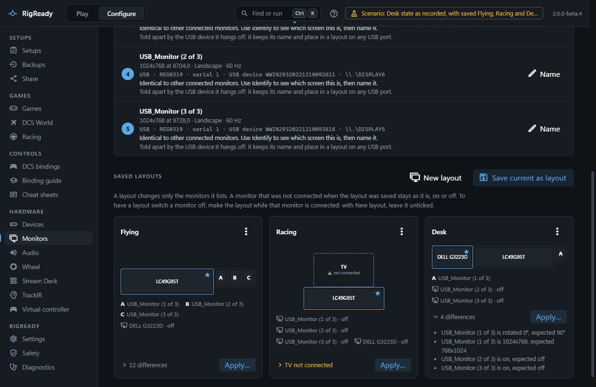
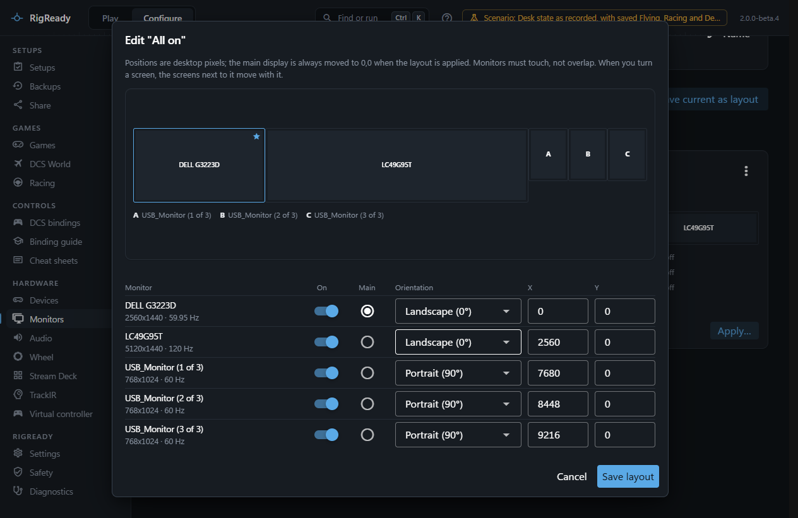
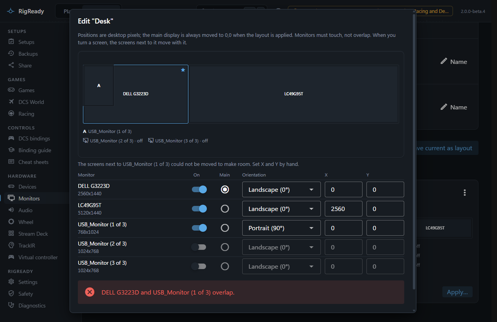

A saved layout is normally made from the monitors as they are. **Edit arrangement**, in the menu of a layout card on **Configure > Monitors**, lets you change one without first arranging the monitors in Windows: turn the MFD screens portrait, move the TV, or switch a monitor off for this layout.

This page covers the edit dialog. Saving and applying layouts is on [Monitor layouts](layouts.md).

## The edit dialog

The dialog shows a compact map of the layout as you edit it, and a table with one row per monitor of the layout:

- **Monitor**: the name RigReady uses for it, its desktop size and, for a monitor that is on, the refresh rate the layout asks for. A monitor the layout contains that is not plugged in right now is marked "not connected"; it stays in the layout and is skipped when the layout is applied without it.
- **On**: whether the layout turns this monitor on. A monitor that is off has no position, no rotation and cannot be the main display.
- **Main**: one monitor must be the main display. Windows keeps the main display at 0,0, so when the layout is applied every position is shifted to put it there.
- **Orientation**: Landscape (0°), Portrait (90°), Landscape (flipped) (180°) or Portrait (flipped) (270°). Turning a monitor a quarter turn swaps its width and height in the layout, and the map redraws it tall or wide at once. Which of the two portrait settings is upright on a given screen is explained under [Identify](identify.md).
- **X** and **Y**: the position of the monitor's top left corner in desktop pixels. A number counts as you type it: the map follows, and **Save layout** saves what the fields show with one press.

### Turning a screen moves the screens beside it

A screen turned a quarter turn is narrower or wider than before. The screens beside it move with its edge, so they still touch it and no gap opens between them. A line under the map says what moved, for example "Moved MFD centre and MFD right to stay next to MFD left." You do not have to work out the new X of every screen to the right.

When the screens beside it cannot be moved without one covering another, only the turned screen changes and the line says: "The screens next to MFD left could not be moved to make room. Set X and Y by hand."

## Saving

**Save layout** checks the arrangement before it is stored. The layout must contain the same monitors it had, at least one must be on, exactly one must be the main display, and no two monitors may overlap. Monitors must touch or sit apart; one covering another is refused with a message naming both.

## Size and refresh rate

The desktop size of each monitor comes from when the layout was saved (or from the connected monitor, when the layout does not say) and is not typed in here. It turns with the orientation. The refresh rate comes from the save too: **Save current as layout** and **Replace with the monitors as they are now** store the rate Windows reports for each monitor that is on. The edit dialog shows it and keeps it when you save, but does not change it; to store another rate, set it in Windows and replace the layout with the monitors as they are now. A monitor that is saved as off gives up its rate with its position. If you switch it on in this dialog later, the layout holds no rate for it and Windows chooses one when the layout is applied, until you replace the layout with the monitors as they are now. A setup or a hand-edited layout file (`displays\layouts.json` in [the data folder](../app/index.md)) can also give one, or leave it out to let Windows choose. When a layout does ask for a size or refresh rate the monitor does not offer, applying it is refused before anything changes, and the setup's check ([Checks and fixes](../setups/checks.md)) lists the difference as, for example, "Samsung runs at 60 Hz, expected 120 Hz".

## Monitors that are not connected

A layout keeps every monitor it was saved with. When one of them is not plugged in, the card says "X not connected" and the apply dialog offers to apply the rest. Editing a layout does not add or remove monitors: to add a monitor that was not there when the layout was saved, connect it, arrange it, and use **Replace with the monitors as they are now** or save a new layout.

A monitor is matched to its entry in the layout by what identifies it, never by its name alone. When several identical monitors are connected and the layout cannot tell which one its entry is, the difference reads "MFD left was not found where it was: 2 identical monitors are connected elsewhere, so RigReady cannot tell which one it is". Naming the screens with Identify, and keeping port-identified screens on their ports, avoids this.
