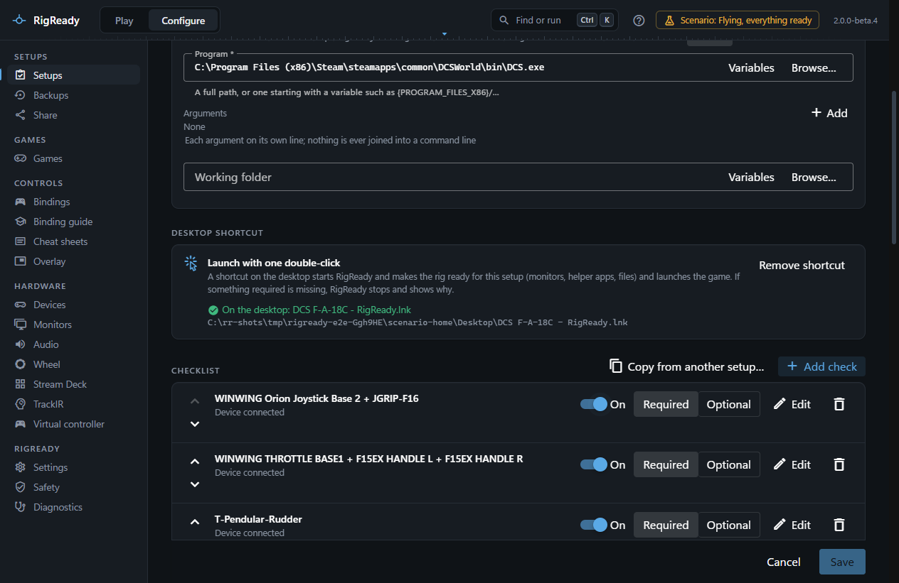
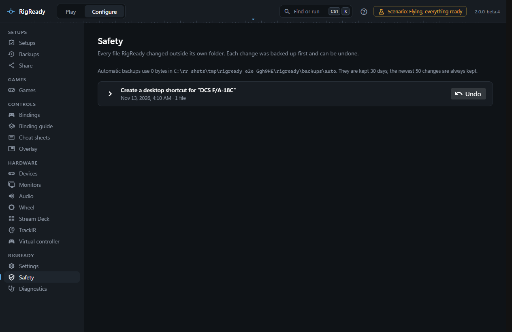

A desktop shortcut starts RigReady for one setup: it makes the rig ready and launches the game, or only makes the rig ready for a setup that launches nothing.

## Making one

Open **Configure > Setups**, choose **Edit** on the setup, and find the **Desktop shortcut** panel under the Launch section. It says whether a shortcut is on the desktop.

**Create desktop shortcut** shows what will change on the desktop first, with the file that will be written, and asks **Put a shortcut for "DCS F/A-18C" on the desktop?**. After **Create shortcut**, RigReady writes the file, reads it back, and reports it as made only when the file is there and starts this RigReady with this setup: "On the desktop: DCS F-A-18C - RigReady.lnk".

The panel waits for a save when the setup's name or what it launches has changed, because the shortcut takes both from the saved setup.

## The file

The shortcut is `<setup name> - RigReady.lnk` in your Desktop folder. Characters a file name cannot hold (`/ \ : * ? " < > |`) become dashes, so "DCS F/A-18C" gives "DCS F-A-18C - RigReady.lnk". It starts `RigReady.exe --launch=<setup id>` (or `--make-ready=<setup id>` for a setup that launches nothing), with RigReady's folder as the working folder and RigReady's icon. The setup's id, not its name, is in the shortcut, so renaming the setup does not break it.

Writing the shortcut is a change outside RigReady's own folder, so it goes through the Safety page like every such change: it is listed there and can be undone ([Protect](../protect/index.md)).

## What a double-click does

RigReady starts (or the RigReady already running is handed the command), its window comes forward, the setup is checked, every fix runs, and the game is launched only when every required check is met. If something is missing, nothing is launched and the window says what. A monitor change asks to be kept. See [Starting without the window](index.md).

## When the shortcut is out of date

The panel reads the shortcut each time and says what is wrong:

- The setup was renamed: the old shortcut is found under its earlier name. **Update shortcut** writes the new one and removes the old.
- The setup now launches something, or no longer does: the shortcut asks for the wrong thing. **Update shortcut** rewrites it.
- The shortcut starts another copy of RigReady (an earlier install in another folder): **Update shortcut** points it at this one.
- Another file has the name and is not a shortcut to this setup: the panel says so and offers **Replace it with the shortcut**.

## Removing it

**Remove shortcut** shows what will be removed, then removes the shortcut (and one left under an earlier name). The setup itself is not touched. Deleting a setup does not remove its shortcut: remove the shortcut first, or delete the file on the desktop by hand. A shortcut to a setup that no longer exists opens RigReady with "There is no setup ..." and the names of the setups on this PC.
