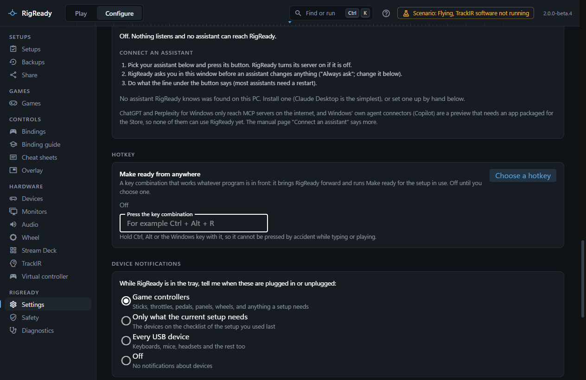
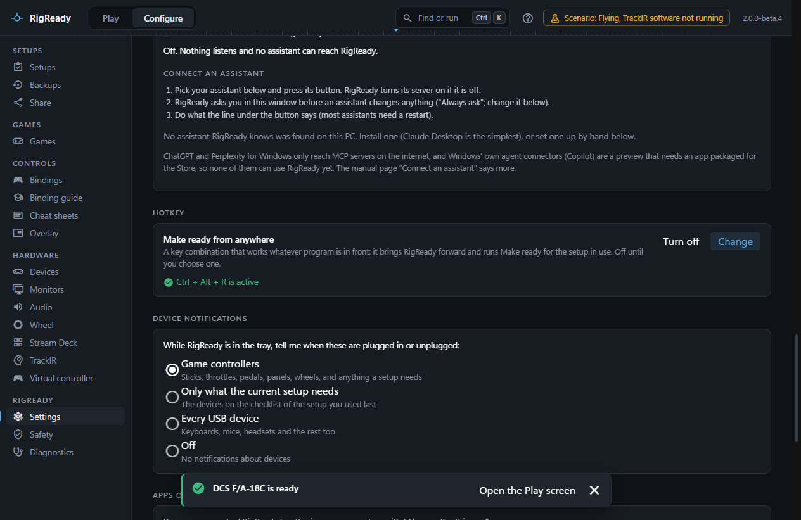

A hotkey is a key combination Windows gives to RigReady, so it works whatever program is in front, the game included. It brings RigReady forward and runs [Make ready](../play/make-ready-and-launch.md) for the [setup in use](../play/switching-setups.md). It is off until you choose one.

## Choosing one

Open **Configure > Settings** ([Settings](../app/settings.md#hotkey)) and find **Hotkey**, under "Make ready from anywhere". **Choose a hotkey** opens a field: hold Ctrl, Alt or the Windows key and press a key. The combination is taken at once and the line says "Ctrl + Alt + R is active". Esc cancels; Tab leaves the field.

- A hotkey needs Ctrl, Alt or the Windows key, so it cannot be pressed by accident while typing or flying. Shift on its own is not enough.
- The last key can be a letter, a digit, a function key (F1 to F24), a number pad digit, an arrow, Space, Home, End, Page Up, Page Down, Insert or Delete.
- A combination another program already holds is refused: "Windows did not give it to RigReady: another program is probably using it. Choose another combination." The hotkey you had before stays.

**Change** chooses another; **Turn off** gives the combination back to Windows. RigReady shows the hotkey as active only when Windows confirms it is registered for RigReady; a combination taken away since says so. The hotkey is registered again every time RigReady starts.

## What it does

Pressing it runs the same command as `RigReady.exe --make-ready "<setup>"` for the setup in use: the window comes forward, the setup is checked, every fix runs (a monitor change asks to be kept), and the strip at the bottom of the window says whether the rig is ready and what is still missing. See [Starting without the window](index.md).

## What it does not do

- It never launches the game. Launch stays a button, a shortcut or `--launch`.
- Without a setup it only brings the window forward.
- While RigReady is already making ready, launching or standing down, a press only brings the window forward.
- A fix that runs a program you would have to confirm ([Scripts](../setups/scripts.md)) is not run; it is listed as needing you.

A real press of the hotkey with a game in front has not yet been verified on real hardware: it passed its tests on recorded data from one rig. The [changelog](../../../CHANGELOG.md) lists it under known limitations.
