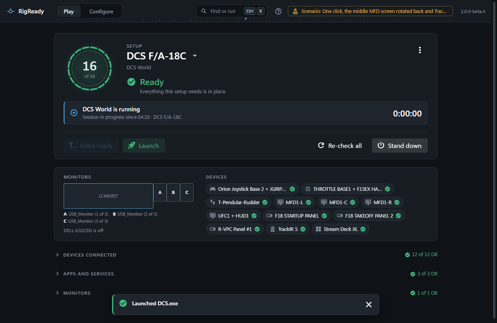

Once a setup works, a session need not start in RigReady's window. The same Make ready and Launch of the [Play screen](../play/make-ready-and-launch.md) can be asked for from the desktop, the taskbar, the tray, a key combination and the command line.

## The five ways

- [A desktop shortcut](desktop-shortcut.md): "<setup name> - RigReady" on the desktop, one per setup. A double-click makes the rig ready and launches.
- [The taskbar button](taskbar.md): right-click it for **Launch <setup>**; the button carries the state of the setup in use and has Make ready, Launch and Stand down under its thumbnail.
- [The tray icon](tray.md): the state at a glance, a tooltip with what is not met, and a menu with every action.
- [A hotkey](hotkey.md): a key combination that works from any program, brings RigReady forward and runs Make ready.
- [The command line](command-line.md): `RigReady.exe --launch "<setup>"`, for a Stream Deck button or a batch file.

## What a command does

A shortcut, a Jump List entry, the hotkey and the command line all run the same command, and it runs the way the Play screen does, with one rule of its own:

1. RigReady's window comes to the front, and a strip at the bottom of it says what is happening: "Looking for DCS F/A-18C", "Checking DCS F/A-18C", "Making DCS F/A-18C ready" with the steps as they go, "Launching DCS F/A-18C".
2. The setup is checked and becomes the setup in use.
3. Make ready runs every fix, in the same order as on the Play screen. A monitor change still asks **Keep this monitor layout?** ([Monitor layouts](../monitors-and-audio/layouts.md#keep-it-or-go-back)). A fix that runs a program you would have to confirm ([Scripts](../setups/scripts.md)) is not run, since nobody can be asked; it is listed with what still needs you.
4. The game is launched only when every required check is met. Otherwise nothing is launched: the strip says "DCS F/A-18C was not launched: 2 required items are not met", with the reasons, and stays until you put it away. The Play screen behind it shows the same.
5. After a launch the window goes to the tray when **Hide RigReady after Launch** is on ([The Play menu](../play/the-menu.md)).

While the rig is being made ready, the strip has **Do not launch**: the fixes finish, the game is not started, and the strip says "DCS F/A-18C is ready. Not launched, as you asked".

`--make-ready` and the hotkey stop after step 3 and say whether the rig is ready. `--setup` stops after step 2.

## One at a time

A command runs alone. A second shortcut or hotkey press while one is running, or while the Play screen itself is making ready, launching or standing down, only brings the window forward to show what is going on. When RigReady is already running, a second start hands its command to the running RigReady and exits; see [The command line](command-line.md).
