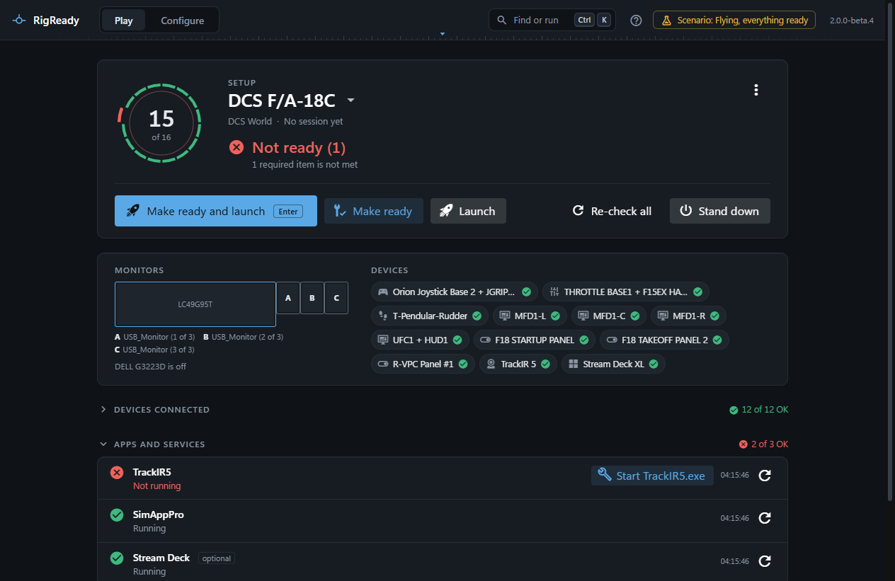
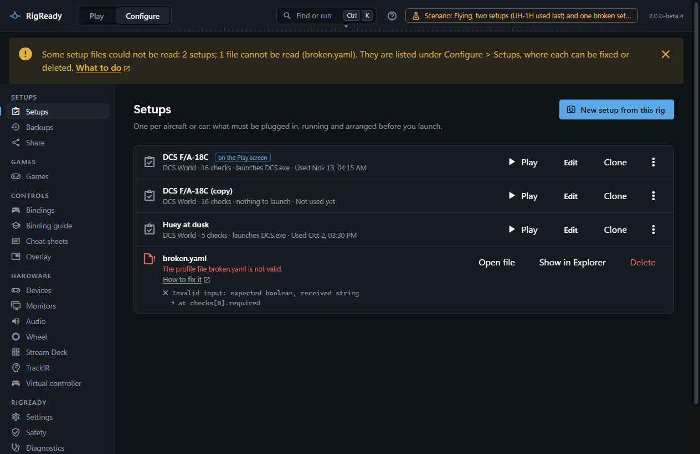

RigReady's button on the Windows taskbar is more than a way to the window. Right-click it to launch a setup, read the state of the rig from its badge, and use the buttons under its thumbnail.

Windows accepted all of this in tests, but nobody has yet looked at the badge, the progress bar and the thumbnail buttons on a real taskbar. `CHANGELOG.md` lists them under known limitations.

## The Jump List

Right-click the button. The list has **Launch <setup>** for the setups used most recently, up to six, the most recent first; setups never used come last, by name. A setup that launches nothing is listed as **Make ready: <setup>**. Each entry runs the same command as a desktop shortcut: see [Starting without the window](index.md).

The list follows your setups: one made, renamed, deleted or used changes it.

## The badge

The button carries the state of the setup in use, in colour and in shape so it reads either way: a green dot for **Ready**, an amber triangle for **Ready with warnings**, a red square for **Not ready**. There is no badge until the checks have run. The same shapes are on the tray icon.

## The tooltip

Rest the pointer on the button to read the same line the tray shows: the setup, its state, and what is not met by name, as far as fits.

## The progress bar

The button fills while Make ready, Launch, Stand down or a single fix runs, whoever started it: the window, the tray, a shortcut. During Make ready and Launch it shows how many steps are done. During a check you asked for, it moves without a count. The quiet re-check of the Play screen does not show.

## The thumbnail buttons

Rest the pointer on the button and three small buttons appear under the window's thumbnail: **Make ready** (a check mark), **Launch** (a triangle) and **Stand down** (a square), each with the setup's name in its tooltip. They do what the same lines of the tray menu do, with the same limits: nobody can be asked, so fixes that need your OK are not run, and the game is never closed. They are greyed while RigReady is working, and Launch is greyed for a setup that launches nothing.
