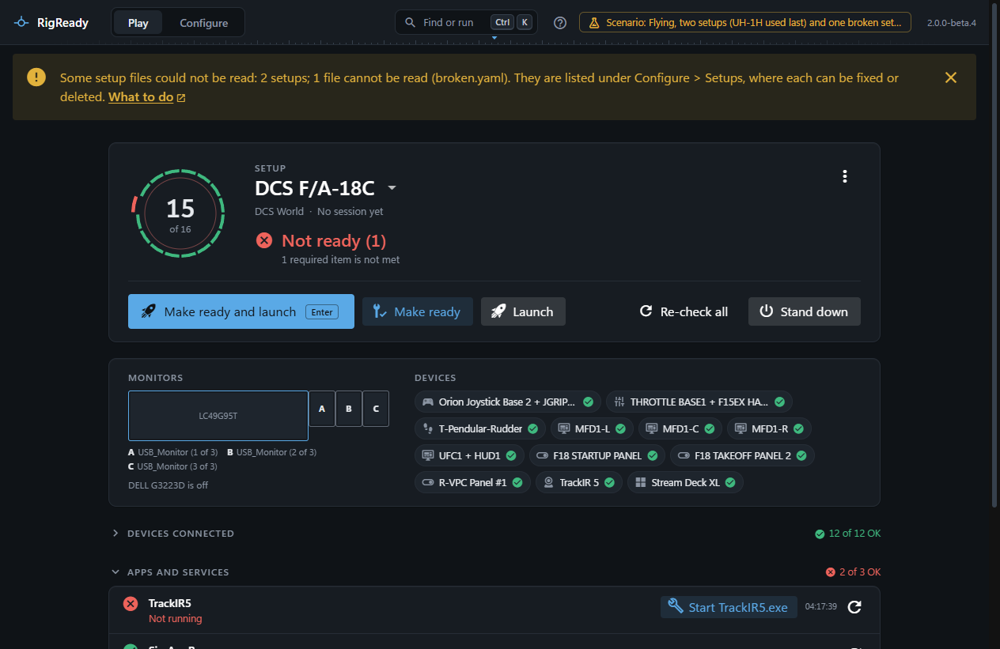

RigReady lives in the tray, the notification area next to the clock. The icon shows the state of the rig, its tooltip says what is wrong, and its menu has every action, so the window need not be opened at all.

## Colour and shape

A badge on the icon shows the state of the [setup in use](../play/switching-setups.md): a green dot for **Ready**, an amber triangle for **Ready with warnings**, a red square for **Not ready**. The shape says it without the colour. There is no badge until the checks have run. The same badge is on the [taskbar button](taskbar.md).

## The tooltip

Rest the pointer on the icon: "RigReady - DCS F/A-18C: Not ready (2 problems): TrackIR, Pedals". With warnings, the optional items are named instead. Windows cuts a tooltip off after 127 characters, so a long list ends with "and 3 more". While RigReady is working the tooltip says "working...".

## One click and a double-click

One click does the sensible thing: it brings the window out when it is hidden, minimised or behind another window, and puts it away when it is the window you are looking at. A double-click always opens the window. After a single click the window waits a moment before going away, so the first click of a double-click does not make it blink.

## The menu

Right-click the icon:

- **Open RigReady**.
- The state in words: "DCS F/A-18C: Ready (1 warning)", "No setup yet", "DCS F/A-18C: not checked yet".
- **Setup**, with every setup, when there is more than one. Choosing one makes it the setup in use, on the [Play screen](../play/index.md) too.
- **Make ready**, **Launch** (only for a setup that launches something) and **Stand down** ([Make ready and launch](../play/make-ready-and-launch.md), [Stand down](../play/stand-down.md)). While one runs the menu says "Working..." and the actions are greyed.
- **Quit**.

The result of an action from the tray is a Windows notification: "DCS F/A-18C is ready", "DCS F/A-18C launched" (with "It was not ready: open RigReady to see what is missing" when it was not), "Stood down: Closed 2 apps". Nobody can be asked from the tray, so a fix or a launch step that needs your OK ([Scripts](../setups/scripts.md)) is not run and is reported as not run, and the game is never closed by a Stand down from here.

## Closing the window, starting with Windows

Closing the window puts RigReady in the tray rather than quitting, unless you turned that off in **Configure > Settings**. **Start with Windows** starts RigReady hidden, in the tray, so the state is there before you open anything. See [Settings](../app/settings.md).
