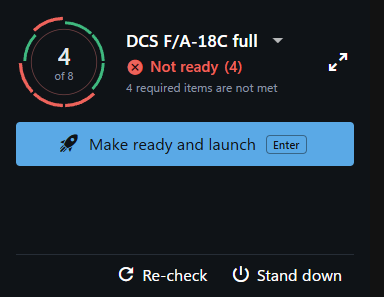

**Compact view** in [the Play menu](the-menu.md) opens a small window that stays on top of other windows. It is the [Play screen](index.md) with everything but the essentials left out: the dial, the setup, the status words and the one button.

## What is in it

- The dial and the status words, as on the Play screen.
- The setup as a drop-down, to switch ([Switching setups](switching-setups.md)).
- A line of words above the button: what stands in the way ("Not ready: TrackIR: Not running and 2 more"), or what the last action came to.
- The one button: **Make ready and launch**, **Launch**, **Make ready** or **Stand down**, chosen the same way as on the Play screen ([Make ready and launch](make-ready-and-launch.md)). Enter presses it.
- **Re-check**, and **Stand down** as a small link. [Stand down](stand-down.md) from here closes the helper apps and always leaves a running game alone.
- The session line: "DCS World is running" with the clock, and **Welcome back** when the game closes ([Sessions and history](sessions.md)). While the countdown to Stand down runs, the line counts down and has **Cancel** ([Stand down](stand-down.md#stand-down-when-the-game-closes)). After that it says in one line what Stand down did, or why it did not start; hold the pointer over a line that is cut short to read all of it.
- A button at the top right that opens the full window.

The window remembers where you left it.

## Launch anyway

Pressing **Launch** on a rig that is Not ready turns the button into **Launch anyway**, with **Cancel** next to it, and the line says what is missing. When **Make ready and launch** stops because something required still needs you, the same happens. When a step before launch failed and is set to stop the launch, its message is shown and **Launch anyway** goes on past it. Launch anyway is always a click, never Enter.

## What it leaves to the full window

A fix or a launch step that runs a program you have to confirm ([Scripts](../setups/scripts.md)) is shown to you before it runs, and there is no room for that here. The button is then greyed and the line says: "This setup runs a program that is shown to you first. That is done in the full window." The same goes for Make ready while a fix would undo something you set elsewhere, such as "Set the DCS options" after "Use in DCS" ([Setups made before "Use in DCS"](../dcs/screens.md#setups-made-before-use-in-dcs)): "A fix of this setup would undo something you set elsewhere, and asks you first. That is done in the full window." Open the full window and run it from there.
