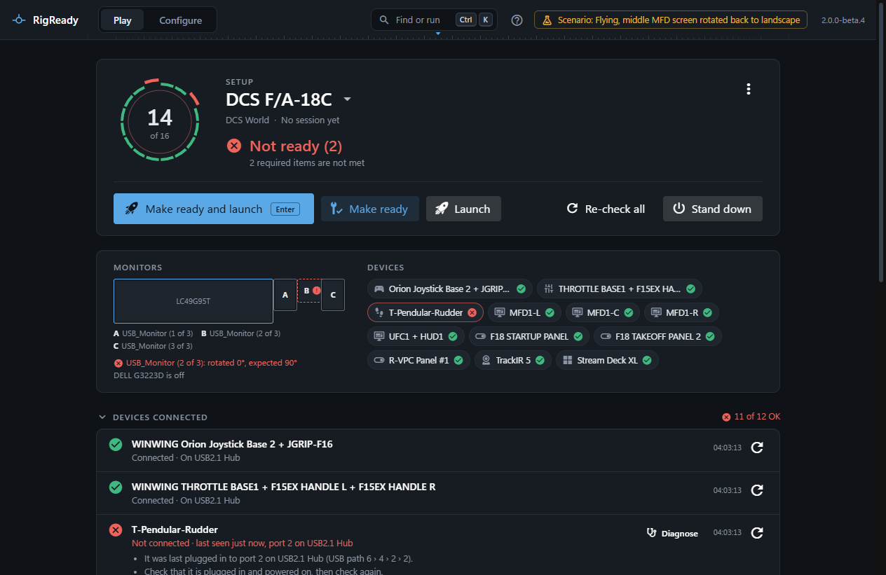

The Play screen is what RigReady opens on. It shows the setup you used last, checks everything that setup needs, and says in a word or two whether the rig is ready. Everything you do before and after a session happens here; the rest of the app is under **Configure**, the other mode at the top left of the window (see [Play and Configure](../getting-started/two-modes.md)).

This page explains what is on the screen. [Make ready and launch](make-ready-and-launch.md) covers the buttons, [Stand down](stand-down.md) what happens afterwards.

## The setup and the dial

The name at the top is the setup in use. It is also a drop-down; see [Switching setups](switching-setups.md). Under it: the game the setup is for, and when its last session was and how long ("Last session Tuesday, 1 h 42 min", or "No session yet").

The dial on the left has one arc per check, clockwise from the top, in the order of the checklist below. A met check is green. An optional check that is not met is yellow and stands a little out of the ring; a required one that is not met is red and stands out further. The number in the middle is how many checks are met, out of how many count. Checks switched off in the setup are not counted.

## The status words

Next to the dial, RigReady says what it found:

- **Checking…** while the first results come in: "3 of 12 checked".
- **Not ready** (2): two required items are not met. The line under it also counts the optional items that are not met, and says "still checking" while results are still arriving.
- **Ready with warnings** (1): everything required is met; one optional item needs attention.
- **Ready**: everything this setup needs is in place. A setup with no checks is Ready too, and says so.

The same words reach the [tray icon](../one-click/tray.md), the [taskbar button](../one-click/taskbar.md) and the [command palette](../app/command-palette.md).

## Required, optional and off

Every check in a setup is required or optional; the [capture screen](../setups/capture.md) and the [setup editor](../setups/editor.md) decide which; [Checks and fixes](../setups/checks.md) lists every kind.

- A **required** check that is not met is shown in red and makes the rig Not ready. A required check that could not be run at all (a timeout, a folder that does not exist on this PC, a check type this version does not have) counts the same way and carries an "error" chip.
- An **optional** check that is not met is shown in yellow with an "optional" chip. It never makes the rig Not ready.
- A check that is **off** in the setup is listed with an "off" chip, is not run and is not counted. Its row says so and links to the setup editor.
- A few check types only ever warn, whatever the setup says, for example "Game updated since you last verified". The editor marks them.

## The rig at a glance

Under the buttons the rig is drawn as it is right now, so a problem shows as a place and not only as a line in a list.

- **Monitors** are drawn to scale, with the names you gave them on the [Monitors page](../monitors-and-audio/index.md) or their own names, numbered when several share one. The main display is marked. A monitor that is not as the setup expects carries a red mark and a note: "off, expected on", "rotated 90°, expected 0°", "not where the setup expects it", "not the main display", or a size that differs. A monitor the setup wants that is not connected is listed as missing. Choosing the drawing jumps to the monitor row in the checklist. When the setup has no monitor check the drawing is shown without marks.
- **Devices** are the setup's device checks as chips, each with a picture by kind (stick, throttle, pedals, wheel, head tracker, button deck, panel, display unit, headset) and its state: met, not met, not met (optional), could not be checked, or off. The maker's name is left out when most of the devices share it; the whole name is in the tooltip. Choosing a chip jumps to its row.

The drawing follows the machine: plug a device in or out and it changes within a moment.

## The checklist

The checks are listed in groups: **Devices connected**, **Apps and services**, **Monitors**, **Audio**, **Config files** and **Other**. Each group header counts what is met, for example "3 of 4 OK · 1 off". A group with something that needs attention is open; the others are closed. Choose a header to open or close it by hand.

Each row has:

- An icon and the word for it: Passed, Failed, Warning, Could not check, Checking, Off.
- The check's name, and a line saying what is true right now ("Not running", "Missing", "Default is Speakers").
- More lines when there is more to say, and a **Program output** panel when a script printed something.
- A fix button, when the check has a fix, labelled with what the fix does: "Start TrackIR5.exe", "Apply the "Flying" layout", "Restore options.lua from the copy you saved of 2026-10-03 12:00". After it ran, the row says what happened; when the fix did not help, it links to the setup editor.
- **Show instructions**, when the fix only tells you what to do.
- The check's own button, when it has one, for example **Mark verified** on the game-updated check.
- **Diagnose** on a device row that is not met, which opens the [Devices page](../hardware/devices.md) on that device.
- The time it was last checked, and a button to check that row again.

A fix that runs a program is shown to you first: a dialog names the program, every argument (each is passed as it is, never joined into a command line) and the folder, with **Skip** and **Run it**. See [Scripts](../setups/scripts.md).

## Re-check

**Re-check all** runs every check again. Every row has its own re-check button. On top of that the screen checks quietly by itself: every five seconds, when the window comes back to the front, and when a device is plugged in or unplugged. A quiet check does not count as using the setup, so the "used" time in the switcher does not move.

A check that takes too long is reported as "Timed out after 5 s" and counts as not met. The limit is in **Configure > Settings** ([Settings](../app/settings.md)) and can be set per check in the setup editor.

## When something is wrong with the setup itself

- The setup file was changed by hand and no longer loads, or the setup you used last is gone: the screen keeps the last version that loaded, or shows another setup, with a yellow note saying so. See [A broken file](../setups/yaml.md#a-broken-file) and [Switching setups](switching-setups.md).
- Every setup file is broken: the screen says so and sends you to [Setups](../setups/index.md).
- No setup yet: the welcome panel with what RigReady found on this PC and **Create a setup from this rig**. See [The first run](../getting-started/first-run.md).

## The menu

The ⋮ button at the top right of the panel has the settings of the Play screen (hide after launch, stand down when the game closes, the ready tone), **History** and **Compact view**. See [The Play menu](the-menu.md).
