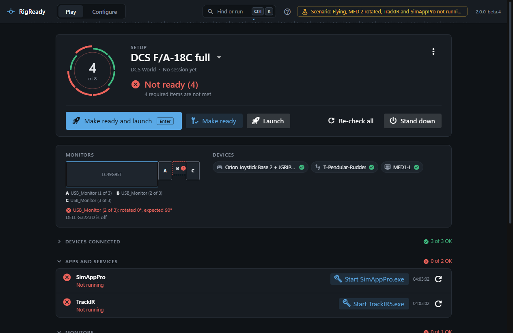
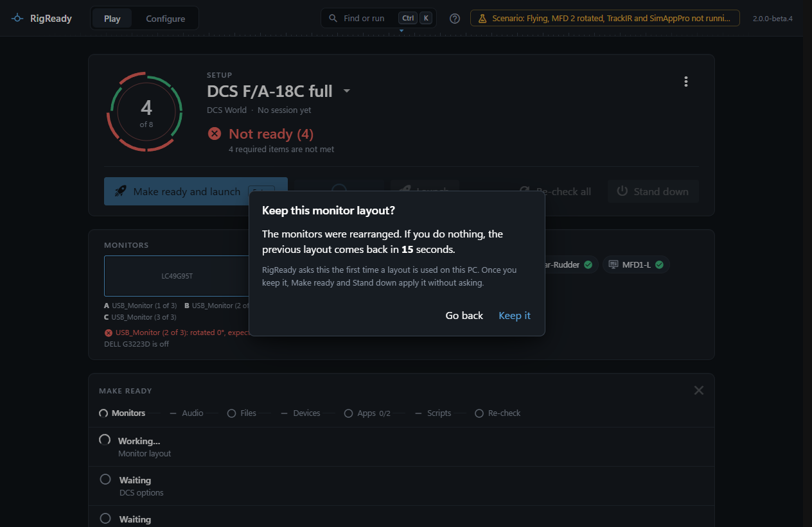
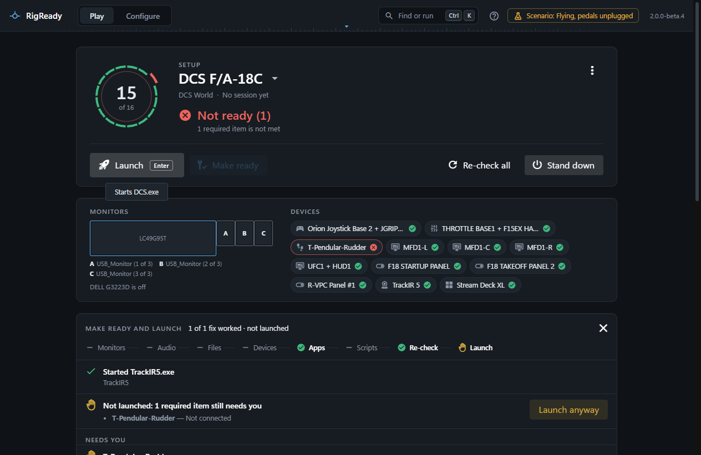

The Play screen has one main action, drawn large with "Enter" on it. Which action that is follows the state of the rig. The other buttons stay next to it.

## Which button is the main one

- The rig is **Not ready** and something can be fixed: **Make ready and launch**.
- Otherwise: **Launch**. It turns green once the rig is known to be ready, and never before.
- The setup has nothing to launch: **Make ready**, when there is something to fix. In place of Launch there is a link, **Choose what Launch starts**, to the setup editor.
- While the game runs: none. Enter never starts a second copy of a game.
- Once the game has closed: **Stand down**.

**Make ready** on its own runs the fixes without launching; it is greyed when there is nothing to fix. **Re-check all** and **Stand down** are on the right.

## Enter

Enter presses the main button when nothing else has the keyboard: a focused text field, button or list, or an open dialog or menu, keeps Enter for itself. If a check is still running, the action waits for its answer first, so it acts on what is true now, not on what was true a moment ago.

## What is asked first

Before anything runs, every fix and every launch step that starts a program you have to confirm is shown to you, one at a time: **Run this program?** with the program, each argument as it will be passed, and the folder. **Run it** or **Skip**. Only then does the run go through by itself. A skipped fix is listed as "Skipped by you" and ends up under **Needs you**.

## The order of the fixes

Make ready runs every available fix in this order, so that each phase can count on the one before:

1. **Monitors**, so helper apps open on the right screens.
2. **Audio**.
3. **Files**: restore a config file, put back Export.lua lines, set DCS options.
4. **Devices**.
5. **Apps**: start programs. A Windows service has no automatic fix.
6. **Scripts**.

Within a phase, fixes run by their kind and then in the order of the setup. The strip above the list shows the phases with how many fixes each has, then **Re-check**, then **Launch**.

A fix is counted as done only when its check passes afterwards. Otherwise the step says "Started TrackIR5.exe, but the check still fails: Not running".

## A monitor change asks you to keep it

When a fix applies a monitor layout, Windows changes the screens and RigReady asks **Keep this monitor layout?** with a countdown. **Keep it** keeps it; **Go back**, or no answer before the countdown ends, puts the previous arrangement back. Make ready waits for the answer before going on, because what comes next must know which layout is there. The countdown is 15 seconds unless you changed it in Settings. A layout that was not kept counts as a failed fix.

## After the fixes

Everything is checked again. The headline sums it up: "3 of 4 fixes worked · 1 failed". Each fix is listed with what it said, and with its output when it printed any.

**Needs you** lists what is still not met and RigReady cannot do for you: a check without a fix, a fix that only shows instructions (they are shown right there), a fix that opens a screen where you make the change (its button is there), and a fix you skipped.

## What stops the launch

With **Make ready and launch**, the game starts only when every required check is met after the fixes. Otherwise the run stops and says so: "Not launched: 2 required items still need you", with the items. **Launch anyway** is next to it.

**Launch** on its own is never blocked, only warned. On a rig that is Not ready it asks **Launch anyway?**, lists the required items that are not met, and reminds you that you can still launch. On a rig that is Ready with warnings it launches at once, and a short note names the optional items that are not met.

## The launch itself

1. The setup's steps **Before launch** run in order. A step set to stop the launch when it fails does just that: the dialog **A step before launch failed** shows what it printed, and you choose **Launch anyway** (the launch goes on after that step) or **Cancel**.
2. The game is started: a program, or Steam is asked to start it (see [Launch targets and steps](../setups/launch.md)). RigReady waits up to 30 seconds for the program to appear; "Launched DCS.exe" or "Asked Steam to start DCS F/A-18C" is said only then.
3. The steps **After launch** run in the background, each at its delay after the start. A failure there is reported and logged, and never touches the game.
4. The window gets out of the way when **Hide RigReady after Launch** is on, as it is by default: it goes to the tray. See [The Play menu](the-menu.md).

From then on the screen shows the session: [Sessions and history](sessions.md).

## From the tray, the taskbar and the command palette

The same Make ready and Launch run from the [tray](../one-click/tray.md), the [taskbar button](../one-click/taskbar.md) and the [command palette](../app/command-palette.md). Nobody can be asked there, so a fix or a step that needs your OK is not run and is reported as not run. Launch from the tray is not blocked either; its notification says when the rig was not ready.
