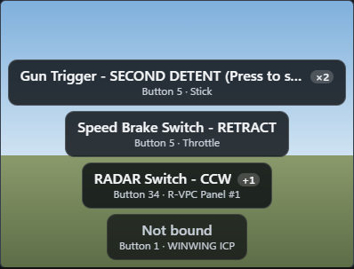
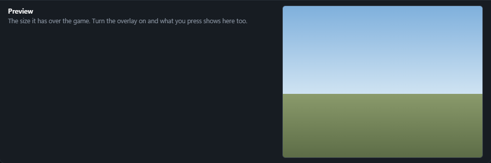
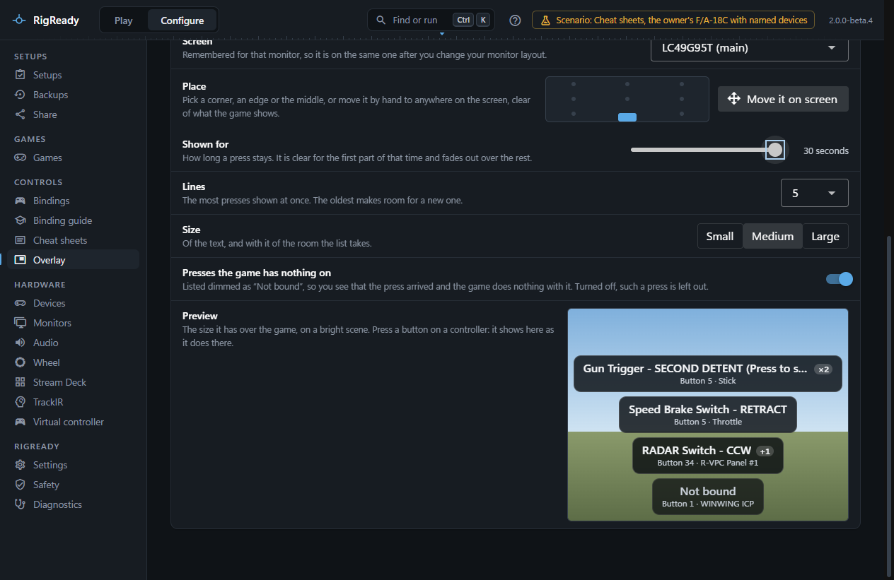

**Configure > Overlay** puts a small see-through list over the game. Each button or hat you press on a controller appears in it at once, with what the game does on it for the aircraft or car you are in, and fades away a few seconds later. It is for learning the controls while you fly or drive, and for seeing why a press did nothing. It goes with the [trainer](../controls/trainer.md), which asks you the same controls at the desk.

Clicks go through the overlay to the game, and it never takes the keyboard. While nothing is pressed there is nothing on the screen.

## Where it shows, and where it cannot

- It shows over the desktop and over a game that runs in a window or as a borderless window.
- Over a game in exclusive full screen it may not show. If you do not see it there, set the game to borderless.
- It does not show inside a VR headset. The overlay is a window on a monitor, and a headset is not one.

Not yet verified on a real rig: the overlay passed its tests in the app on recorded data, but nobody has looked at it over a running game yet, or dragged it into place with the mouse on real monitors. The [changelog](../../../CHANGELOG.md) lists it under known limitations.

## Turning it on

**Show the overlay** at the top of the page turns it on and off. On, it stays on: it comes up again whenever RigReady runs, until you turn it off. The line under the switch says which screen it is over, or why it is not showing.

While it is on, RigReady reads your controllers in the background, also while the game is the window you are in. Off, nothing is put over the game and the controllers are not read for it.

The [command palette](../app/command-palette.md) has **Turn the overlay on** and **Turn the overlay off**.

## What a line says

- In large letters, the action as the game names it. A control with more than one action shows the first, the one that works on its own, and "+1" for each further one. An action that needs another button held shows that button in front of it.
- Under it, the control ("Button 12", "Hat 1 up") and the controller: the name you gave it on [Devices](../hardware/devices.md), or a short form of the name it reports.
- "×3" when you pressed the same control three times running. Pressing again does not add a line; the line counts up and its time starts again.
- **Not bound**, dimmed: the press arrived and the game has nothing on that control for this aircraft or car.

A switch or a lever with several positions is one line that changes as it moves, not a line for every position it passes. What is already held when the overlay starts, such as a three-way switch in its middle position, is taken as rest and not listed.

## Which game and aircraft

**What the presses are named from** shows the setup in use (the one you played last), its game, and the aircraft or car whose bindings are read. A game keeps separate bindings for each aircraft or car, and nothing tells RigReady which one you are in, so it goes by what it knows:

1. the one you chose under **Aircraft or car** on this page, remembered for that setup;
2. one the setup names, in a check or in its own name;
3. the only one the game has bindings for;
4. otherwise the first one with bindings of your own. The page says that this is a guess; choose the right one.

**Let RigReady pick** goes back from your choice to the list above.

Bindings you change in the game are picked up within about two minutes of your next press, or at once when you open this page. When the bindings of the game cannot be read, the page says why, and a line shows the control and the controller without an action.

## Placing it

- **Screen** chooses the monitor. The place is remembered for that monitor, so the overlay is on the same one after you switch your [monitor layout](../monitors-and-audio/layouts.md). When that monitor is off, the overlay is on the main screen until it is back, and the page says so.
- **Place** has the small picture of the screen with nine spots: the corners, the edges and the middle. Click one and the overlay goes there.
- **Move it on screen** frames the overlay where it is. Drag the frame to anywhere on the screen, on any monitor, then press **Lock here** in the frame or **Lock it here** on the page. While it is framed it takes clicks; locked, they go through it again.

The list hangs from the edge it is nearest to. In the upper half of the screen the newest press is at the top and older ones go down; in the lower half the newest is at the bottom and older ones go up. So the newest press is always in the same spot.

## Options

- **Shown for**: how long a press stays, from 1 to 30 seconds; 5 to begin with. A line is clear for the first part of that time and fades out over the rest. When Windows is set to show no animations, a line does not fade: it goes when its time is over.
- **Lines**: the most presses shown at once, from 1 to 10. The oldest makes room for a new one.
- **Size**: small, medium or large. The text and the room the list takes go together.
- **Presses the game has nothing on**: turned off, a press that is not bound is left out, and one that is on the list goes at once.

**Preview** shows the list at the size it has over the game, on a bright background.

While the overlay is off, the preview shows two lines marked **Example**, so that you can settle Size and Lines before you turn it on: they change as you set them. They are buttons bound for the aircraft or car chosen above, with the game's own names for what they do. Where RigReady has no bindings to go by they are "Button 1" and "Hat 1 up" on "Your controller". Examples are only ever on this page: nothing is put over the game while the overlay is off.

Turn the overlay on and the examples are gone: what you press shows in the preview instead, as it does over the game.

## If it does not show

- The line under **Show the overlay** and the lines in yellow on the page say what is wrong: no screen, the window could not be opened, or the controllers are not being read. For the last, see [Game controllers could not be read](../troubleshooting/controllers-not-read.md).
- A press that shows in the [Input tester](../hardware/input-tester.md) and not in the overlay was most likely held when the overlay started. Let go of it and press again.
- Over a game in exclusive full screen, set the game to borderless.

The overlay keeps its settings in [RigReady's own folder](../app/index.md) and changes nothing in any game.

When the page says that `overlay\settings.json` in that folder is not valid, something other than RigReady changed the file. RigReady leaves the file as it is and refuses changes to the overlay until the file is repaired or deleted. Deleted, the overlay starts again from its first settings, turned off.
