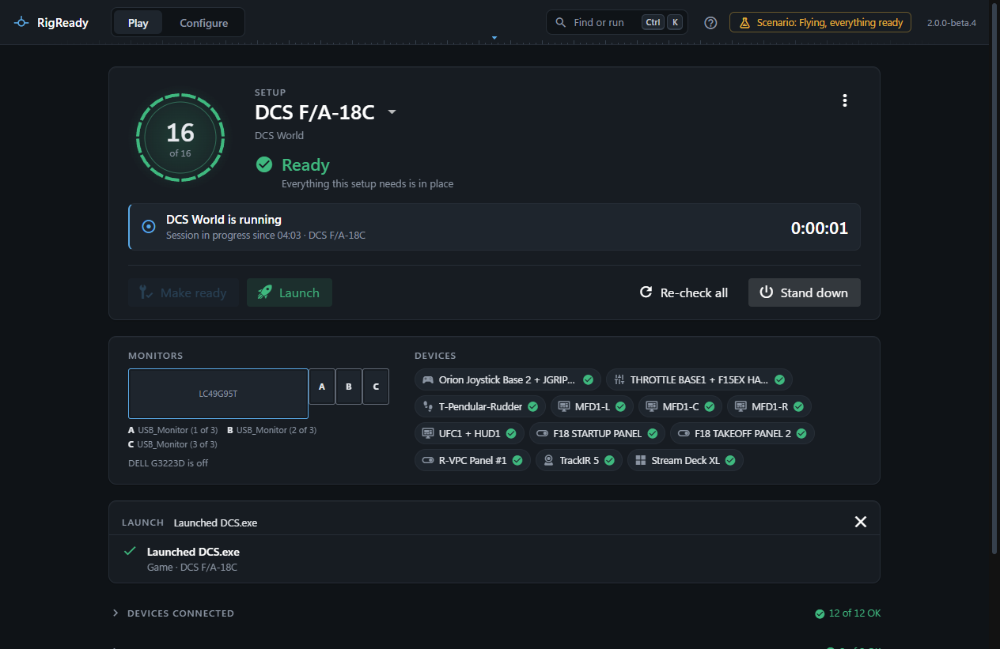
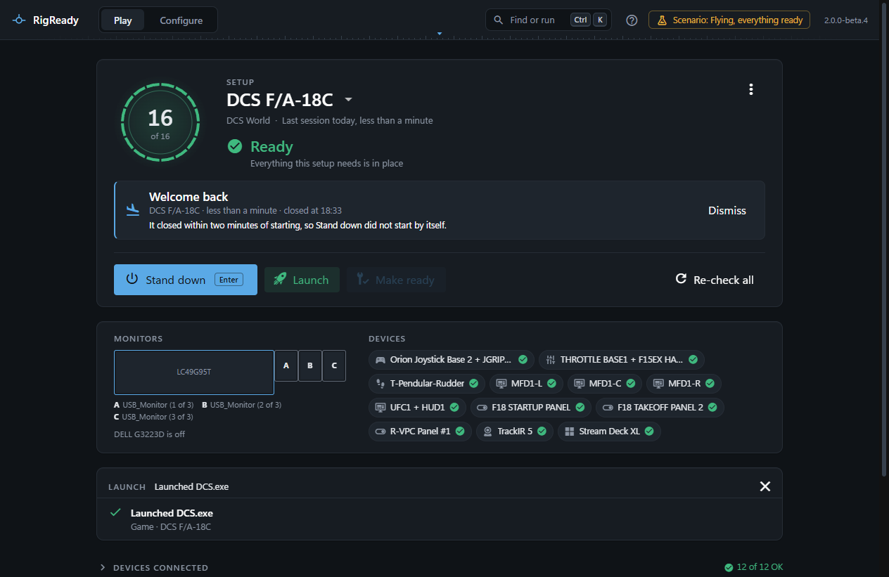
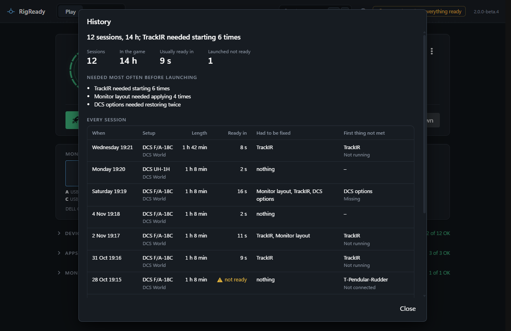

A session is the time the game runs. RigReady notices the game's program in the list of running programs ([Games](../games/index.md) says how each game is recognised), and keeps a record of every session it launched: how long it was, how long the rig took to be ready, and what had to be fixed first.

## During the session

Once the game is running, the Play screen says "DCS World is running · Session in progress since 20:14 · DCS F/A-18C", with a clock. There is no main action while the game runs, so Enter does nothing; Make ready, Launch and Stand down are still there if you want them.

A game started through Steam shows up a little later. The screen says "Waiting for DCS World to start. Steam was asked at 20:14. The session begins when the game itself is running." If Steam never starts it (an update, a sign-in, a closed window), RigReady stops waiting after fifteen minutes and records nothing.

RigReady looks at the running programs every two seconds. The game is known by its program name: the one the setup launches, or the names the game module knows for a game started through Steam. A launcher and the simulator it starts count as one session.

The session survives RigReady being closed: on the next start it picks the session up if the game is still running, or records that it happened, without a length, if not.

## Welcome back

When the game closes the screen says **Welcome back**, with the setup, how long the session was and when it closed. **Stand down** is now the main button. **Dismiss** puts the line away without standing down.

With **Stand down when the game closes** on, the line says "Standing down…" and then what Stand down did (see [Stand down](stand-down.md)). If nobody is at a window of RigReady (nothing was done in it for a minute, or it is hidden), the welcome is a Windows notification instead ([the tray icon](../one-click/tray.md)): "DCS F/A-18C: 1 h 42 min. Stand down when you are done."

## Last session

Under the setup's name the Play screen says when the last session was and how long: "Last session Tuesday, 1 h 42 min". A session whose length is not known says only when it was.

## History

**History** in [the Play menu](the-menu.md) opens every session RigReady recorded, newest first.

- One line sums it up: "12 sessions, 14 h; TrackIR needed starting 6 times".
- **Sessions**, **In the game** (the total of the sessions whose length is known), **Usually ready in** (the typical time from opening the setup until every required check was met) and **Launched not ready** (sessions started with something required not met).
- **Needed most often before launching**: the fixes that ran before a launch, counted across every session, most frequent first: "TrackIR needed starting 6 times", "Monitor layout needed applying twice".
- The table lists the last 100 sessions: when, the setup and its game, the length, how long the rig took to be ready (or "not ready"), what had to be fixed, and the first required item that was not met when the setup was opened.

"Ready in" counts from the first check after you open or switch to the setup until the moment every required check passes. Coming back to the window after more than two minutes away starts that clock again.

The record is kept in `fly\sessions.json` in [RigReady's data folder](../app/index.md); the newest thousand sessions are kept. A damaged file is left as it is and the history continues in the next one; the dialog says so.
