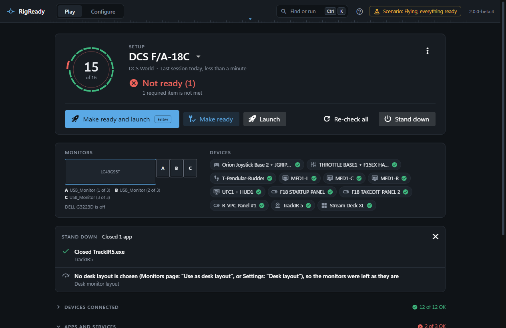
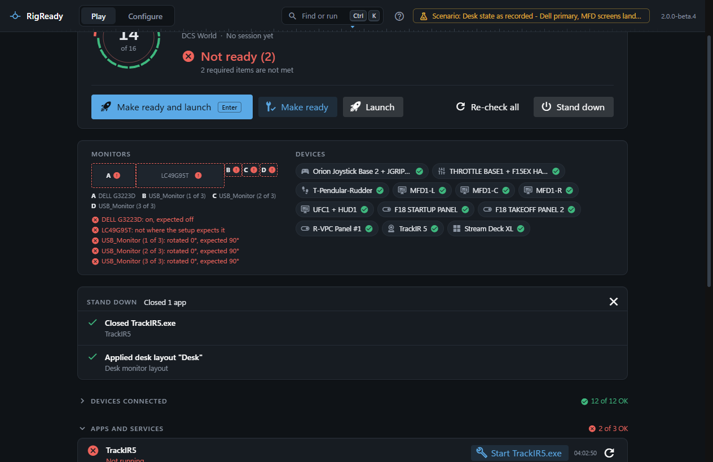

**Stand down** puts the rig back the way it was before Make ready: it closes the helper apps that are only useful in the sim and returns the monitors to your desk. It is the main button once the game has closed, and it is always on the right of the Play screen, in the tray menu, under the taskbar thumbnail, in the command palette and in the compact view.

## What it closes

Stand down goes through the setup's checks and does what each kind has to do at the end:

- **App running** checks: the app is closed when the check says so (**Close at Stand down**: always), or when RigReady started it during this session and the check leaves it unsaid. An app the check says never to close is left alone. RigReady asks the program to close and waits ten seconds; it terminates the program only when the check allows force.
- **TrackIR** and **Stream Deck** checks close their app when their **Close at Stand down** option is on.
- **Default audio device** checks put back the device that was the default before Make ready changed it, unless you changed the default yourself since.
- **Monitor layout** checks put back the arrangement from before Make ready, unless a desk layout is chosen (see below).

Then it closes the programs that launch steps started (each step has **Close it at Stand down**, on by default), runs the setup's own **At Stand down** steps, and applies the desk layout. The game's own program is never on this list unless you say so.

## The desk layout

One saved layout can be the desk layout: choose it with **Use as desk layout** on **Configure > Monitors**, or under **Desk layout** on **Configure > Settings**; the two are the same choice. Stand down applies it last. The first time, it asks **Keep this monitor layout?** with the countdown; once you have kept the desk layout with the same monitors connected, it is applied without the question ([When RigReady asks, and when it does not](../monitors-and-audio/layouts.md#when-rigready-asks-and-when-it-does-not)). When no desk layout is chosen, the step is listed as skipped ("No desk layout is chosen (Monitors page: "Use as desk layout", or Settings: "Desk layout"), so the monitors were left as they are") and the monitor check's own revert is what puts the screens back. When the chosen layout was deleted since, the step fails and says to choose another in either place. See [Monitors and audio](../monitors-and-audio/index.md).

## What it reports

The headline counts what was closed: "Closed 2 apps", "No apps to close", and "1 step needs attention" when something did not close. Every step is listed with what it said, for example "TrackIR5.exe is still running: it did not close when asked." Afterwards the checklist is run again, so the screen shows the rig as it is now (usually Not ready, which is right: you are at the desk).

## When the game is still running

Stand down from the Play screen looks first. If the game is running it asks: **DCS World is still running. Stand down closes the helper apps. Should it close the game too?** with **Leave it running**, **Close it too** and **Cancel**. The game is closed the way an app is: asked, then waited for, never forced. From the tray, the compact view and the command palette the game is always left running; only the Play screen can close it.

## Stand down when the game closes

The Play menu has **Stand down when the game closes**. With it on, RigReady watches the game and, once it is gone, stands down by itself. The **Welcome back** line says "Standing down…" and then what was done. The game is gone by then, so there is nothing to ask about closing it. If nobody is at a window of RigReady, a Windows notification says the same. See [Sessions and history](sessions.md).

If you stood down while the game was still open, nothing is offered again when it closes.
