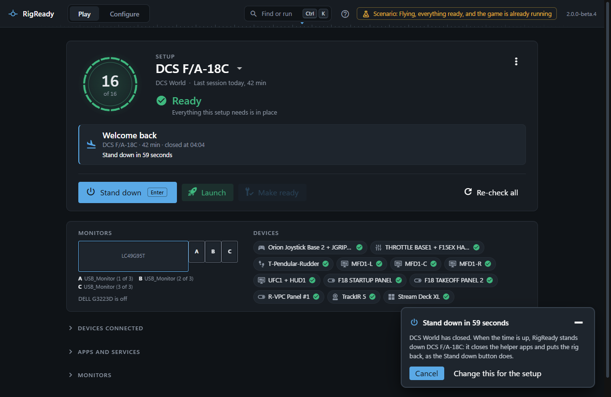
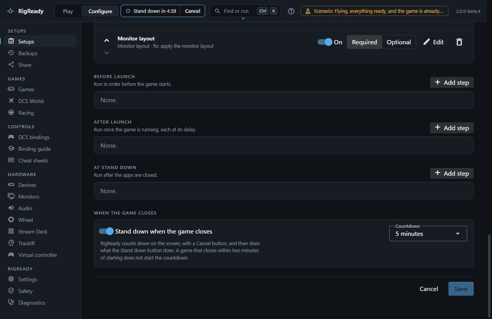
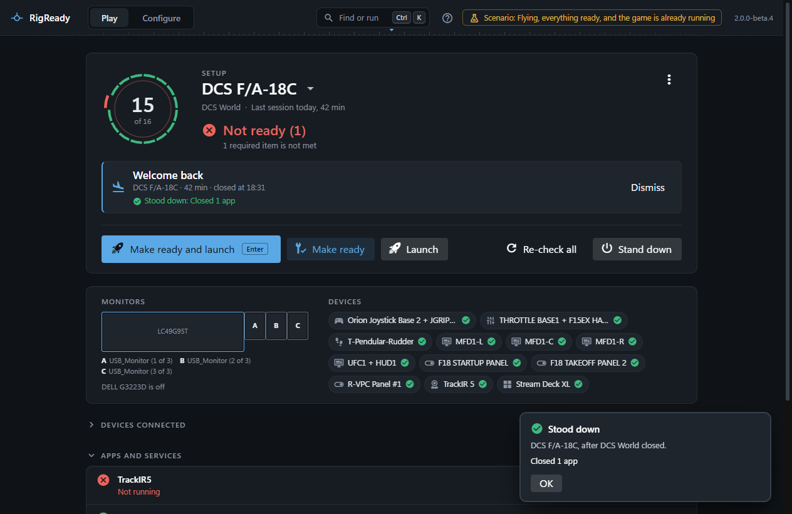
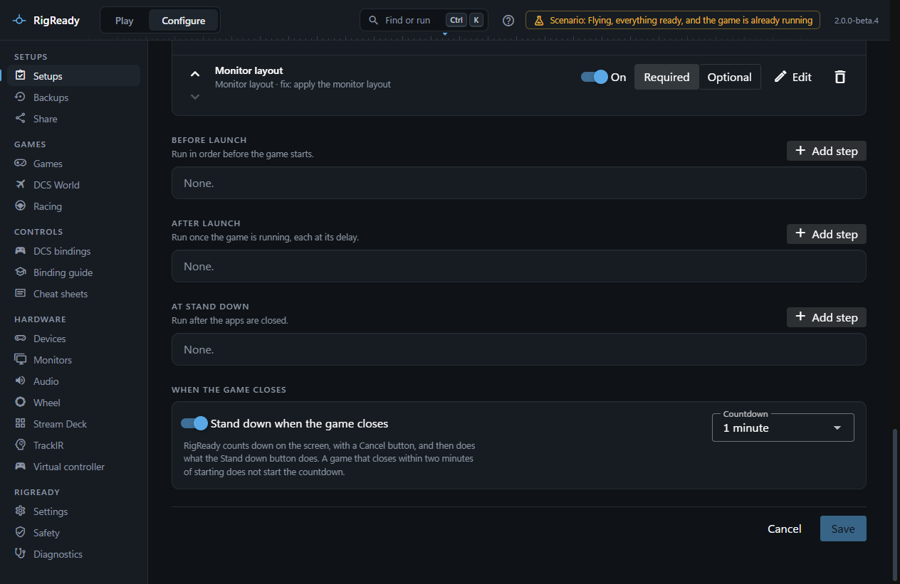

**Stand down** puts the rig back the way it was before Make ready: it closes the helper apps that are only useful in the sim and returns the monitors to your desk. It is the main button once the game has closed, and it is always on the right of the Play screen, in the tray menu, under the taskbar thumbnail, in the command palette and in the compact view.

## What it closes

Stand down goes through the setup's checks and does what each kind has to do at the end:

- **App running** checks: the app is closed when the check says so (**Close at Stand down**: always), or when RigReady started it during this session and the check leaves it unsaid. An app the check says never to close is left alone. RigReady asks the program to close and waits ten seconds; it terminates the program only when the check allows force.
- **TrackIR** and **Stream Deck** checks close their app when their **Close at Stand down** option is on.
- **Default audio device** checks put back the device that was the default before Make ready changed it, unless you changed the default yourself since.
- **Monitor layout** checks put back the arrangement from before Make ready, unless a desk layout is chosen (see below).

Then it closes the programs that launch steps started (each step has **Close it at Stand down**, on by default), runs the setup's own **At Stand down** steps, and applies the desk layout. The game's own program is never on this list unless you say so.

## The desk layout

One saved layout can be the desk layout: choose it with **Use as desk layout** on **Configure > Monitors**, or under **Desk layout** on **Configure > Settings**; the two are the same choice. Stand down applies it last. The first time, it asks **Keep this monitor layout?** with the countdown; once you have kept the desk layout with the same monitors connected, it is applied without the question ([When RigReady asks, and when it does not](../monitors-and-audio/layouts.md#when-rigready-asks-and-when-it-does-not)). When no desk layout is chosen, the step is listed as skipped ("No desk layout is chosen (Monitors page: "Use as desk layout", or Settings: "Desk layout"), so the monitors were left as they are") and the monitor check's own revert is what puts the screens back. When the chosen layout was deleted since, the step fails and says to choose another in either place. See [Monitors and audio](../monitors-and-audio/index.md).

## What it reports

The headline counts what was closed: "Closed 2 apps", "No apps to close", and "1 step needs attention" when something did not close. Every step is listed with what it said. Afterwards the checklist is run again, so the screen shows the rig as it is now (usually Not ready, which is right: you are at the desk).

## An app that is still running

Stand down asks an app to close the way its window's X button does, and waits ten seconds. An app that is still there afterwards is named, with the reason:

- "TrackIR5.exe is still running: it was asked to close and stayed open. Some apps only go to the tray when asked."
- "… it has no window, so it could not be asked to close."
- "… Windows did not let RigReady close it. It may be running as administrator."

The line ends with what you can do: close it yourself, or switch on **Force it closed if it does not close** for that check in [the setup editor](../setups/editor.md). With that on, RigReady ends the program when it has not closed after the wait. An app that runs as administrator cannot be forced either, unless RigReady runs as administrator too; for that one the line only says to close it yourself.

The **Stream Deck app** check has the same switch, off until you switch it on: the Stream Deck window only goes to the tray when asked, so without the switch the line names it as still running. **TrackIR** has no switch. It is always ended when it has not closed after the wait, and the line then says "Closed TrackIR (it had to be forced)".

An app made of several programs with the same name is closed as one: all of them are asked, and it counts as closed when none is left.

The same is said wherever RigReady asks a program to close before it restores files (a [backup](../protect/restore.md), the [Stream Deck profiles](../hardware/stream-deck.md), the [wheel software settings](../games/wheel.md)): the program is named with the reason, and nothing is restored while it is open.

## When the game is still running

Stand down from the Play screen looks first. If the game is running it asks: **DCS World is still running. Stand down closes the helper apps. Should it close the game too?** with **Leave it running**, **Close it too** and **Cancel**. The game is closed the way an app is: asked, then waited for, never forced. From the tray, the compact view and the command palette the game is always left running; only the Play screen can close it.

## Stand down when the game closes

Every setup stands down by itself when its game closes, unless you switch that off for the setup. RigReady watches the game. Once it is gone, a notice in the bottom right corner of the window counts down: **Stand down in 1 minute**, then the seconds. It says what will happen: "DCS World has closed. When the time is up, RigReady stands down DCS F/A-18C: it closes the helper apps and puts the rig back, as the Stand down button does." The notice is on every page. The **Welcome back** line on the Play screen says the same in one line, and so does the session line of the [compact view](compact-view.md).

- **Cancel** ends the countdown. Nothing is closed, the line says "Stand down was cancelled. Nothing was closed.", and the Stand down button is there for when you are done.
- **Change this for the setup** opens the setup editor, where the switch is.
- The small button at the top right of the notice moves the countdown to the top bar. Use it when the notice lies over something you need, such as the setup editor's **Save** and **Cancel**. The countdown ("Stand down in 4:05") and its **Cancel** are then in the bar on every page. Press the countdown there to bring the notice back.
- The game starting again ends the countdown too. So does Stand down pressed by hand (it runs at once, and once), and so does quitting RigReady. Closing the window to the tray is not quitting: the countdown goes on.

When the time is up, Stand down runs: the same one the button runs. The game is gone by then, so there is nothing to ask about closing it. The notice then says what was done: **Stood down** with "Closed 2 apps", or **Stand down ran, but 1 step needs attention** with each step that did not work, or **Stand down did not finish** with the reason. It stays until you press **OK**. It says "Stood down" only when every step worked.

If nobody is at a window of RigReady when the game closes, a Windows notification says when Stand down starts ("DCS F/A-18C: 1 h 42 min. Stand down starts in 1 minute. Open RigReady to cancel."), the window comes back on screen, and a second notification says what was done. See [Sessions and history](sessions.md).

### The switch and the countdown length

Both are in the setup editor, under **When the game closes** ([The setup editor](../setups/editor.md#when-the-game-closes)): the switch **Stand down when the game closes**, on by default, and **Countdown**, one minute by default. A setup saved before the switch existed has both defaults. With the switch off nothing is closed by itself: the screen says Welcome back and the Stand down button waits for you.

### When it does not start by itself

- The game closed within two minutes of starting. A game that stops right after it started, or a launcher that hands over to the game, should not close the helper apps you are about to need. The line says "It closed within two minutes of starting, so Stand down did not start by itself." The compact view has one short line for it: "It closed too soon: Stand down did not start."
- You stood down while the game was still open. Nothing is offered again when it closes.
- RigReady was not running when the game closed. At its next start it records the session and closes nothing.

A step that asks a question still asks it. The desk layout's **Keep this monitor layout?** is one: when nobody answers, the layout goes back, and Stand down lists that step as not done.
