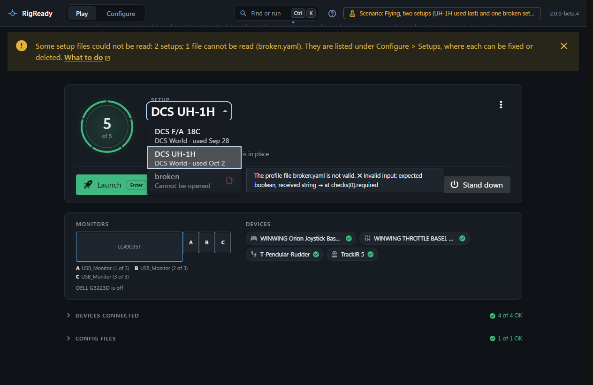
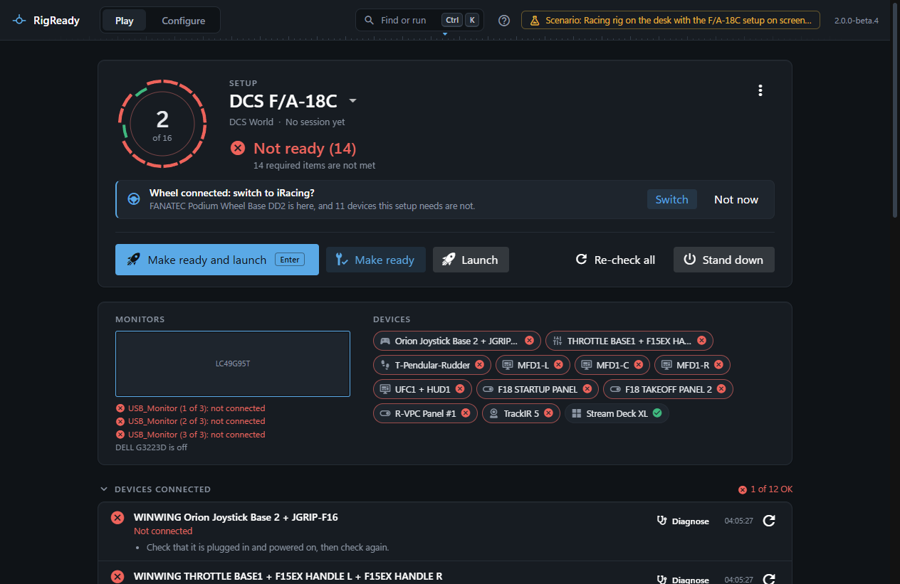

Setups are one per aircraft or car. The Play screen shows one at a time, the setup in use, and remembers it: the next start opens on it, the tray and the taskbar name it, and the hotkey makes it ready.

## The switcher

The setup's name at the top of the Play screen is a drop-down. Each entry shows the game and when the setup was last used ("used today 20:14", "not used yet"). A setup whose file cannot be read is listed greyed out with the reason in its tooltip; it cannot be chosen until the file is fixed (see [Hand-editing the YAML](../setups/yaml.md)).

Choosing a setup checks it at once and makes it the setup in use. Every other window of RigReady, the tray and the taskbar follow. Looking is not choosing: a quiet re-check in the background never changes which setup is in use.

## Other ways to switch

- The tray menu has a **Setup** entry with every setup, when there is more than one ([The tray icon](../one-click/tray.md)).
- The [command palette](../app/command-palette.md) has **Switch to <setup>** for every other setup.
- **Configure > Setups** has **Play** on each setup.
- The compact view has the same drop-down ([Compact view](compact-view.md)).
- A desktop shortcut, a Jump List entry or `RigReady.exe --setup "<setup>"` chooses the setup it names ([Starting without the window](../one-click/index.md)).

## The quiet offer

Sometimes the gear on the desk says which setup you mean better than the one on screen. When a device this setup requires is not connected, and every device another setup requires is, the Play screen offers that setup in one line: "Wheel connected: switch to iRacing?", with "FANATEC Podium Wheel Base DD2 is here, and 11 devices this setup needs are not."

**Switch** goes to that setup. **Not now** puts the offer away, and it is not made again for this pair of setups while RigReady runs. RigReady never switches by itself.

The offer is made only between setups that have required device checks, only when more than one setup exists, and not while a session is in progress. Of several setups whose gear is all there, the one used most recently is offered. The device named is one that setup requires and this one does not.

## When the last setup cannot be opened

If the file of the setup you used last was removed by hand, the Play screen opens on the setup changed most recently and says so in a note; a setup deleted on the Setups page is simply replaced by the first in the list. If the file no longer loads, the screen keeps showing the last version that loaded, with a yellow note and the error, until the file is fixed.
