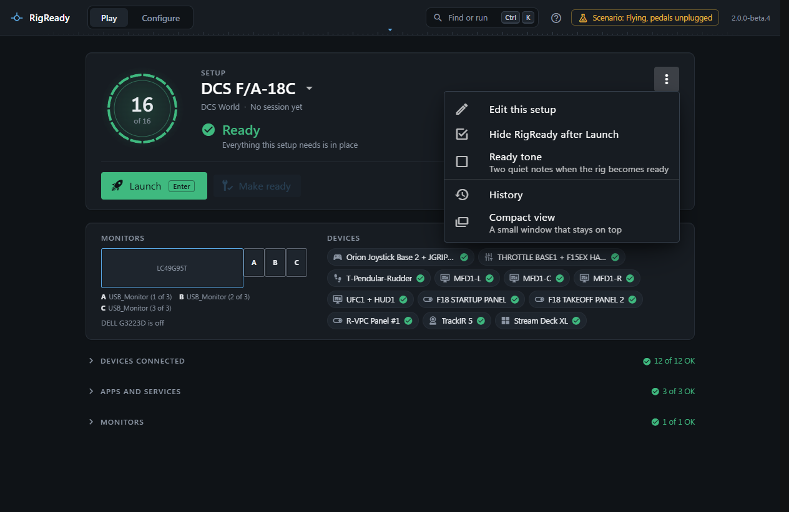

The ⋮ button at the top right of the Play screen's panel holds the few settings that belong to the Play screen, and two more views. The three settings are ticks: choosing one changes it and leaves the menu open, so you see the tick change.

## Edit this setup

Opens the setup in use in the setup editor ([The setup editor](../setups/editor.md)).

## Hide RigReady after Launch

On by default. After a successful launch the window goes to the [tray](../one-click/tray.md), out of the way of the game. Off: the window stays where it is. Without a tray icon the window is minimised instead.

## Stand down when the game closes

Off by default. On: when the game closes, Stand down runs by itself, without asking. See [Stand down](stand-down.md).

## Ready tone

Off by default. On: two short, quiet notes are played the moment the rig becomes ready (from Not ready, or from still checking, to Ready or Ready with warnings). The notes are made on the spot, there is no sound file, and they are quiet next to a game. Switching the tone on plays it once, so you know what to expect. When it cannot be played (no audio device, or the sound system refused) a note on the screen says why. The sound has not yet been verified on real hardware: it passed its tests, but nobody has heard it on a real rig. The [changelog](../../../CHANGELOG.md) lists it under known limitations.

## History

Every session RigReady recorded, with totals. See [Sessions and history](sessions.md).

## Compact view

Opens the small window that stays on top. See [Compact view](compact-view.md).
