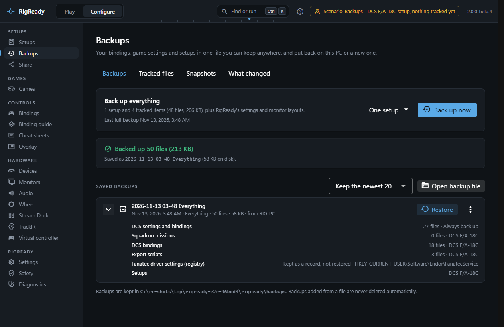
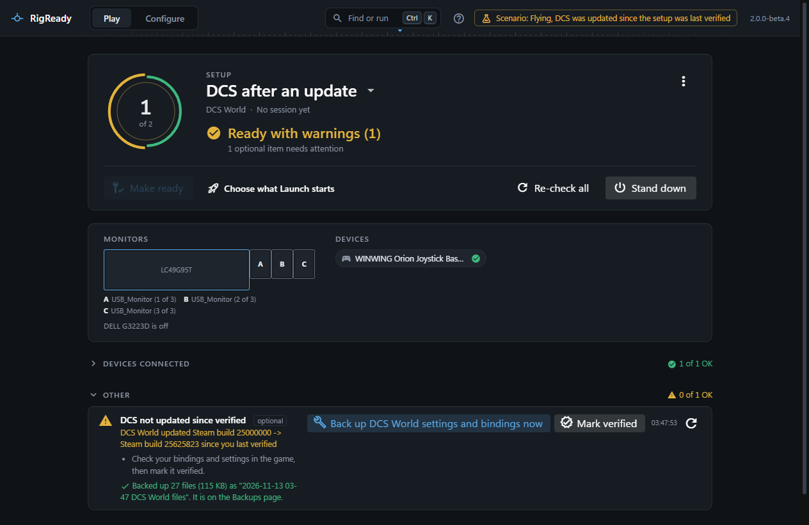

**Configure > Backups** is where you make backups and keep them. One click saves everything RigReady tracks into a single file; the list below it shows every backup on this PC with its contents.

This page is about making and keeping backups. [Tracked files](tracked-files.md) explains how to choose what goes in, and [restore](restore.md) how to put a backup back.

## Back up now

The **Backups** tab opens on a panel called **Back up everything**. It says how many setups and tracked items a full backup would hold, how many files that is and their size, and when the last full backup was made.

**Back up now** makes a full backup. While it runs, a progress bar names the item being read and counts the files; **Cancel** stops it. Nothing is written until the very end, so a cancelled backup leaves nothing behind: the page says "The backup was cancelled. Nothing was written."

When it is done the page reports what was really saved: "Backed up 340 files (12.4 MB)", the name of the file and its size on disk, and whether older backups were removed to stay within the number you keep. Two lists follow when they apply:

- **Could not be read**: files that were skipped because they could not be opened, each with the reason. The backup is still saved; the title then says "Backup completed with N skipped".
- **Left out on purpose**: files that are never copied because they hold credentials, each with why.

**One setup** next to the button makes a backup of a single setup: its own tracked items and its setup file, nothing else.

The same full backup can be started from anywhere with the [command palette](../app/command-palette.md): Ctrl+K, then **Back up now**. The result is reported at the bottom of the window.

## What a full backup contains

- Every tracked item of the **Always back up** list and of every setup, with its files. An item tracked in two places is stored once.
- Every setup file (`profiles\*.yaml`).
- RigReady's settings, your saved monitor layouts and the **Always back up** list itself.
- Settings that live in the Windows registry rather than in files, when a tool provides them. Today that is the Fanatec driver settings ([Wheel](../games/wheel.md#backups)). These are kept as data to read later; nothing writes them back, and the list marks them "kept as a record, not restored".

A backup of one setup holds that setup's tracked items and its setup file only. A backup of selected items (made from the [Tracked files](tracked-files.md) tab) holds just those items.

[Snapshots](snapshots.md), the [what changed](what-changed.md) records and the automatic copies on the Safety page are not part of a backup file. They stay on the PC they were made on.

## Where the files go

Backups are zip files in `backups` under [RigReady's data folder](../app/index.md), `~/.rigready`; the folder is printed at the bottom of the page. A file is named after the date, the time and what it covers, for example `2026-10-03 14-05 Everything.zip`.

Each backup holds a manifest with a checksum of every file. When a backup is opened again, every file is checked against it; a damaged or incomplete file is refused rather than restored.

Expand a row with the chevron to see what it holds: each item with its file count and where it was tracked, the records, and the setups by name. A row that is not a readable backup says so in red and cannot be restored.

The row's menu has:

- **Export to…**: copies the backup to a place you choose, for example a USB stick or a network share, and checks that the copy matches.
- **Show in folder**: opens the backups folder in Explorer with the file selected.
- **Rename** and **Delete**. Deleting removes the file from this PC; copies you exported elsewhere are not affected.

**Open backup file** adds a backup made elsewhere (another PC, an exported copy) to the list after checking it. A backup added this way is marked "added from a file" and is never deleted automatically.

## How many are kept

The selector above the list sets how many backups made on this PC are kept: the newest 5, 10, 20 (the default) or 50, or all of them. After each new backup the oldest beyond that number are deleted. Backups added from a file and backups that cannot be read are never deleted by this rule; the backups RigReady makes before a restore ("Saved before a restore") count like any other.

This is separate from the retention of the automatic copies RigReady makes before it changes a file, which is set in [Settings](../app/settings.md) and shown on [the Safety page](safety-page.md).

## The 2 GB limit

A backup is built in memory before it is written, so one backup can hold at most 2 GB of files. If the tracked files add up to more, RigReady refuses before reading anything and names the largest item: leave its big folders out with patterns (see [tracked files](tracked-files.md)). The DCS suggestion already leaves out logs, tracks, caches, screenshots, mods and liveries for this reason.

A backup can also be refused because it would be empty: no setups and no tracked files, or tracked files that do not exist on this PC.

## A backup before a game update

When a setup's check for the game's version ([Checks and fixes](../setups/checks.md#game-updated-since-you-last-verified-game-updated)) notices that the game was updated since you last verified it, the fix it offers is **Back up the game's settings and bindings**. That makes one backup of everything known about the game: what you track for it and what its game module suggests. It appears on the Backups page like any other, named after the game. The warning itself goes away only when you mark the new version as verified.

