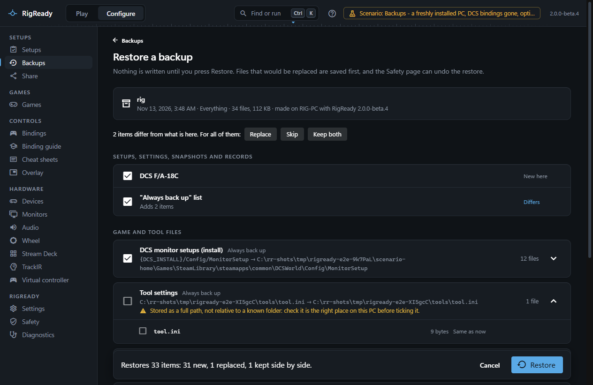

A new PC, or Windows installed afresh, is the case backups are for. The order matters: the games and tools have to be there before their files can go back, and the controllers have to be plugged in before their IDs can be sorted out.

What you need from the old PC is one full backup, exported to a USB stick or a network share. If the old PC is gone and you have no backup, this page cannot help; start by making one now, on the PC you have.

## On the old PC

1. Open **Configure > Backups**. On the **Tracked files** tab, make sure everything you care about is tracked: the suggestions for each game and tool, and anything of your own. See [tracked files](tracked-files.md).
2. Press **Back up now**.
3. On the backup's menu choose **Export to…** and save the file to a USB stick or a network share.

## On the new PC

1. Install Windows and its updates, then the games: DCS World, the racing games, Microsoft Flight Simulator, whichever you use. Start each once so it creates its settings folder (`Saved Games\DCS`, `Documents\iRacing` and so on). RigReady restores into those folders, and a game that was not found cannot have its files restored.
2. Install the helper tools you use: [SimAppPro](../dcs/simapppro.md), [Stream Deck](../hardware/stream-deck.md), [TrackIR](../hardware/trackir.md), the [Fanatec software](../games/wheel.md), [HidHide](../hardware/devices.md#hidhide), and sign in where they need it. Credentials are never in a backup ([What is never copied](index.md#what-is-never-copied)).
3. Plug in the controllers and the extra screens.
4. Install RigReady (see [install](../getting-started/install.md)) and open it. Go to **Configure > Backups** and press **Open backup file** to add the exported file.
5. Press **Restore**. The page notes that the backup comes from another PC and shows where each item lands here. Items whose game was not found say so; everything else is ticked. Press **Restore**.
6. Read the report. If it says **Controllers have different IDs on this PC**, open **Bindings > Device IDs** from the button: Windows gave the controllers new IDs, and DCS ignores a binding file until it is moved to the new ID. The page shows which files can be moved and moves them with a preview; with identical devices it asks you to press a button on each. See [device IDs](../dcs/device-ids.md).
7. Press **Run checks now**. The restored setups are checked against this PC on the [Play screen](../play/index.md). Fix what the checklist shows: a helper app not yet running, a monitor layout to save again, a device on another port.

## What comes back and what does not

Back from the backup: the game files you tracked, every setup, your monitor layouts, the RigReady settings (desk layout, retention, timeouts) and the **Always back up** list.

Not in a backup, to set up again:

- **Credentials**: DCS and Steam logins, the SimAppPro account. Sign in again in each program.
- **Registry settings** such as the Fanatec driver settings. The backup shows them under **Kept as a record** ([Restore a backup](restore.md)) so you can set the same values in the tool.
- **Start with Windows**, the **hotkey** and the **AI key**. Set them in [Settings](../app/settings.md).
- **Snapshots** and the **What changed** records. They stay on the old PC.
- **Monitor layouts** on different monitors. Layouts name monitors by their identity; the same monitors on the new PC keep working, other monitors need new layouts saved under Configure > Monitors. See [layouts](../monitors-and-audio/layouts.md).
- **Stream Deck**: the profiles are files and come back; the Stream Deck page has its own guide for a new PC ([Set up on a new PC](../hardware/stream-deck.md#set-up-on-a-new-pc)).
- **Desktop shortcuts** for setups: create them again from the [setup editor](../setups/editor.md) ([Desktop shortcut](../one-click/desktop-shortcut.md)).
