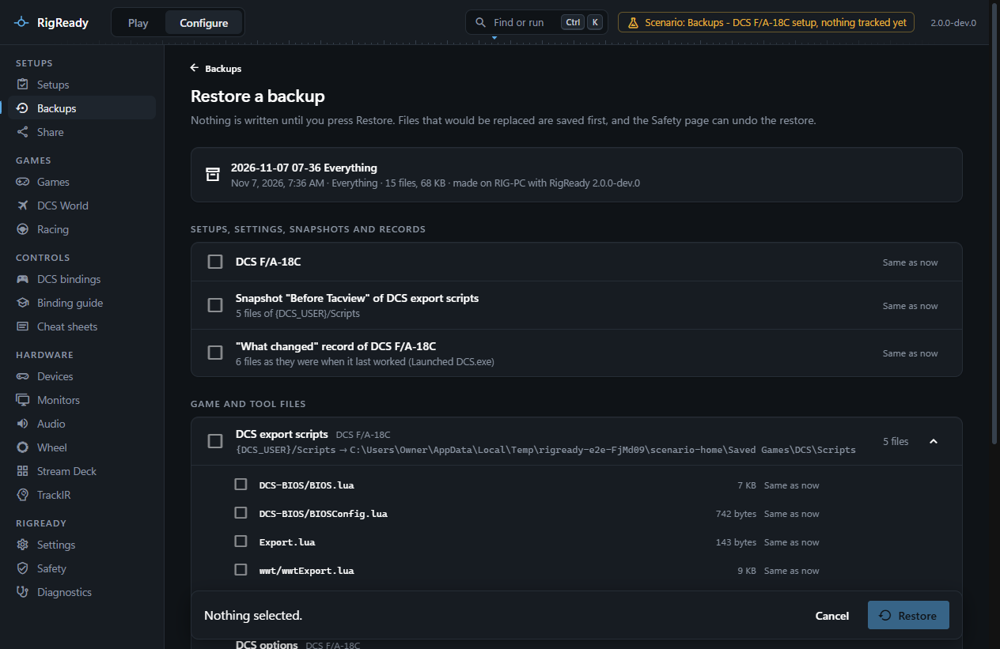
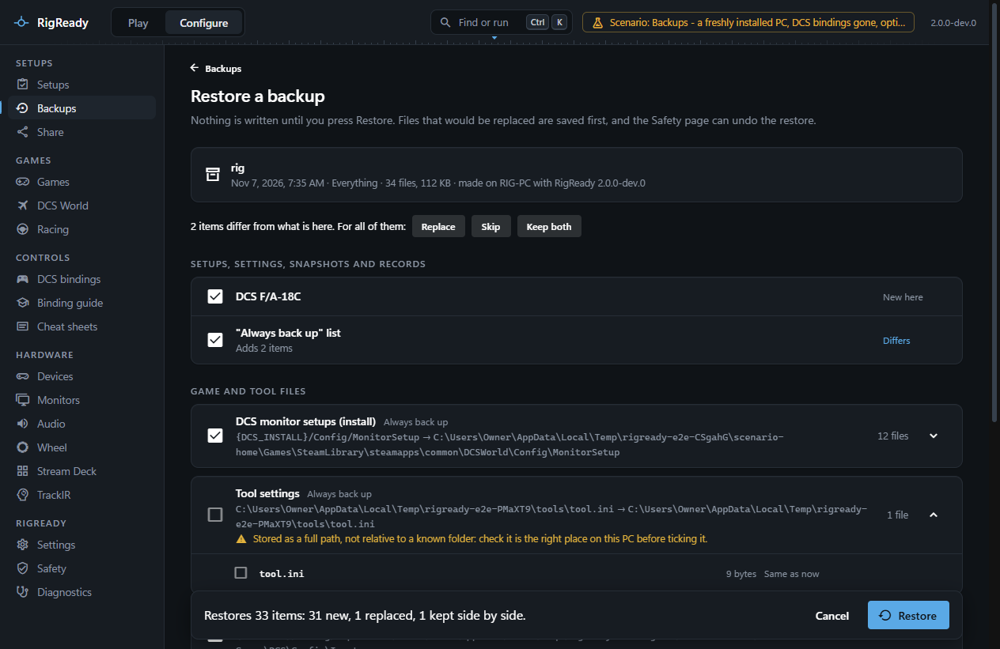
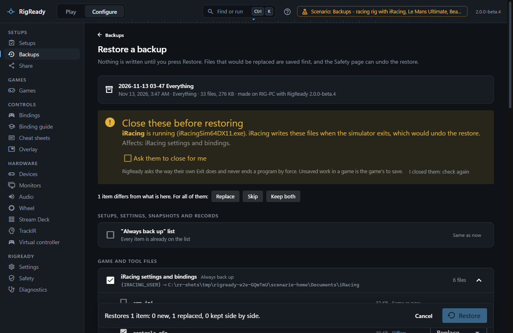
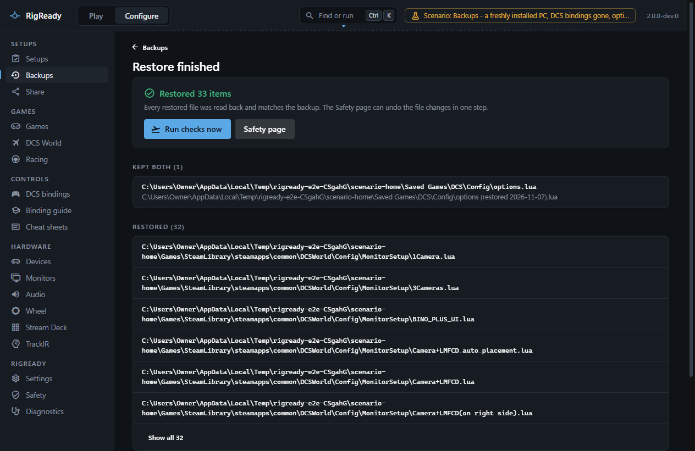
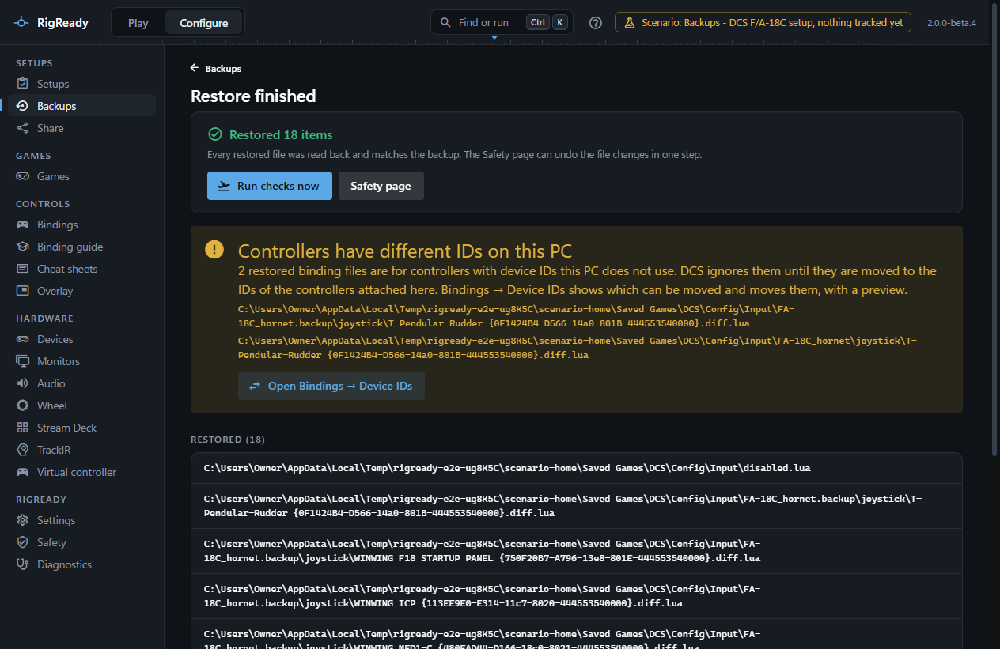

**Restore** on a backup row opens the restore page. Nothing is written until you press **Restore** at the bottom; until then the page only reads, and shows you what would happen.

Before a restore replaces anything, the files it replaces are saved in a backup of their own, and the files it writes are recorded on [the Safety page](safety-page.md), where the whole restore can be undone in one step.

## What the page shows

At the top: the backup's name, when and on which PC it was made, with which version of RigReady, and how many files it holds. A backup from another PC or Windows user gets a note that paths are worked out for this PC; each item then shows the stored path and where it lands here, for example `{DCS_USER}/Config/Input` becoming `C:\Users\you\Saved Games\DCS\Config\Input` ([Path variables](../setups/path-variables.md)).

**Setups, settings, snapshots and records** lists what is RigReady's own: each setup by name, each monitor layout, the RigReady settings (desk layout, retention and timeouts; Start with Windows and the API key stay as they are), the **Always back up** list, which is merged rather than replaced, each [snapshot](snapshots.md) by name with the item it belongs to, and the ["what changed" record](what-changed.md) of each setup. A snapshot or record whose stored copies are not all in the backup says so and cannot be ticked.

**Game and tool files** lists each tracked item with its files. Expand an item to see every file.

**Kept as a record** shows settings that were read from the Windows registry when the backup was made, as a table or as raw values. RigReady does not write them back; set them again in the tool they belong to.

**Not in this backup** names files that were left out when the backup was made, with the reason, so you know not to look for them.

## New, same or different

Every file and every own item carries one of three states, compared with what is on this PC now:

- **New here**: nothing is there yet. Ticked by default.
- **Same as now**: the file on disk is identical. It cannot be selected; there is nothing to do.
- **Differs**: the file here is different. Ticked by default, with a choice of what to do.

Two kinds of item are not ticked until you tick them yourself, because they deserve a look: files stored as a full path rather than relative to a known folder ("check it is the right place on this PC before ticking it"), and programs or scripts, which are flagged "program or script".

An item that cannot be restored here says why: the folder it belongs to is not on this PC because the game or tool was not found, or the item lives in RigReady's own folder, which is restored through the setups and settings instead.

## Replace, skip or keep both

For every file that differs you choose:

- **Replace**: the file on disk is overwritten with the one from the backup. The current file is saved first.
- **Keep both**: the backup's file is written beside the current one, named with the date, for example `Export (restored 2026-10-03).lua`. A `.diff.lua` binding file keeps its double extension.
- Untick it to skip it.

A bar above the lists applies one choice to every file that differs at once. For a setup, a monitor layout or a snapshot that differs, **Keep both** saves the backup's version under its name with "(restored)" added. A "what changed" record that differs is replaced or skipped: there is one per setup.

The footer sums it up before you press **Restore**: "Restores 12 items: 3 new, 8 replaced, 1 kept side by side."

## Close the game first

Games and some tools write their settings when they exit, or hold them in memory, which would undo a restore made while they run. The page lists any such program that is running and holds files you are about to restore, with the reason and which items it affects. The **Restore** button stays off until they are closed.

Either close them yourself and press **I closed them: check again**, or tick **Ask them to close for me**. RigReady asks each program to close the way its own Exit would and never ends one by force; a program that does not close in time is named and nothing is restored. Helper tools such as [Stream Deck](../hardware/stream-deck.md) are started again afterwards when that option is offered; a game is left closed. DCS has its own page on this: [RigReady will not write DCS files](../troubleshooting/dcs-files-refused.md).

## What happens when you press Restore

1. The running programs are checked once more.
2. Every file that will be replaced, and every setup, layout, settings file, snapshot or record that will be overwritten, is saved into a new backup named "Before restoring <name>". It appears on the [Backups](backups.md) tab as "Saved before a restore". If this cannot be done, nothing is restored.
3. The files are written, as one change on the Safety page. Each file is read back and compared with the backup after writing; a mismatch is reported as failed.
4. Setups, layouts, settings, the Always back up list, snapshots and "what changed" records are restored. A snapshot or record brings the stored copies of its files with it, each read back after writing.
5. Tools that were closed for the restore are started again.

The report says how many items were restored, that every restored file was read back and matches, the name of the safety backup, and lists what was restored, kept both, already the same, skipped and failed. **Run checks now** goes to the [Play screen](../play/index.md); **Safety page** opens the undo.

## Controllers with different IDs

DCS names each binding file after the controller's Windows device ID. When the backup comes from another PC, or Windows gave the controllers new IDs, restored binding files may name controllers that are not attached here. The report then shows "Controllers have different IDs on this PC" with the files, and a button to **Bindings > Device IDs**, which finds those files and moves them to the IDs of the controllers attached now, with a preview. See [device IDs](../dcs/device-ids.md).

