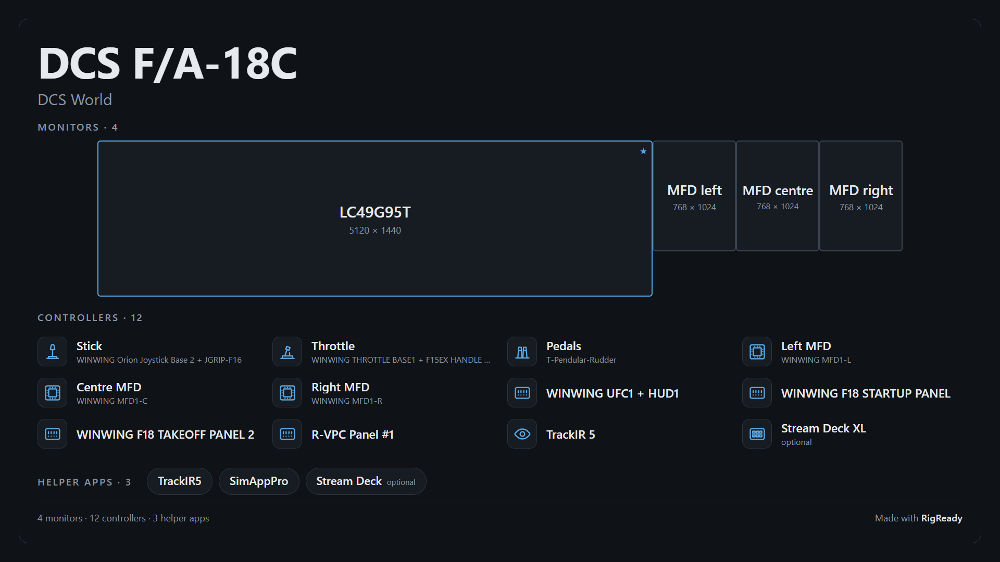
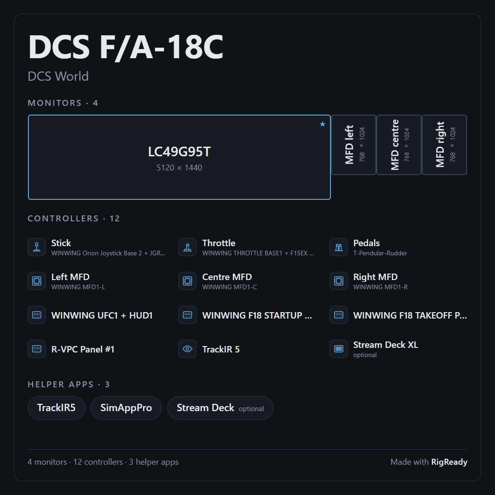

**Save a picture of this setup** on **Configure > Share** ([Share a setup](sharing.md)) makes one image of a setup to show people: the monitors drawn to scale, every controller with an icon and the name you gave it, and the helper apps. It is for a forum post, a video or a profile picture.

The picture is built from names only. No serial number, Windows user name, PC name or folder path is in it, and every text in it goes through the same [privacy review](sharing.md#the-privacy-review) as a shared setup, with everything removed.

## Making one

Choose the setup and the shape: **16:9** (1920 by 1080) for a post or a video, or **Square** (1080 by 1080) for a profile picture. The picture is drawn at once and shown on the page. What you see is the PNG that **Save picture…** writes; after saving, the page shows the file that was written and its size.

The line under the picture says what is in it: how many monitors, controllers and helper apps.

## What is drawn

- **Monitors**: from the setup's [monitor layout](../monitors-and-audio/layouts.md) check, each with its name and size, the main display marked. A setup that does not check the layout gets the monitors as they are now, and the page says so. A setup with neither says "This setup does not arrange the monitors."
- **Controllers**: one per device the setup checks, with the name you gave it on the [Devices page](../hardware/devices.md) (the hardware's own name underneath when they differ), an icon by its kind (stick, throttle, pedals, wheel, panel, screen, tracker, deck), and "optional" when the check is optional. The kind is what you said the device is on the Devices page ([Say what a device is](../hardware/devices.md#say-what-a-device-is)), or else what its name says; a kind the picture has no drawing for gets the nearest one (a yoke is drawn as a stick). Only the drawing is in the picture. A rig with more controllers than fit shows as many as fit and counts the rest.
- **Helper apps**: the apps the setup checks, by the check's title.

