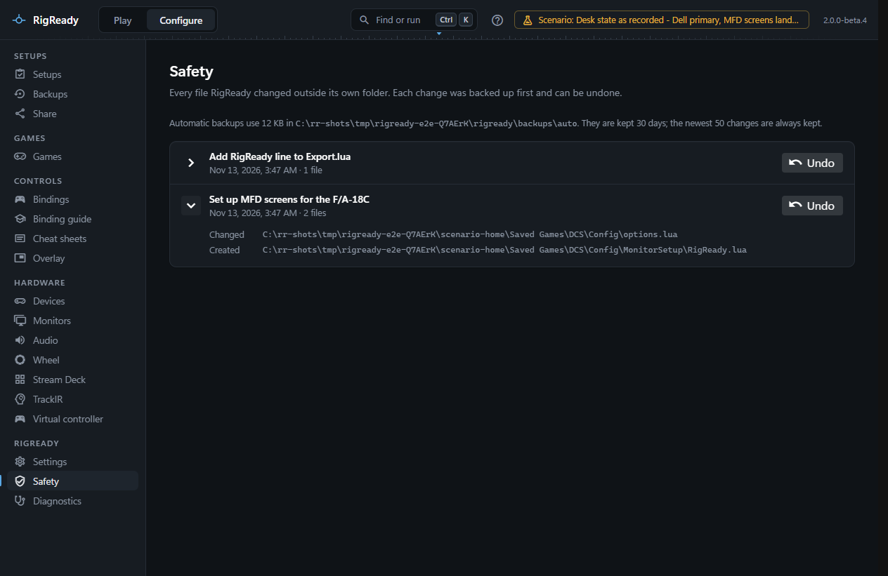
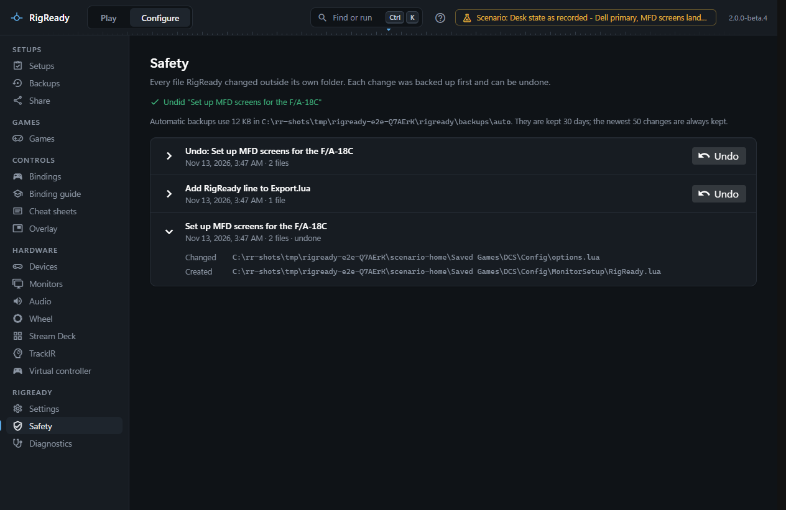

RigReady never changes a file outside its own data folder without first keeping a copy of it and writing down what it did. **Configure > Safety** is that record: every change, newest first, each with an **Undo** button.

This is the layer you do not have to think about. It covers restores, imports, snapshots put back, binding edits, the files RigReady writes for DCS, and anything else a feature writes on your behalf. A few files inside RigReady's own folder are listed too, because removing them would lose your work, for example a binding guide you delete.

## What is listed

Each row is one user action, with the words the feature used for it, for example "Restore backup "2026-10-03 14-05 Everything"", "Import shared setup "Hornet night"", "Put back snapshot "Before rebinding" of DCS bindings", or "Set the MFD screens". It shows when it happened and how many files it touched; expand it to see each file marked **Created**, **Changed** or **Deleted** with its full path.

An action an AI assistant made through RigReady's [assistant connection](../ai/safety.md) also names it, for example "by Claude Code". An action you made in RigReady names no one.

An action that has been undone is marked "undone" and loses its button. The undo itself is listed too, as "Undo: ..." with the files it put back.

The line above the list says how much space the automatic copies take, where they are (`backups\auto` under RigReady's data folder), and how long they are kept.

## How it works

Before a file is written or removed, the file as it is now is copied into `backups\auto` under RigReady's data folder, and a line is appended to the journal (`journal.jsonl`) with the path, the reason, the copy, and a checksum of the file before and after. The journal line is written before the change, so a crash in between leaves a record and never a silent edit. Changes made under one action are grouped so they are undone together. When an assistant caused the action, a further line names it; nothing else about the change or its undo differs.

A file that is not UTF-8 text (a game file in a Windows code page) is never rewritten as text, because that would damage characters in it: RigReady refuses and leaves the file as it is.

## Undo

**Undo** puts every file of that action back the way it was: a changed file gets its kept copy back, a created file is removed (and the folders that were created for it, when they are empty), a deleted file is written again. Every undo is itself recorded, so an undo can be undone.

If a file was changed again after the action, by you, by a game or by another program, RigReady refuses at first: "... was changed again after this. Undoing would discard that change." The dialog **Undo anyway?** lets you go ahead; the current content is backed up first.

## What undo cannot do

- It works on files. A change RigReady makes elsewhere is not here: applying a monitor layout has its own countdown and revert, and the Start with Windows entry is switched in Settings. RigReady never changes HidHide settings.
- RigReady's own data (setups, settings, layouts, snapshots) is not journaled, with one exception: a setup created by an import is, so undoing the import removes it. Setups are protected differently, by backups and by their YAML being editable.
- It does not close a game. While a game or tool that writes the files is running, Undo refuses and names it, as a [restore](restore.md) does: "DCS World is running (DCS.exe). DCS World may write its settings again when it exits, which would undo the restore. Close it first. Nothing was undone." Close the game, then undo.
- It needs the kept copy. Copies are removed after the retention period, and a change whose copy is gone reports "The backup file is missing".
- It does not undo what a program did after it was started, or what a game wrote itself.

## Retention

Automatic copies are kept for a number of days, and the newest number of changes are always kept whatever their age. Both are set in [Settings](../app/settings.md) under **Safety and limits** (30 days and 50 changes by default). Old copies are removed when RigReady starts; the journal lines that go with them are removed too, and lines that could not be read are never dropped.
