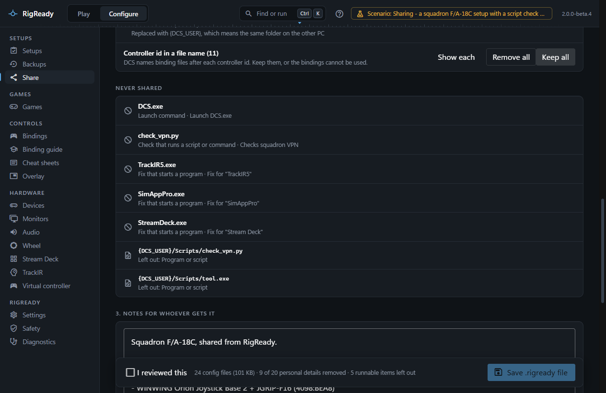
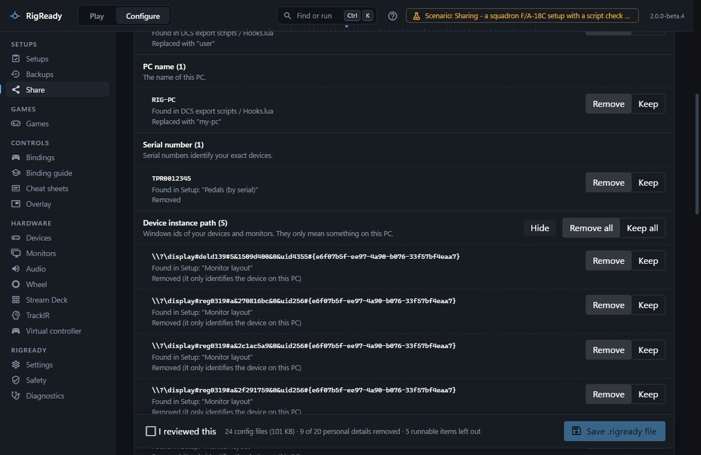
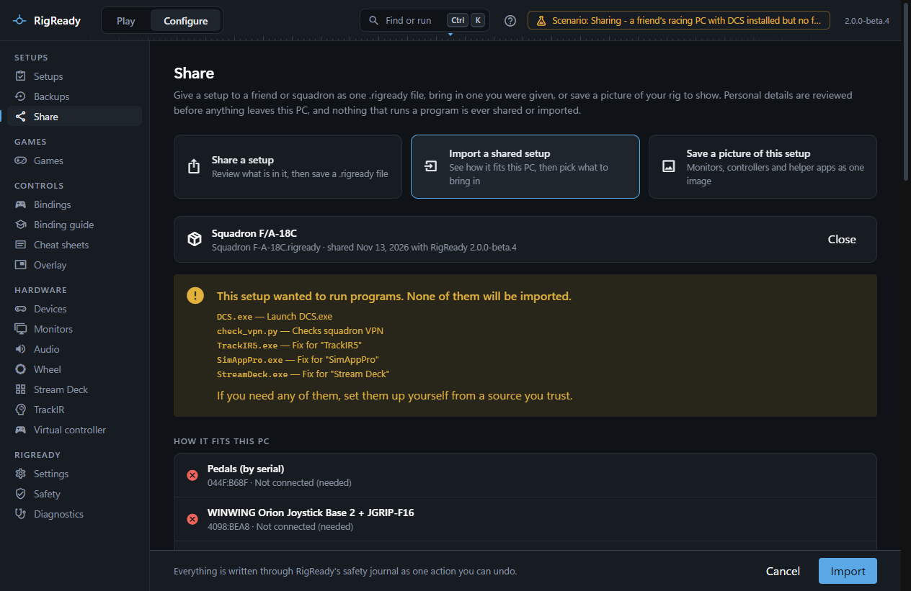
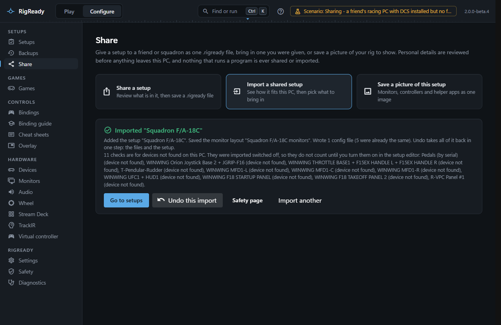

**Configure > Share** gives a setup to a friend or a squadron as one `.rigready` file, and brings in a file you were given. Personal details are reviewed before anything leaves this PC, and nothing that runs a program is ever shared or imported. [Privacy](../app/privacy.md) sums up what leaves the PC and what never does.

The page has three modes: **Share a setup**, **Import a shared setup** and **Save a picture of this setup**. The picture is described on [its own page](rig-picture.md).

## What a shared setup contains

The setup's checks (devices, apps, monitor layout, audio, files) and its monitor layout are always included. Its config files are optional: the tracked items of the setup are listed under **1. What to share**, each with its file count, and you tick the ones to send along. A setup that tracks no files says so and points to [Tracked files](tracked-files.md).

The file also carries a compatibility summary read from the checks, so the other PC can say what it is missing: the hardware by vendor and product ID, the game and the helper apps, and the monitors.

## Never shared

Anything that could run a program is removed before export and listed under **Never shared**:

- the launch command,
- checks that run a script or a command,
- fixes that start a program,
- steps before or after launch and at Stand down that run a program ([Scripts](../setups/scripts.md)).

They are named so the other person knows what to set up themselves. Files that are programs or scripts (`.exe`, `.bat`, `.ps1`, `.py`, `.dll` and the like) and credential files are left out of the config files too.

## The privacy review

**2. Privacy review** lists every personal detail found in the setup and in the files you ticked, grouped by kind, each with where it was found and a **Remove** or **Keep** choice. Groups with more than three findings fold, with **Remove all** and **Keep all**.

| Kind | Default | What Remove does |
|---|---|---|
| Windows user name | Remove | Replaced with "user" |
| PC name | Remove | Replaced with "my-pc" |
| Serial number | Remove | Removed; the check then matches the device by vendor and product ID |
| Device instance path | Remove | Removed; it only identifies the device on this PC |
| Folder path | Remove | Replaced with a [variable](../setups/path-variables.md) such as `{DCS_USER}` that means the same folder on the other PC, inside config files too |
| Audio device id | Keep | Removed; the audio check then matches by name only |
| Controller id in a file name | Keep | The file is left out. DCS names binding files after each controller id; keep them or the bindings cannot be used |
| File that cannot be checked | Keep | The file is left out. Not a text file, so RigReady cannot look inside it |

**3. Notes for whoever gets it** starts with text written from the checks: the hardware the setup needs, optional hardware, software and monitors. Edit it as you like; the notes go through the same review.

Tick **I reviewed this** and press **Save .rigready file**. The footer sums up: how many config files, how many personal details removed, how many runnable items left out. The file is written where you choose and read back to confirm it matches.

## Importing

**Open .rigready file** picks a file. It is checked completely before anything is shown: the size against the **Largest import** [setting](../app/settings.md#safety-and-limits), the number of entries, a manifest that lists every file with its checksum, a valid setup, and no program or script inside. A file that fails any of this is refused with the reason, for example "The shared setup contains a program or script".

The report then shows:

- **This setup wanted to run programs**: everything runnable that was removed when it was shared, and anything runnable still found in the file, removed now. None of it is imported. "If you need any of them, set them up yourself from a source you trust."
- **How it fits this PC**: each device the setup needs, connected or not, needed or optional; the game, installed or not and from which source; each helper app, running, installed or not found; the monitors the setup uses against the monitors here.
- **Notes from whoever shared it**.
- **What to import**: the setup, the monitor layout (saved with your other layouts), and each group of config files with its path on this PC and each file's state: new here, same as yours, or differs from yours. A group that cannot be imported says why: it names a full path instead of a known folder, its folder is not on this PC, or it would write outside Documents, Saved Games and the games' own settings folders.

For files that differ, choose **Replace mine (each is backed up first)** or **Keep mine and add theirs as (shared) copies**.

## After an import

The setup is added under its name, or with "(shared)" added when you already have one by that name. Checks for devices not found on this PC are kept but switched off and titled "(device not found)", so the setup can still be Ready and the check is one click away when the device arrives. Any fix or step that could run a program is marked to ask for confirmation first, whatever the file said.

Everything an import writes is one change on [the Safety page](safety-page.md). **Undo this import** takes all of it back in one step: the files and the setup. When a file was edited since, it asks before undoing.

Imported DCS binding files that name controllers this PC does not use are reported with a button to **Bindings > Device IDs** ([Device IDs changed](../dcs/device-ids.md)), as after a [restore](restore.md).

