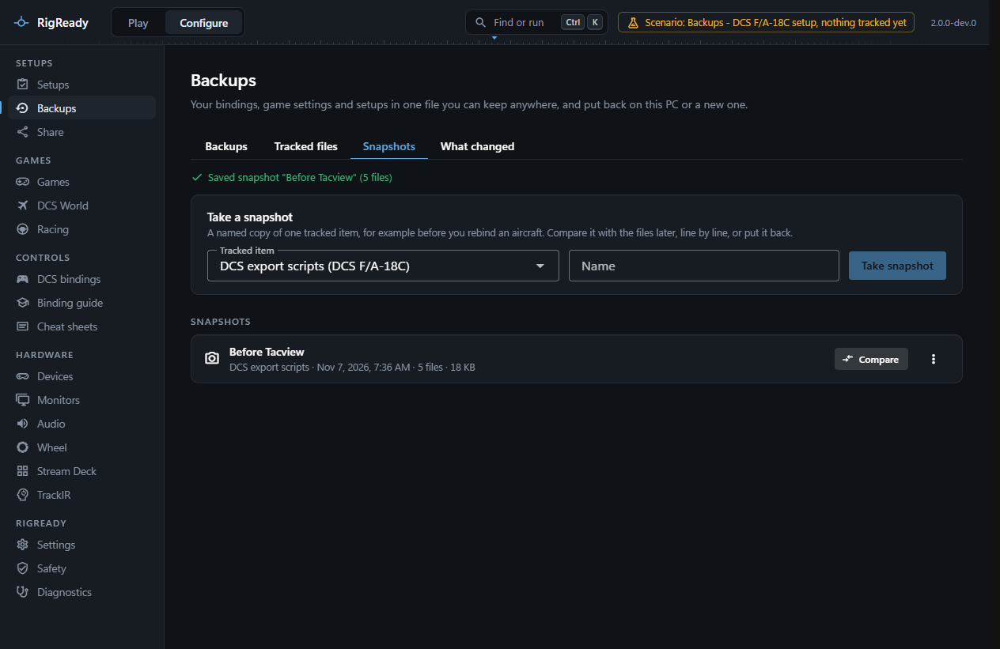
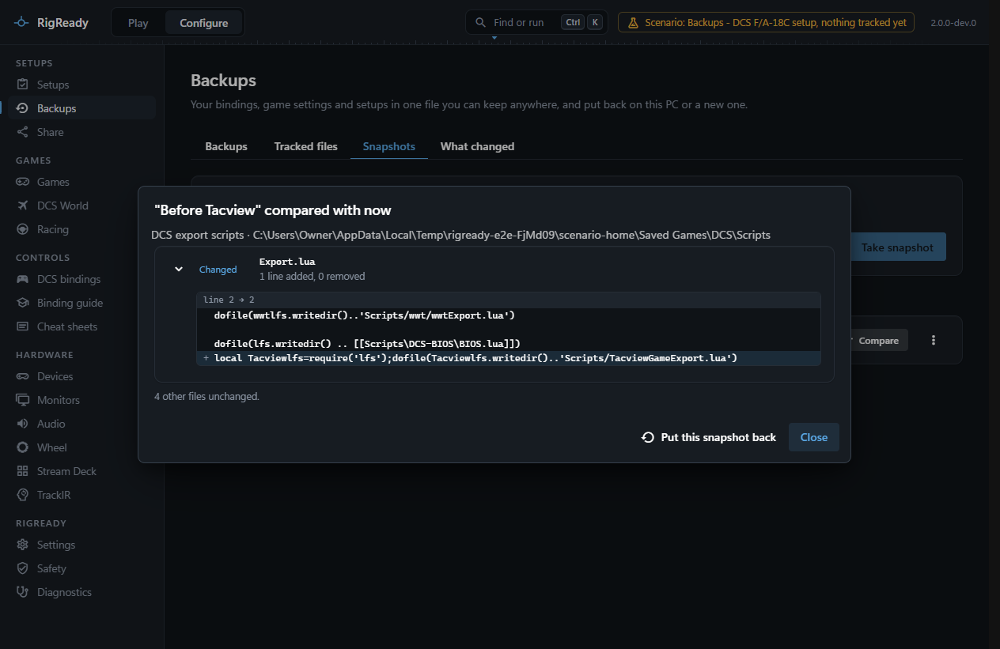

A snapshot keeps one tracked item exactly as it is at one moment: the bindings of an aircraft before you rebind the throttle, a game's settings before you try new graphics options. Later you compare it with the files as they are, line by line, or put it back.

Snapshots are on the **Snapshots** tab of **Configure > Backups** ([Backups](backups.md)). They are smaller and quicker than a backup, and they are about one item only. The DCS bindings page keeps snapshots of its own, of the binding files only: see [Copy between aircraft and snapshots](../dcs/copy-and-snapshots.md).

## Take a snapshot

Under **Take a snapshot**, choose the tracked item (each is listed with the list it belongs to), give the snapshot a name of up to 80 characters, and press **Take snapshot**. Every file the item covers is copied into [RigReady's data folder](../app/index.md); the page confirms the name and the number of files.

An item that is tracked but has no files on this PC cannot be snapshotted, and an item whose folder cannot be found says why. If nothing is tracked yet, the tab sends you to [Tracked files](tracked-files.md) first.

## Compare

**Compare** on a snapshot opens the comparison with the files now. For each file that differs it says added, removed or changed, and for text files shows the changed lines. Files that are not text are only marked changed. When nothing differs: "The files are exactly as they were in this snapshot."

## Put back

**Put back…** in the row's menu, or **Put this snapshot back** in the comparison, opens a confirmation that lists exactly which files would be written and how each changes. Only files that differ from the snapshot or are missing are written; files added since the snapshot are left alone. Each file that is replaced is backed up first, and the whole put-back is one change on [the Safety page](safety-page.md).

Every file is read back after writing and compared with the snapshot. The result line says how many files were put back and how many newer files were left as they are.

A put-back is refused while the game or tool that owns the files is running, because it would write them again on exit: "Close it first. Nothing was put back." ([Close the game first](restore.md#close-the-game-first))

## Rename and delete

**Rename** changes the name. **Delete** removes the snapshot; your files are not touched. Stored copies that no snapshot needs any more are cleaned up at that point.

## Where snapshots live

Snapshots are kept in RigReady's data folder, with each file stored once by its content, so ten snapshots of the same unchanged file take the space of one.

Every full [backup](backups.md) holds your snapshots with the stored copies of their files, so they travel to another PC with the rest. On the [restore page](restore.md) each snapshot is a row of its own under **Setups, settings, snapshots and records**, new, the same or different compared with the snapshots on this PC, with the same choices as a setup: replace, skip, or keep both under its name with "(restored)" added. The stored copies count towards the 2 GB one backup can hold.
