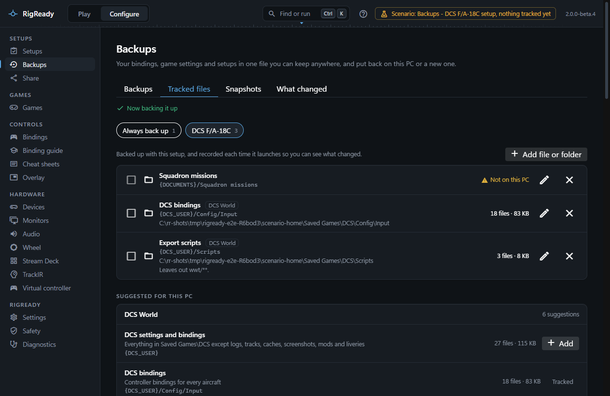
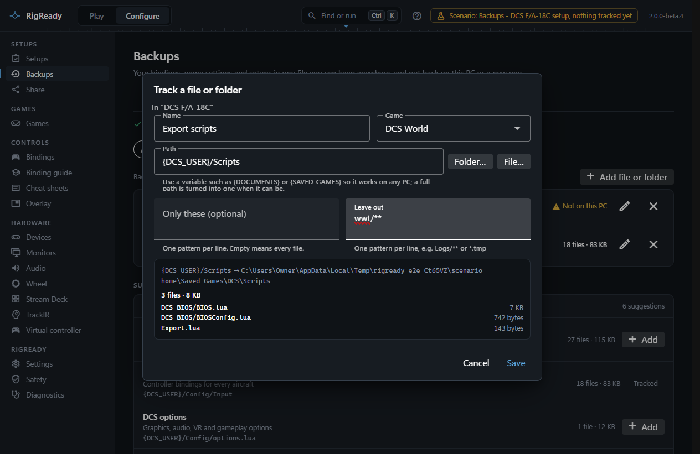

A backup holds what is tracked. The **Tracked files** tab of **Configure > Backups** shows that list, offers what the games and tools on this PC keep, and lets you add files and folders of your own.

Tracked items are also what [snapshots](snapshots.md) are taken of, what [what changed](what-changed.md) records, and what a [shared setup](sharing.md) can carry along.

## Two kinds of list

The chips at the top switch between lists:

- **Always back up** is backed up with every full backup, whichever setup you use. Put things that belong to no particular setup here: Stream Deck profiles, TrackIR settings, a tool's configuration.
- Each **setup** has its own list. These items are backed up with the setup, and they are recorded each time the setup's game starts so you can see what changed.

A backup of one setup takes the setup's own list; a full backup takes every list.

## What a tracked item is

An item is a file or a folder, with a name, an optional game it belongs to, and for a folder two sets of patterns:

- **Only these (optional)**: patterns for the files to include, one per line, for example `**/*.lua`. Empty means every file.
- **Leave out**: patterns for files to skip, for example `Logs/**` or `*.tmp`.

Patterns are matched against the path below the folder, with forward slashes. The row of an item shows them as "Only ..." and "Leaves out ...".

Each row shows the stored path, where that is on this PC, and what it covers right now: "340 files · 12.4 MB", or **Not on this PC** when nothing is there, or the problem when the path cannot be resolved. A row also says how many credential files in it are never copied.

The pencil edits an item; the cross stops tracking it. Nothing on disk is deleted either way: "Stopped backing up ... Nothing was deleted."

Tick one or more items and **Back up N selected items** makes a backup of just those, listed as "Selected items" on the Backups tab.

## Suggestions

**Suggested for this PC** lists what the games and tools RigReady knows keep on this PC, grouped by source. Only suggestions that exist here are shown. Each has a short description, its path, and what it covers now; **Add** tracks it in the list that is selected, and a suggestion already tracked there says "Tracked". Groups show three rows and a **Show all** button, because a game suggests its whole folder first and then its single files.

What is suggested, when it is found:

- **DCS World**: "DCS settings and bindings" (everything in `Saved Games\DCS` except logs, tracks, caches, screenshots, movies, mods and liveries), and separately the bindings, `options.lua`, the monitor setups, the export scripts and your kneeboard pages.
- **DCS bindings by aircraft**: one item per aircraft that has bindings of its own, for a setup that is about one aircraft.
- **iRacing**, **Le Mans Ultimate**, **BeamNG.drive**, **Assetto Corsa**, **Assetto Corsa EVO**, **Assetto Corsa Rally** and **Microsoft Flight Simulator 2024**: the game's settings folder as a whole, then its bindings, calibration, graphics, audio and other files one by one, each named by what it holds (for example "Bindings (controls.cfg)" for iRacing).
- **Stream Deck**: the profiles, the plugin list (only the manifests, so the plugins can be installed again), and the plugins as whole folders, which are large.
- **TrackIR**: the settings, the game-to-profile map and every profile.
- **Fanatec**: the Fanatec App's own preferences. The driver settings in the registry are not a file; a full backup keeps them as a record instead (see [backups](backups.md)).

## Adding your own

**Add file or folder** opens the editor. Give the item a name, pick the game it belongs to if any, and enter a path or use **Folder…** or **File…** to choose one.

Paths are stored with a variable where one fits, so the item means the same place on another PC or under another Windows account: `{DCS_USER}/Config/Input` rather than `C:\Users\you\Saved Games\DCS\Config\Input`. A full path you type is turned into one of these when it can be, and you can type a variable yourself. [Path variables](../setups/path-variables.md) lists them all.

Below the fields, a preview lists the files the item covers right now with their sizes. A path that does not exist yet is accepted: "Nothing is there on this PC right now. It is still saved and backed up when it appears." Credential files in the folder are named as never backed up.

Some paths are refused:

- RigReady's own data folder: it is part of every full backup already.
- A path outside the folders RigReady may use (Documents, Saved Games, AppData, the Steam libraries and the game folders) when typed by hand. Choosing it with **Browse** is your own say-so and is accepted.
- A file that holds credentials.
- A folder of more than 20,000 files cannot be listed; narrow it with patterns.

