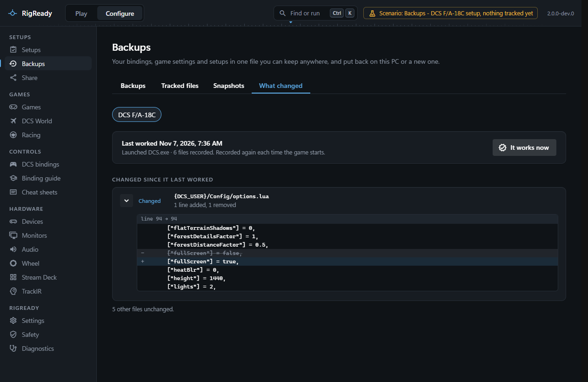

Something worked last week and does not today. The **What changed** tab of **Configure > Backups** ([Backups](backups.md)) answers the first question: which of the files you track are different from the last time the game was started, and what exactly changed in them.

This works for any setup that tracks files. See [tracked files](tracked-files.md) for how to add them.

## How the record is made

RigReady looks at the running programs every few seconds. When the program a setup launches starts, or the game its [game module](../games/index.md) knows, RigReady records the setup's tracked files at that moment: the setup's own items and the **Always back up** list. It does not matter how the game was started: from RigReady, from Steam or from a [desktop shortcut](../one-click/desktop-shortcut.md). When several setups match the same game, the one used last is recorded, or all of them when the one used last is not among them.

For text files up to 1 MB the content is kept, so the comparison can show the lines. Larger files and files that are not text are recorded by their checksum only, so for them the page can say "changed" but not what changed.

You can also record by hand. **It works now** records the files at this moment, with the reason "Marked as working".

## Reading the page

Choose a setup with the chips. The panel says when the setup last worked, why it was recorded ("Launched DCS.exe" or "Marked as working") and how many files were recorded. "Not recorded yet" means the game has not started since the files were tracked; record now if everything works.

**Changed since it last worked** lists every file that was added, removed or changed, and for text files shows the changed lines. When every tracked file is exactly as it was: "Nothing changed". A file whose earlier version was not kept says so.

## Getting the old version back

This tab compares; it does not restore. To put an earlier version back, use a [snapshot](snapshots.md) you took, or [restore](restore.md) the file from a backup. The comparison tells you which file to look for.

## The record in a backup

A full [backup](backups.md) holds the record of every setup, with the stored copies of the text files it kept, so "what changed" still works after a move to another PC or a fresh install. On the [restore page](restore.md) each record is a row under **Setups, settings, snapshots and records**, named after its setup and compared with the record on this PC. There is one record per setup, so a record that differs can be replaced or skipped; there is no keeping both.
