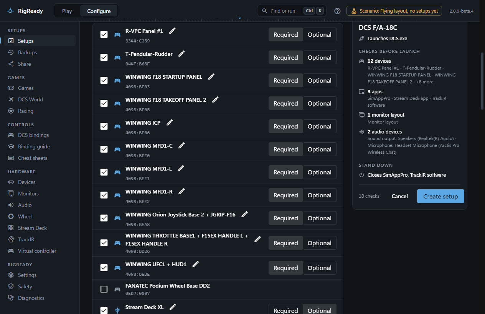
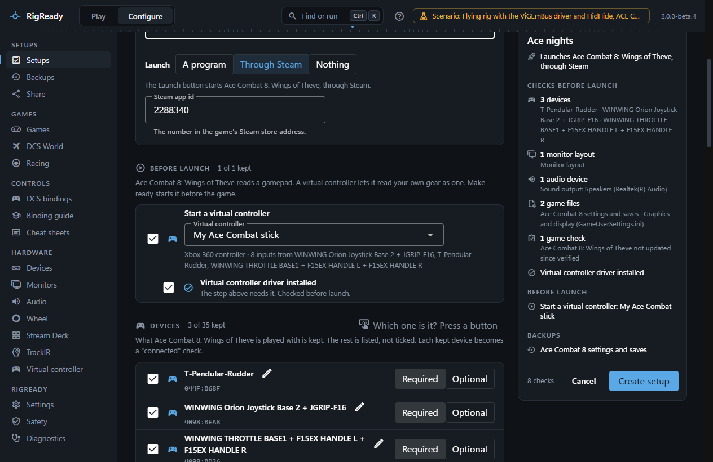
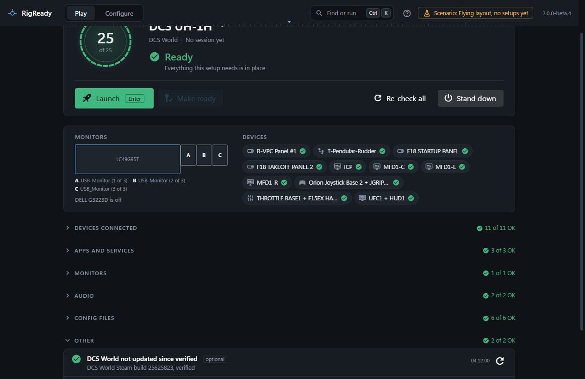

A setup is captured, not typed in. Get the rig the way you fly or race: gear plugged in, helper apps running, monitors arranged, the right headset as the default. Then **Configure > Setups > New setup from this rig** reads the machine and lists what it found, section by section. Everything that stays ticked becomes a check on the [Play screen](../play/index.md), with a fix where RigReady has one. The first capture is walked through on [Your first setup](../getting-started/first-setup.md).

## Game

The games RigReady found on this PC are tiles; one says "running now" when it is. **Another game** is for a game RigReady has no module for: you name it and say what to launch. **No game** just checks the rig.

RigReady suggests a game when the PC says so clearly: the game that is running, the only installed sim of the family your controllers belong to (flight or racing), or the only one you have bindings for. The reason is written under the tiles.

A known game brings its launch program, its aircraft or cars (from your bindings, as chips: choose one and the setup is named after it, for example "DCS F/A-18C"), its config files and its own checks. For a game installed more than once, **Install this setup uses** picks one. **Launch** has the same three choices as the editor: **A program** (Program, Arguments and Working folder, with **Browse…**), **Through Steam** (the game's **Steam app id**) and **Nothing**. A game Steam starts comes on **Through Steam** with its number filled in. With **Nothing**, or with nothing filled in, the Play screen has no Launch button. See [Launch targets and steps](launch.md), and [Path variables](path-variables.md) for what **Install this setup uses** changes.

## The sections

Each section lists what was found, with a tick per line and a count of what is kept.

- **Devices**: what the chosen game is played with is kept, and each kept device becomes a "connected" check. For a flight sim that is the stick, throttle, pedals, panels and head tracker; for a racing game, the wheel, pedals and shifter. The rest of the rig is listed and not ticked, one click away. Gear RigReady cannot place (a home-built controller, say) is ticked for either kind of game. Say what it is and what it is used for on the [Devices page](../hardware/devices.md#say-what-a-device-is): what you say there comes before the device's name and its maker. With no game chosen, every game controller is kept. A virtual controller that RigReady itself has switched on is not part of the rig and is not listed. Keyboards, mice and other USB devices are behind **Show N other USB devices**. Identical devices are marked "1 of 3 identical" and told apart by serial number or, failing that, by USB port. **Which one is it? Press a button** lights up the line of the controller you press ([Devices](../hardware/devices.md)). A kept device can be renamed with the pencil; the name is what the Play screen shows.
- **Apps**: helpers for the chosen game that are running now (SimAppPro, SimHub, Crew Chief, VoiceAttack and the like) are listed first and kept. A program that runs gear the game does not read is listed, not kept, even while it is running: the head tracker's program for a racing game, for example. A helper made for one game is kept for that game only: DCS-SRS is kept for DCS World and listed, not kept, for another flight sim. Voice chat, streaming and overlay programs are listed but not kept; everything else that is running is behind **Show N other running apps**. **Find an app** searches all of them. A helper that is only useful in the sim is marked "closed at Stand down" ([Stand down](../play/stand-down.md)). [Make ready](../play/make-ready-and-launch.md) starts a kept app when it is missing, from the path it was found at.
- **Monitors**: the arrangement as it is now, drawn to scale. Make ready puts it back. When the arrangement is not already one of your saved layouts, the line has a field, **Save this arrangement as a layout named**: with a name, the arrangement is also saved on the Monitors page ([Monitor layouts](../monitors-and-audio/layouts.md)), so other setups can share it and a change to the saved layout reaches every setup that uses it. When it is a saved layout already, the line says which.
- **Audio**: the default playback and recording devices as they are now. Make ready sets them again ([Audio](../monitors-and-audio/audio.md)).
- **Game files**: the config files the chosen game's module tracks, checked before every launch so a missing file shows before the game loads.
- **Game checks**: what only this game needs, for example [SimAppPro](../dcs/simapppro.md) for WinWing panels, the [Export.lua](../dcs/export-lua.md) tools, the [DCS monitor setup](../dcs/screens.md), the [iRacing](../games/iracing.md) helper service, or "not updated since verified". The rotation a wheel's driver last recorded is listed and not ticked: many people change it from car to car, or let the game set it. Tick it if you want the same rotation checked before every launch. [Checks and fixes](checks.md) lists every kind.

What belongs to another game, or to another aircraft or car, is not shown. A helper of the other family (a wheel app in a flight setup) is listed but not kept unless you tick it. Ticks you set by hand stay when you change the game.

## Before launch

A game that reads a gamepad and not sim gear (Ace Combat 8, for example) gets one more section, **Before launch**, with the step **Start a virtual controller**. Choose which of your virtual controllers it starts, by name. The line under the list says what kind of controller it is and which gear feeds it. The one in use now comes chosen, or the only one you have. Without a choice the step is not kept.

The step cannot work without the driver for virtual controllers, so the check **Virtual controller driver installed** comes with it, ticked, on its own line under the step. Untick it if you do not want it checked before every launch.

Make ready starts the controller before the game, and the [Play screen](../play/make-ready-and-launch.md) says so before you click Launch. With no virtual controller of your own yet, make one on [Virtual controller](../hardware/virtual-controller.md) first.

## Required or optional

Every kept line has **Required** or **Optional**. A required check that is not met makes the rig Not ready; an optional one only warns, and the rig is still Ready. Mark as optional what is nice to have: a second button box, a streaming app, a check that depends on something you do not always use.

## Back up with this setup

Below the checks: the files and folders the Backups page can keep for this setup. The game's own settings folder is kept by default; what helper tools keep is one click away. Nothing is copied now; see [Tracked files](../protect/tracked-files.md).

## The summary and Create setup

The panel on the right shows the setup so far: its name, what Launch starts, the checks by section, what Stand down will close, and what is backed up. **Create setup** needs only a name; a setup with nothing kept is still a valid start. The new setup opens on the Play screen and becomes the setup in use. Everything can be changed later in [the setup editor](editor.md).

