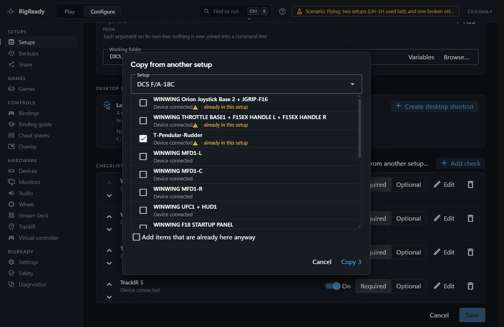
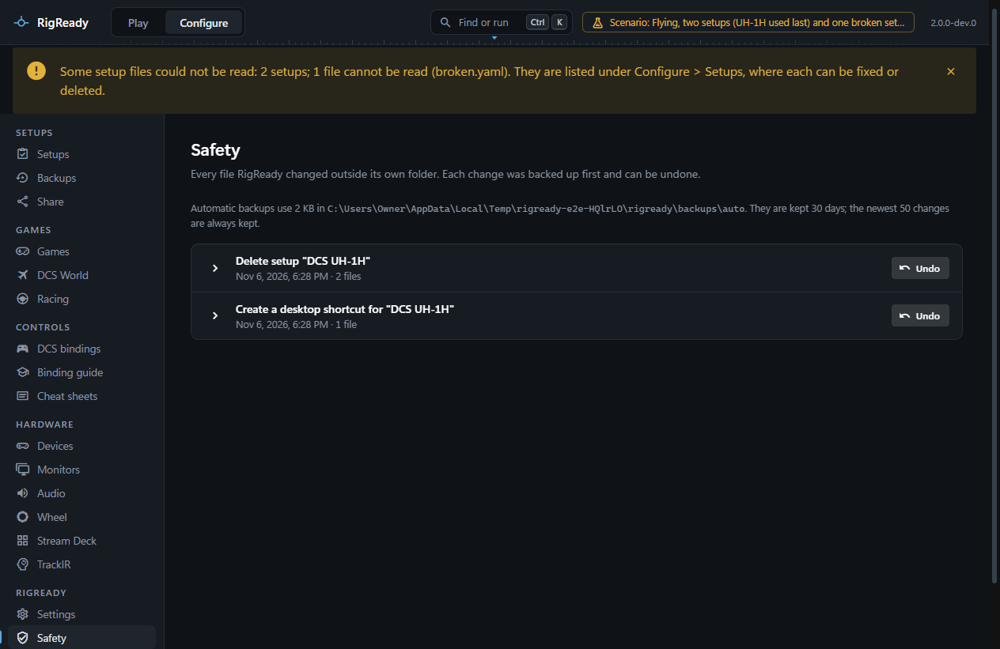

Setups are usually alike: the same gear, the same helper apps, a different aircraft. Rather than capturing the rig again, clone a setup or copy items between setups.

## Clone

**Clone** on the Setups page makes a complete copy named "<name> (copy)" with a new id, and opens it in the editor so you can give it its own name. Nothing is shared with the original: changing one never changes the other. The copy has no desktop shortcut of its own until you make one.

## Copy from another setup

In the editor, **Copy from another setup…** above the checklist opens a dialog: choose the setup to copy from, then tick the checks and the steps (before launch, after launch, at Stand down) you want. An item that is already in this setup, meaning the same kind of check with the same target (the same program, device, file, service or game), is marked "already in this setup" and skipped, unless you tick **Add items that are already here anyway**. Copied items get new ids. The dialog says what it did ("Copied 3 items from "DCS F/A-18C"; skipped 1 already here. Save to keep them."); nothing is written until you save.

## Delete

**Delete…** in a setup's menu on the Setups page asks first: "The setup is removed from RigReady; a copy is kept and the Safety page can bring it back. Nothing on the rig or in any game changes, and monitor layouts and backups stay." The file is removed, and the removal is recorded like any change RigReady makes, so **Configure > Safety** lists it with **Undo** ([Protect](../protect/index.md)). A broken file and a file from RigReady 1 can be deleted the same way.

If the deleted setup was the one on the Play screen, the screen moves to the first setup in the list.

## What a delete leaves behind

- The desktop shortcut, if the setup had one. Deleting a setup does not touch the desktop. Remove the shortcut in the editor before deleting, or delete the `.lnk` file by hand; a double-click on it afterwards opens RigReady with "There is no setup ..." ([Desktop shortcut](../one-click/desktop-shortcut.md)).
- The saved monitor layouts and the backups the setup used; other setups may use them.
- The session history: sessions of the deleted setup stay in History under its name.
