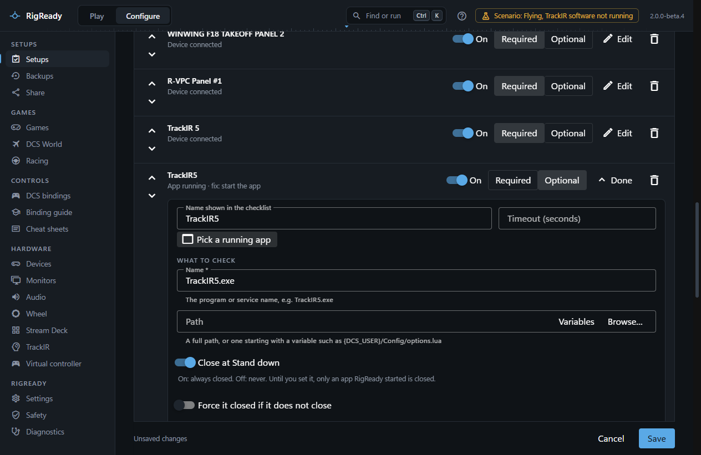
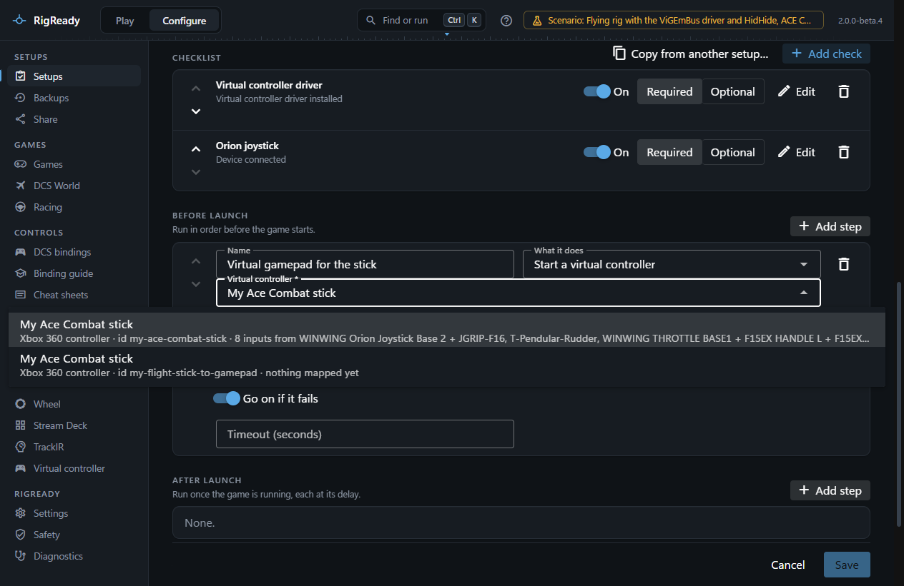
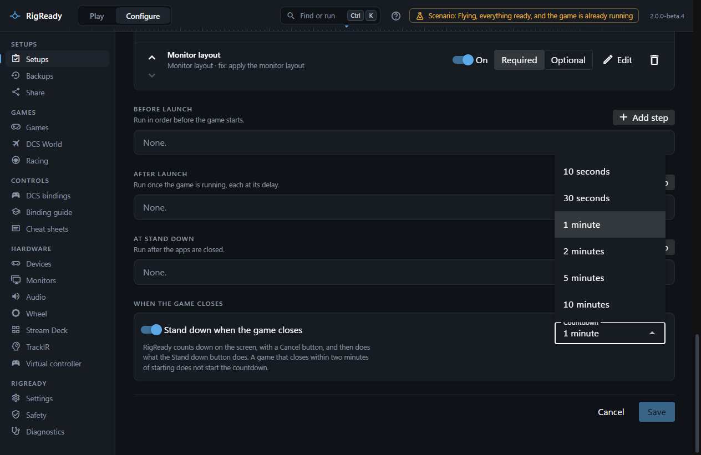

**Configure > Setups > Edit** opens a setup. Everything a setup holds is on this one page, top to bottom. Nothing is written until **Save**.

## YAML file

The button at the top right opens the setup's file **in your editor** or shows it **in Explorer**. RigReady picks up a change to the file when you save it there; see [Hand-editing the YAML](yaml.md).

## Setup

- **Name**: what the [Play screen](../play/index.md), the [tray](../one-click/tray.md) and the shortcut call it, up to 80 characters. The id in the file name does not change when you rename.
- **Game**: no particular game, a game RigReady knows (marked "not found on this PC" when it is not installed), or **Other game…** with a **Game name**. Choosing a known game fills in what Launch starts, when nothing was chosen yet.
- **Install this setup uses**: shown when the game is installed more than once (DCS stable and open beta). Its folders are then what the game's path variables (`{DCS_INSTALL}` and `{DCS_USER}` for DCS) mean for this setup's checks, fixes and launch; see [Path variables](path-variables.md).
- **Notes**: a line or two for yourself.

## Launch

**A program**, **Through Steam** or **Nothing**. For a program: the executable (path variables allowed, **Browse…**), the arguments as a list, and the working folder; "Found on this PC" offers the game's own program with **Use it**. For Steam: the **Steam app id**, the number in the game's store address. A setup that hands its game to Steam opens as **Through Steam** with the number filled in, also when it was made by **New setup from this rig**. With Nothing the Play screen has no Launch button. Details on [Launch targets and steps](launch.md).

## Desktop shortcut

Whether this setup has a shortcut on the desktop, and the buttons to make, update or remove it. It takes the name and the launch from the saved setup, so it waits for a save after you change either. See [Desktop shortcut](../one-click/desktop-shortcut.md).

## Checklist

The checks, in the order the Play screen shows them within each group. Each line has:

- Arrows to move it up or down.
- Its name, its kind ("App running", "Config file content") and its fix, if any.
- **On** / **Off**. An item that is off stays in the setup but is not checked, not counted, not fixed by Make ready and left alone by [Stand down](../play/stand-down.md). The Play screen shows it as "off".
- **Required** / **Optional**. A check that only ever warns (such as the game-updated check) has this greyed.
- **Edit** opens the item; **Done** closes it. The bin removes it.

**Add check** lists every check type by group ([Checks and fixes](checks.md)). **Copy from another setup…** brings checks and steps over from another setup ([Clone, copy and delete](clone-copy-delete.md)).

An open item has:

- **Name shown in the checklist**, and **Timeout (seconds)** for this item in place of the limit in [Settings](../app/settings.md#safety-and-limits).
- Pickers for the common kinds: **Pick a connected device** (identical devices get their serial number or USB port added, so they are told apart; see [Devices](../hardware/devices.md)) and **Press a button on it** for a device check; **Pick a running app** for an app check, which also fills in the fix with the app's path; **Pick a service** for a Windows service.
- **What to check**: the fields of the check type. The path, program and folder fields have **Browse…**, which stores the path with a variable where one applies.
- **Lists by name**: what RigReady can list is chosen from a list and never typed as an id: a saved monitor layout, a virtual controller, a game, an audio device, saved bindings, an aircraft, a Stream Deck. The line under the list says what the chosen one is. Two virtual controllers of the same name show what each is made of and its id, so they can be told apart. Saved bindings of two games with the same name are two lines, each with its game under the name. An empty list says where to make the first one. When what the setup uses is no longer in the list, it stays there marked "(no longer in the list)" until you choose another.
- A check chosen from a list is named after the choice ("Monitor layout: Flying") until you type a name of your own.
- **Fix**: **What Make ready does when this is not met** ([Make ready and launch](../play/make-ready-and-launch.md)), chosen from the fixes that suit this check type, and the fix's own fields. Some fixes have a helper button, for example **Keep a copy of the file as it is now** for a restore, which saves a known-good copy the fix can later put back. A fix that goes with one check is added with it: **Add check > Monitor layout** brings **Apply the monitor layout**. Such a fix takes what was chosen in the check and says so ("Uses the layout chosen above."), so nothing is asked twice.

## Before launch, After launch, At Stand down

Three lists of steps, each with **Add step**. A step is any fix type that does something: start a program, run a [script](scripts.md), apply a monitor layout, set the default audio device, start TrackIR. A new step is named after what it does ("Start the app") and follows the type you choose for it until you type a name of your own. Each step has a name, what it does and its fields, plus:

- **Go on if it fails**, on by default. Off: a failure before launch pauses the launch and asks.
- **Wait until it finishes**: scripts wait by default, programs do not.
- **No console window**, for scripts, on by default.
- **Close it at Stand down**, for programs, on by default.
- **Timeout (seconds)**, 30 by default.
- **Seconds after the game starts**, for a step after launch.

A step that needs a choice from a list, such as which virtual controller to start, is not saved without one. The step then says "Virtual controller: choose one from the list."

What each list means is on [Launch targets and steps](launch.md).

## When the game closes

- **Stand down when the game closes**, on by default. When this setup's game has closed, RigReady counts down on the screen, with a Cancel button, and then does what the Stand down button does. Off: nothing is closed by itself.
- **Countdown**: how long that countdown is. One minute by default; the list goes from 10 seconds to 10 minutes.

Every setup has its own answer. What the countdown looks like, and when it does not start, is on [Stand down](../play/stand-down.md#stand-down-when-the-game-closes).

## Saving

**Save** is enabled once something changed; "Unsaved changes" says so at the bottom. A save checks every field: a check or step whose fields are wrong is opened and the problems are listed ("c3 "TrackIR" fix: exe: Too small"), and a path with an unknown variable is refused. A file that holds hand-written YAML comments warns **Your comments will be lost** before it is overwritten. **Cancel** asks before discarding changes. The Play screen picks up a saved setup at once.
