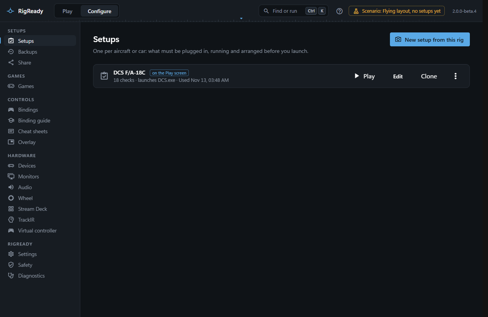

A setup is one "ready state": one aircraft or car, with everything the rig needs before you launch it. The [Play screen](../play/index.md) checks a setup, [Make ready](../play/make-ready-and-launch.md) fixes what it can, and Launch starts what the setup says. You make one per aircraft or car, because a Hornet and an iRacing evening want different gear, helper apps, monitors and files. A session can also start from a [desktop shortcut](../one-click/desktop-shortcut.md) per setup.

## What a setup holds

- A name, the game it is for (a game RigReady knows, "other" with a name of your own, or no particular game), notes, and for a game installed more than once the install it uses.
- **Checks**, grouped as the Play screen shows them: devices connected, apps and services, monitors, audio, config files, other. Each is required or optional, can be switched off, and may carry a fix. [Checks](checks.md) lists every kind.
- What **Launch** starts: a program with arguments, a Steam app id, or nothing. See [Launch targets and steps](launch.md).
- Steps **Before launch**, **After launch** and **At Stand down** ([Stand down](../play/stand-down.md) says what runs at the end of a session).
- The files and folders the Backups page keeps for this setup ([Tracked files](../protect/tracked-files.md)), and other data features keep with it.

## Where setups live

Each setup is one YAML file: `~/.rigready/profiles/<id>.yaml`, where `~` is your user folder (`C:\Users\<you>`) and the id is made from the name ("DCS F/A-18C" becomes `dcs-f-a-18c`). Set the `RIGREADY_HOME` environment variable to keep RigReady's data somewhere else ([The app and its data folder](../app/index.md)). Which setup is in use is kept in `state.json` next to the folder.

The file is yours to read and edit; RigReady notices a change within about two seconds. See [Hand-editing the YAML](yaml.md).

## The Setups page

**Configure > Setups** lists every setup with its game, how many checks it has, what it launches and when it was last used; the one on the Play screen is marked. Each has **Play** (makes it the setup in use and goes to the Play screen), **Edit** ([The setup editor](editor.md)), **Clone** and a menu with **Open the YAML file**, **Show in Explorer** and **Delete…** ([Clone, copy and delete](clone-copy-delete.md)). Files that cannot be read are listed with the reason ([A setup file cannot be read](../troubleshooting/setup-file-cannot-be-read.md)), and files left by RigReady 1 are listed apart under **From RigReady 1** ([Files from RigReady 1](yaml.md#files-from-rigready-1)).

**New setup from this rig** is how a setup is made: RigReady reads the rig as it is and proposes the checks. See [Creating a setup from the rig](capture.md).

## In this section

- [Creating a setup from the rig](capture.md)
- [The setup editor](editor.md)
- [Checks](checks.md)
- [Launch targets and steps](launch.md)
- [Scripts](scripts.md)
- [Path variables](path-variables.md)
- [Hand-editing the YAML](yaml.md)
- [Clone, copy and delete](clone-copy-delete.md)
