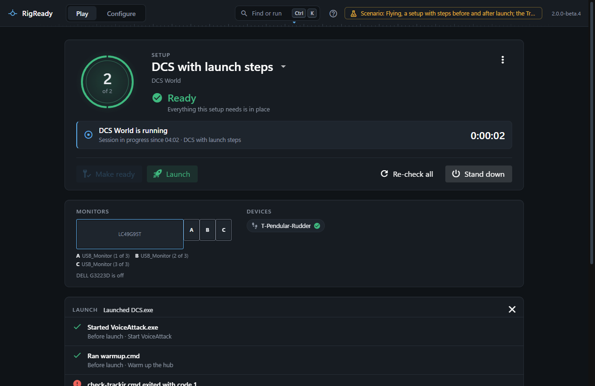

The Launch section of a setup says what the Launch button starts. The three lists of steps say what runs around it.

## A program

The program's path (a path variable such as `{DCS_INSTALL}/bin/DCS.exe` keeps it portable), its arguments, and a working folder. Each argument is passed as it is; nothing from the setup is ever joined into a command line ([Path variables](path-variables.md) says what `{DCS_INSTALL}` and the others mean). For a game RigReady knows, the editor offers the program it found with **Use it**.

Launch starts the program and waits up to 30 seconds for it to appear in the list of running programs. Only then does it say "Launched DCS.exe". A program that is not where the setup says fails with "DCS.exe not found at ...". When the setup names an install that is gone, Launch says so and never starts another install in its place.

## Through Steam

A **Steam app id** (the number in the game's store address: 244210 for Assetto Corsa, 223750 for DCS World) makes Launch ask Steam to start the game, through `steam://rungameid/<id>`. Steam must be installed. The result is "Asked Steam to start DCS F/A-18C": Steam does the rest, after an update or a sign-in if it needs one. RigReady then waits for the game's own program, which it knows from the [game module](../games/index.md), for up to fifteen minutes before it gives up on the session ([Sessions and history](../play/sessions.md)). A launch program whose file is `steam.exe` counts the same way. When its arguments are `-applaunch` and the number, which is how a new setup for a Steam game is saved, [the setup editor](editor.md) shows the setup as **Through Steam**.

## Nothing

A setup with nothing to launch has no Launch button; Make ready is its main action, and its [desktop shortcut](../one-click/desktop-shortcut.md) only makes the rig ready.

## Steps before launch

They run in order, before the game starts. The [Play screen](../play/make-ready-and-launch.md#the-launch-itself) names them under its buttons before you click Launch. Each step is a fix type that does something: start a program, run a script, apply a layout, set an audio device, start TrackIR. Options:

- **Go on if it fails**, on by default. Off: when the step fails the launch pauses with **A step before launch failed**, showing the step's output, and asks **Launch anyway** (the launch goes on after that step) or **Cancel**. Nothing is ever silently launched or silently abandoned.
- **Wait until it finishes**: a script waits by default and its exit code is judged; a program does not wait by default, RigReady only waits for it to appear (10 seconds unless the step says otherwise). With it on for a program, the launch waits until the program has exited, within the timeout.
- **Timeout (seconds)**, 30 by default, up to an hour. A step past its timeout counts as failed.
- **Close it at Stand down**, for a program, on by default: Stand down closes what the step started.

A step that runs a script you have to confirm is shown to you before the run starts ([Scripts](scripts.md)); from the [tray](../one-click/tray.md) or a shortcut such a step is skipped and reported.

## Steps after launch

They run once the game is running, each at its **Seconds after the game starts**, in the background. The [Play screen](../play/index.md) lists them as they go. A failure is reported and logged, and never touches the game.

## Steps at Stand down

They run when you [stand down](../play/stand-down.md), after the apps are closed and before the desk layout is applied, in order. Pressing Stand down counts as your OK, so a script here is not asked about again.

## Holding a launch

- **Do not launch** in the strip at the bottom of the window, while a shortcut, the [Jump List](../one-click/taskbar.md) or `--launch` ([The command line](../one-click/command-line.md)) is making the rig ready: the fixes finish, the game is not started.
- **Cancel** in the paused-step dialog.
- After **Make ready and launch** stopped because something required is still missing, nothing happens until you press **Launch anyway** or fix the item. See [Make ready and launch](../play/make-ready-and-launch.md).

## What runs with what rights

Everything RigReady starts, the game included, runs as you, with no elevation; RigReady never asks for administrator rights. That is why a Windows service has no automatic start. Scripts get the setup's details as environment variables, never as text in a command line ([Scripts](scripts.md)).
