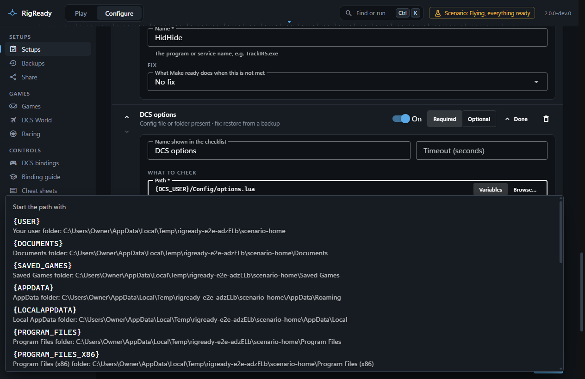

A path in a setup can start with a variable in braces: `{DCS_USER}/Config/options.lua` instead of `C:\Users\Owner\Saved Games\DCS\Config\options.lua`. The setup then means the right file on another PC or under another Windows account, and a shared setup carries no user name.

## The variables

On every PC:

| Variable | What it means |
| --- | --- |
| `{USER}` | Your user folder, `C:\Users\<you>` |
| `{DOCUMENTS}` | Your Documents folder |
| `{SAVED_GAMES}` | Your Saved Games folder |
| `{APPDATA}` | `AppData\Roaming` in your user folder |
| `{LOCALAPPDATA}` | `AppData\Local` in your user folder |
| `{PROGRAM_FILES}` | `C:\Program Files` |
| `{PROGRAM_FILES_X86}` | `C:\Program Files (x86)` |
| `{RIGREADY_HOME}` | RigReady's data folder, `~/.rigready` unless you moved it |
| `{STEAM}` | The first Steam library folder, when Steam is installed |

From the game modules, only when the game is installed on this PC (a folder that does not exist gives no variable):

| Variable | What it means |
| --- | --- |
| `{DCS_INSTALL}` | The DCS World install folder |
| `{DCS_USER}` | DCS's user folder, `Saved Games\DCS` or `Saved Games\DCS.openbeta` |
| `{IRACING_INSTALL}` | The iRacing install folder |
| `{IRACING_USER}` | iRacing's folder in Documents |
| `{LMU_INSTALL}` | The Le Mans Ultimate install folder |
| `{LMU_USER}` | Le Mans Ultimate's user data folder |
| `{BEAMNG_INSTALL}` | The BeamNG.drive install folder |
| `{BEAMNG_USER}` | BeamNG.drive's user folder |
| `{AC_INSTALL}` | The Assetto Corsa install folder |
| `{AC_USER}` | Assetto Corsa's folder in Documents |
| `{MSFS2024_USER}` | Microsoft Flight Simulator 2024's user folder, Steam or Microsoft Store edition |

For a game installed more than once, **Install this setup uses** in the setup decides which install `{DCS_INSTALL}` and `{DCS_USER}` mean for that setup. When that install is gone, a check that uses them reports "DCS install not found", and the setup never falls back to another install.

## The rules

- A variable is written in capitals inside braces, at the start of the path, followed by a slash: `{SAVED_GAMES}/DCS/Config`. Forward slashes are the stored form; backslashes are accepted.
- The path may not climb out of the variable's folder: `{USER}/../../Windows` is refused.
- A path without a variable must be absolute.
- The setup editor refuses to save a path whose variable RigReady does not know: "Unknown path variable {FOO}". Every variable in the two tables above is accepted, whether or not the game is installed here; the list comes from the game modules themselves, so it cannot drift from what they provide.
- A game variable on a PC where the game is not installed makes the check an error ("DCS user folder not found") rather than a failure; the setup is still valid.
- **Browse…** in the editor and the capture store a chosen path with the longest matching variable, so `C:\Users\Owner\Saved Games\DCS\Config` becomes `{DCS_USER}/Config` rather than `{SAVED_GAMES}/DCS/Config`.

## The Variables menu

Every path field in the setup editor (a file or folder to check, a program, a script, the launch program and its working folder) has a **Variables** button next to **Browse…**. It lists every variable above with what it means and where it points on this PC, or "not on this PC" for a game that is not installed here. Choosing one puts the field's path under that variable:

- A path that already starts with a variable is said through the chosen one when its folder holds the file: `{DCS_USER}/Config/options.lua` becomes `{SAVED_GAMES}/DCS/Config/options.lua`, and back again. Otherwise the variable is swapped and the rest of the path is kept.
- A full path below the variable's folder is shortened to it: `C:\Users\Owner\Saved Games\DCS\Config` becomes `{DCS_USER}/Config`. A full path elsewhere is replaced by the variable alone.
- Anything else, or an empty field, gets the variable in front, ready for the rest to be typed.

Where variables can be used: the launch program and its working folder, every path field of a check or fix (a file, a program, a script, a folder), and the paths of tracked files. Arguments are passed as they are and are not expanded.
