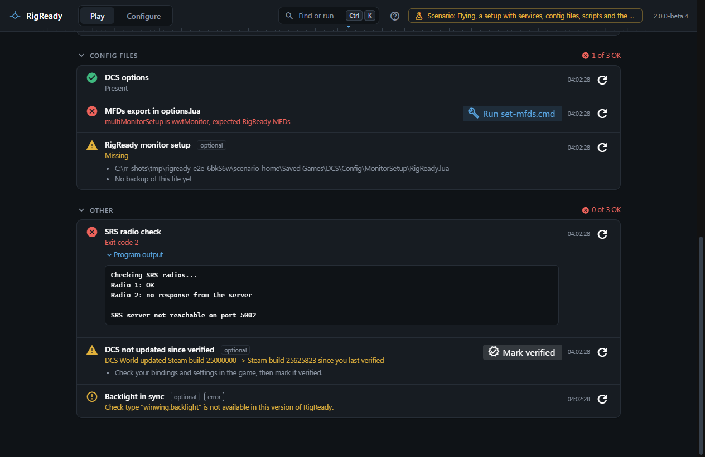

A script is anything Windows can run: a `.cmd` or `.bat` file, a PowerShell `.ps1` script, or a program. RigReady can run one to decide whether the rig is ready (a check), to put something right (a fix), or around a launch (a step). It is how you cover what RigReady has no check for: a hub to power up, a radio server to ping, a tool of your own.



## How a script runs

- **Program**: the file to run, with a [path variable](path-variables.md) or absolute. A `.ps1` file is run through PowerShell. A file that is not there gives "Script not found".
- **Arguments**: a list; each is passed as it is. Nothing from the setup is ever joined into a command line, so a value with a space or a quote needs no escaping.
- **Working folder**, optional.
- **No console window**, on by default. A program started without waiting always gets its own window.
- **Environment**: the script is told which setup it runs for: `RIGREADY_PROFILE_NAME`, `RIGREADY_PROFILE_ID`, `RIGREADY_GAME` (the game module id), `RIGREADY_GAME_PATH` (the game's install folder, empty when there is no known game), `RIGREADY_USER_DATA` (the game's per-user folder, such as Saved Games\DCS), `RIGREADY_HOME` (RigReady's data folder).
- The script runs as you, without administrator rights.

## As a check: Script succeeds

The script is run every time the checklist runs and must finish within its **timeout** (10 seconds by default, 600 at most; this takes the place of the limit in [Settings](../app/settings.md#safety-and-limits)). It passes when its exit code is one of **Success exit codes** (0 by default). Otherwise the row says "Exit code 2" and the last 50 lines it printed are under **Program output**. A script that times out is an error: "Timed out after 10 s". Keep a check script quick and quiet; it runs every few seconds while the [Play screen](../play/index.md) is open.

## As a fix or a step: Run a script

- **Wait until it finishes**, on by default: the script runs to the end, its exit code is judged against the success codes, and the last 200 lines it printed are kept with the step, success or not. Off: the script is started and RigReady goes on at once; the step says "Started warmup.cmd" and nothing more is known about it.
- **Timeout**: 30 seconds by default, up to an hour. At the timeout the script is killed and the step fails.
- **Ask before running** (`requiresConfirmation`), on by default: before the script runs, RigReady shows **Run this program?** with the program, every argument and the folder, and you choose **Run it** or **Skip**. With [Make ready and launch](../play/make-ready-and-launch.md) every such script is asked about first, then the run goes through by itself. From the [tray](../one-click/tray.md), the [taskbar](../one-click/taskbar.md), the [command palette](../app/command-palette.md), a [shortcut](../one-click/desktop-shortcut.md) or the [hotkey](../one-click/hotkey.md) nobody can be asked, so the script is not run and the step says so. Switch it off for a script you trust to run unattended. Steps at [Stand down](../play/stand-down.md) are never asked about: pressing Stand down is the OK.

## Examples

A check that asks a tool of yours whether the radio is reachable, and a file check whose fix runs a script, as they are in the setup's file:

```yaml
checks:
  - id: o1
    type: script.check
    title: SRS radio check
    required: true
    params:
      exe: '{USER}/Scripts/srs-check.cmd'
      args: ['--quiet']
      successExitCodes: [0]
      timeoutSeconds: 10
  - id: f2
    type: file.content
    title: MFDs export in options.lua
    required: true
    params:
      path: '{DCS_USER}/Config/options.lua'
      rule: equals
      keyPath: options.graphics.multiMonitorSetup
      value: RigReady MFDs
    remediation:
      type: script.run
      params:
        exe: '{USER}/Scripts/set-mfds.cmd'
        args: ['--monitor-setup', 'RigReady MFDs']
        requiresConfirmation: true
```

Steps around a launch, including one that stops the launch when it fails:

```yaml
actions:
  preLaunch:
    - id: a2
      title: Warm up the hub
      type: script.run
      params: { exe: '{USER}/Scripts/warmup.cmd', args: [], requiresConfirmation: false }
    - id: a3
      title: Check TrackIR answers
      type: script.run
      continueOnError: false
      params: { exe: '{USER}/Scripts/check-trackir.cmd', args: [], requiresConfirmation: false }
  standDown:
    - id: d1
      title: Put the hub back
      type: script.run
      params: { exe: '{USER}/Scripts/warmup.cmd', args: ['--off'], requiresConfirmation: false }
```

Scripts are never included when a setup is [shared as a file](../protect/sharing.md); the other person is told what to add.
