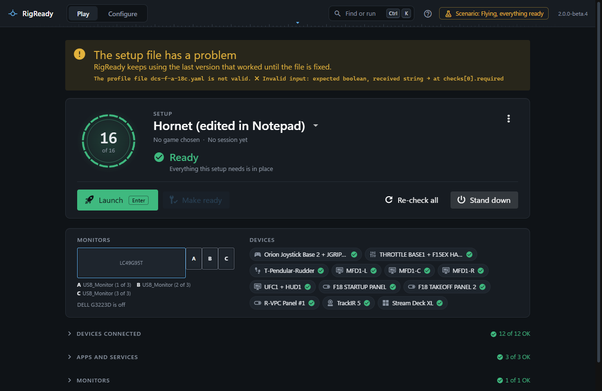
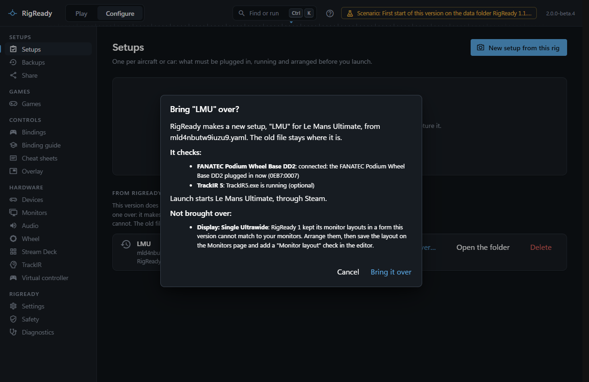

Every setup is a YAML file in `~/.rigready/profiles`, written by RigReady and readable by you. **Configure > Setups > Edit > YAML file > Open in your editor** opens it ([The setup editor](editor.md)). Anything the editor can do, the file can do too, and a few things only the file can: an exact layout copied from another setup, a field the form does not show.

RigReady watches the folder. A change you save shows up on the [Play screen](../play/index.md) and the [Setups page](index.md) within about two seconds, without a restart.

## An annotated example

```yaml
schemaVersion: 1                 # the file format; always 1 for this version
id: dcs-f-a-18c                  # must match the file name (dcs-f-a-18c.yaml)
name: DCS F/A-18C                # what the Play screen shows
description: Hornet, three MFDs  # optional notes
game: dcs                        # dcs, iracing, lmu, beamng, assetto-corsa, msfs2024,
                                 # "other" with a gameName, or absent for no particular game
# gameInstall: D:\DCS World      # for a game installed more than once: the install this setup uses
createdAt: '2026-10-01T18:00:00.000Z'
updatedAt: '2026-10-01T18:00:00.000Z'
launch:                          # what Launch starts; absent: no Launch button
  exe: '{DCS_INSTALL}/bin/DCS.exe'
  args: []                       # one argument per entry, passed as it is
  # cwd: '{DCS_INSTALL}/bin'     # working folder
# steamAppId: '223750'           # instead of launch: ask Steam to start the game
checks:
  - id: c1                       # unique within the setup
    type: device.connected       # a check type (see Checks)
    title: WINWING Orion Joystick Base 2 + JGRIP-F16
    required: true               # false: optional, only warns
    params: { vendorId: '4098', productId: BEA8 }
  - id: c5
    type: process.running
    title: TrackIR
    required: true
    params: { name: TrackIR5.exe, stopOnStandDown: true }
    remediation:                 # the fix Make ready runs when the check is not met
      type: process.launch
      params: { exe: '{PROGRAM_FILES_X86}/TrackIR5/TrackIR5.exe', args: [] }
  - id: c6
    type: file.exists
    title: DCS options
    required: true
    timeoutSeconds: 10           # this item's own limit, in place of the one in Settings
    params: { path: '{DCS_USER}/Config/options.lua' }
    remediation:
      type: file.restore
      params: { path: '{DCS_USER}/Config/options.lua' }
  - id: c7
    type: display.layout
    title: Monitor layout
    required: true
    disabled: true               # off: kept, not checked, not counted, not fixed
    params: &layout              # an anchor: the fix below uses the same arrangement
      # layoutId and layoutName name a layout saved on the Monitors page, when there is one
      displays:                  # the arrangement as captured
        - { id: '\\?\display#sam7053#5&8816e581&0&uid4357#{e6f07b5f-ee97-4a90-b076-33f57bf4eaa7}', name: LC49G95T, enabled: true, primary: true, x: 0, y: 0, width: 5120, height: 1440, rotation: 0 }
        - { id: '\\?\display#deld139#5&8816e581&0&uid4355#{e6f07b5f-ee97-4a90-b076-33f57bf4eaa7}', name: DELL G3223D, enabled: false, primary: false, x: 0, y: 0, rotation: 0 }
    remediation:
      type: display.applyLayout
      params: *layout
actions:                         # steps around the launch; each list may be empty or absent
  preLaunch:
    - id: a1
      title: Start VoiceAttack
      type: process.launch       # any fix type that does something
      params: { exe: '{PROGRAM_FILES}/VoiceAttack/VoiceAttack.exe', args: [] }
      continueOnError: true      # false: a failure pauses the launch and asks
      closeOnStandDown: true     # programs: closed again by Stand down
  postLaunch:
    - id: p1
      title: Start SRS
      type: process.launch
      delaySeconds: 2            # seconds after the game is running
      params: { exe: '{PROGRAM_FILES}/DCS-SimpleRadio-Standalone/SR-ClientRadio.exe', args: [] }
  standDown:
    - id: d1
      title: Put the hub back
      type: script.run
      waitForCompletion: true    # scripts: wait and judge the exit code
      hidden: true               # no console window
      timeoutSeconds: 30
      params: { exe: '{USER}/Scripts/warmup.cmd', args: ['--off'], requiresConfirmation: false }
extensions: {}                   # data other features keep with the setup, for example backup
```

A check has `id`, `type`, `title`, `required` (true unless said otherwise), `params`, and may have `remediation` (`type` and `params`), `timeoutSeconds` (1 to 600) and `disabled`. A step has `id`, `title`, `type`, `params`, and may have `continueOnError` (true unless said otherwise), `delaySeconds` (after launch only), `waitForCompletion`, `hidden`, `timeoutSeconds` (1 to 3600) and `closeOnStandDown`. The fields of each type are on [Checks and fixes](checks.md).

What the setup does when its game closes is kept under `extensions`, in `fly`: `standDownOnClose` (true unless it says false) and `standDownAfterSeconds` (60 unless said otherwise, a whole number from 5 to 3600). A value that is not one of those is read as the default. See [Stand down](../play/stand-down.md#stand-down-when-the-game-closes).

```yaml
extensions:
  fly:
    standDownOnClose: true
    standDownAfterSeconds: 120
```

## Comments and anchors

RigReady reads a file with comments without complaint, and leaves them in place as long as the file is only read. But RigReady writes the whole file when a setup is saved from the editor, when a check's **Mark verified** button ([Checks and fixes](checks.md#game-updated-since-you-last-verified-game-updated)) stores a new version, and when another feature keeps its data with the setup. A save from the editor warns first: **Your comments will be lost**. If you keep notes in the file, keep a copy of them elsewhere, or use the setup's **Notes** field instead. The Setups page marks such a file with "YAML comments", so you know before you open the editor.

YAML anchors and aliases (`&layout` and `*layout`) are read; a file RigReady writes is written out in full, without them.

## A broken file

A file that is not valid YAML, that does not fit the format, or whose `id` does not match its file name is not hidden, and does not stop the other setups from loading:

- **Configure > Setups** lists it with the error (and the line of a YAML error), with **Open file**, **Show in Explorer** and **Delete** ([A setup file cannot be read](../troubleshooting/setup-file-cannot-be-read.md)).
- The Play screen's [switcher](../play/switching-setups.md) lists it greyed out, with the reason in its tooltip.
- If it was the setup on the Play screen when it broke, the screen keeps the last version that loaded, with a yellow note, **The setup file has a problem**, and the error, until the file is fixed. If it was the setup used last and RigReady was started after it broke, the screen shows another setup with a note.
- The editor can still save over a broken file.



A field that fails the type's own rules (a `vendorId` that is not four hex digits) does not break the file: the item is shown on the Play screen as "This check is not set up correctly", with the fields named. A check or fix type this version does not have is shown as not available; the item stays in the file for the version that knows it. A file over 4 MB is not read.

## Files from RigReady 1

RigReady 1 kept its setups in the same folder in another format (a `checklistItems` list and no `schemaVersion`). This version does not read them as they are and does not count them as broken: the Setups page lists them apart under **From RigReady 1**, each with its name and file, and says what RigReady can make of it.

**Bring it over…** is offered when every part RigReady brings has an exact match in this version. It shows the new setup first: its name and game, each check and what it becomes, what Launch starts, and what is not brought over and why. **Bring it over** then makes a new setup file, the way **New setup from this rig** does; the old file is not changed, and the line says "Brought over as the setup …" with a link to it.

| RigReady 1 | Becomes |
|---|---|
| An app is running, with "start the program" or "tell me" as its fix | "App running", with "Start the app" (the same program and arguments) or "Show instructions" |
| A device by vendor and product number | "Device connected", by the same numbers |
| A device known only by its name | "Device connected", by the numbers of the one connected device of that name. With none or several connected, RigReady does not guess: it says so, and you connect it and look again |
| A config file, with or without a pattern | "File exists", or "File content" with the same regular expression |
| A monitor layout, a script check, or "restore a file" as a fix | Not brought over: RigReady 1 kept its monitor layouts in a form this version cannot match to your monitors, it never ran script checks, and this version puts back only copies it kept itself |
| A launch program | The same program and arguments. Without one, the game as RigReady finds it on this PC. Scripts around the launch and files kept for backup are named, not brought over |

When nothing in the file has a match, or something must change first, the line says plainly that RigReady cannot bring the setup over and why; create it again with **New setup from this rig** ([Creating a setup from the rig](capture.md)). **Open the folder** shows the file in Explorer either way. The old file stays where it is until you delete it.


