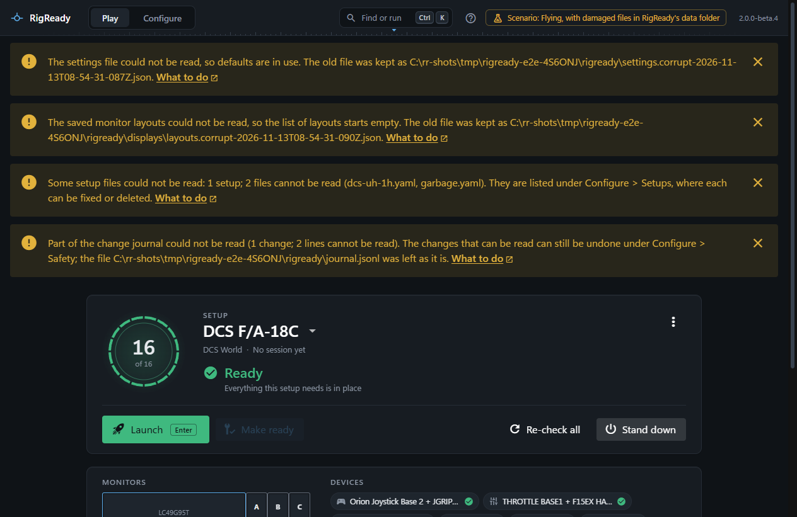
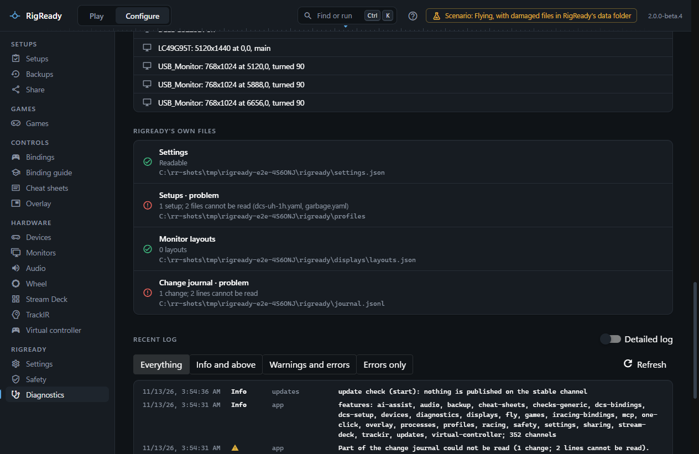

RigReady starts whatever its data folder looks like. A damaged file of its own is set aside or left where it is, never silently replaced, and you are told at the start. This page covers that, and the few cases where RigReady cannot start at all.

## RigReady does not appear

**It is already running.** RigReady runs once. Starting it again, from the Start menu, a [desktop shortcut](../one-click/desktop-shortcut.md) or a [Jump List](../one-click/taskbar.md) task, hands what you asked for to the running copy ([The command line](../one-click/command-line.md)): the window comes forward, or the shortcut's setup is made ready and launched. Look for the icon in the [tray](../one-click/tray.md); one click brings the window out, a double-click always opens it.

**It is in the tray.** With **Keep RigReady in the tray when you close the window** on ([Settings](../app/settings.md#startup)), closing the window does not quit: RigReady keeps running, with its icon in the tray next to the clock. Windows may keep that icon under the ^ arrow. **Quit** is in the tray icon's menu.

**You closed the window and there is no icon in the tray.** Look under the ^ arrow first. If the icon is not there, that switch is off and closing the window quit RigReady. Start RigReady again and turn the switch on in [Settings](../app/settings.md#startup). The line under the switch says what closing the window does.

**It could not start.** When RigReady fails before it has a window, Windows shows a message box, "RigReady could not start", with the error, and points at the log: `logs\rigready.log` in [the data folder](../app/index.md), `~/.rigready`. Copy the error and the end of the log into a [problem report](../app/diagnostics.md#reporting-a-problem).

**Not Windows.** RigReady runs on Windows 10 and 11 only and refuses to start anywhere else, saying so.

## A data file is damaged

At start, RigReady checks its own files. Each problem is a closable notice at the top of the window, and the same text is in the log as a warning. The app is usable behind the notices.

| File | What RigReady does | Notice |
|---|---|---|
| `settings.json` | The file is set aside as `settings.corrupt-<time>.json`, defaults are used and saved. | "The settings file could not be read, so defaults are in use. The old file was kept as ..." |
| `displays\layouts.json` | Set aside as `layouts.corrupt-<time>.json`; the list of layouts starts empty. | "The saved monitor layouts could not be read, so the list of layouts starts empty. The old file was kept as ..." |
| A setup in `profiles\` | Left where it is and listed apart on the Setups page with what is wrong. The other setups load. | "Some setup files could not be read: ... They are listed under Configure > Setups, where each can be fixed or deleted." See [a setup file cannot be read](setup-file-cannot-be-read.md). |
| `journal.jsonl` | Left as it is. Lines that can be read still work; [the Safety page](../protect/safety-page.md) lists and undoes them. | "Part of the change journal could not be read (...). The changes that can be read can still be undone under Configure > Safety; the file ... was left as it is." |
| `window.json`, `panels.json`, `state.json` | The window opens at its default size, panels at their default place, and the Play screen on the first setup. No notice: nothing you made is in them. | |

**Configure > Diagnostics** shows the state of each file under **RigReady's own files**, with "Readable" or the problem, so you can see whether a notice is still due. Once a set-aside file has been replaced by a good one, the next start shows fewer notices.

## The window stopped working

If the page inside the window crashes, RigReady loads it again by itself and shows a notice: "The RigReady window stopped working (...) and was loaded again." A page that crashes again and again, more than three times in a minute, is not reloaded any more; quit from the tray and start again, and report it with the diagnostics. A helper process that dies is reported the same way; RigReady keeps running. See [diagnostics](../app/diagnostics.md).

## A game or driver that does not answer

A page that asks the PC something and gets no answer within a few seconds says so instead of waiting for ever: the Diagnostics page reports "did not answer within 5 s" for the part that was silent, and a check that runs too long is reported as timed out (the limit is the **Check timeout** in [Settings](../app/settings.md#safety-and-limits)). Quitting never waits on the machine either; a feature stuck in a driver call cannot keep RigReady from closing.
