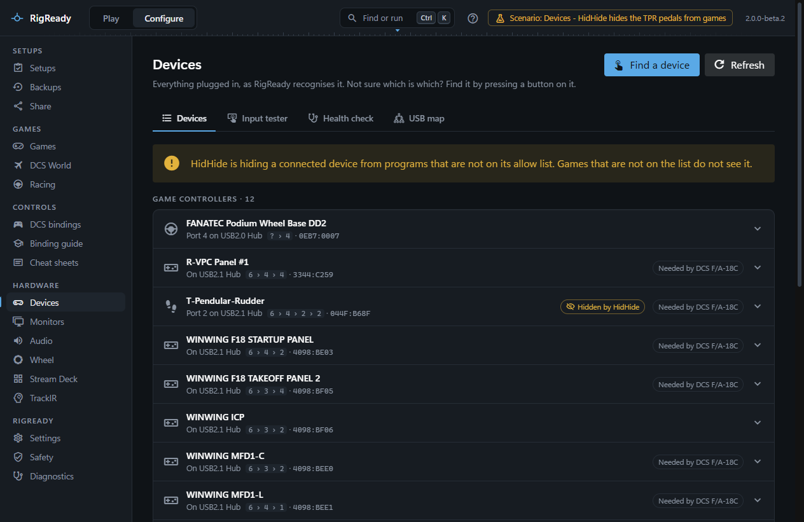

A device check fails with **Not connected** when no connected device matches what the setup asks for. The summary and the details say what RigReady saw, and that usually points at the cause.

RigReady never identifies a device by its name alone. A check names it by vendor and product ID, plus its serial number or its USB port when identical devices have to be told apart.

## Read the check first

The summary line can say:

- **Not connected · last seen 2 days ago, on hub 3, port 2**: RigReady remembers where it was last plugged in; the details give the USB path.
- **1 of 2 connected**: a check that asks for several identical devices.
- **Hidden by HidHide**: the device is there, but the game is not allowed to see it (below).

The details can add:

- "Check that it is plugged in and powered on, then check again."
- "A different <device> is connected (serial ...), not this one." The same model, but another unit: the setup was captured with one unit and another is plugged in.
- "A <device> is connected on another USB port (...)." The check identifies this device by its port, and it moved.
- "This device is identified by USB port, so moving it to another port breaks this check."

## Unplugged, or on another hub

Plug it in, wait a moment, and press the check's re-check. Devices are noticed as they are plugged in; the [Play screen](../play/index.md#re-check) re-checks by itself. **Configure > Devices > USB map** ([USB map](../hardware/usb-map.md)) draws where every device hangs and names what the current setup needs; a hub that lost power takes everything on it with it.

## It moved to another port

A check that identifies a device by its port (needed for identical devices without serial numbers) fails when the device is on another port. Either plug it back where it was, or edit the setup's check for the device so it names the device where it is now. See [Identical devices](../hardware/devices.md#identical-devices) and [Checks and fixes](../setups/checks.md).

## It is another unit of the same model

The check names a serial number and a different unit is connected. If the new unit is the one you want, pick it again in [the setup editor](../setups/editor.md). If several identical devices are connected and you are not sure which is which, **Find a device** on the Devices page ([Find a device by pressing a button](../hardware/devices.md#find-a-device-by-pressing-a-button)) highlights whatever you press a button on.

## Hidden by HidHide

HidHide hides devices from every program that is not on its allow list, which is often how it is used for sim wheels and sticks. When a device the setup needs is on HidHide's hidden list and the program the setup launches is not on the allow list, the check fails with **Hidden by HidHide** and says which program is not allowed. The fix is in HidHide Configuration Client: untick the device on the Devices tab, or add the game on the Applications tab. RigReady reads HidHide's settings to tell you this and never changes them. The Devices page shows HidHide's state, the hidden devices and the allowed programs.

## Windows renamed it

Windows sometimes shows a device under another name after a driver update or on another port. Because the check matches by IDs, a renamed device still passes. The name RigReady shows is the one you gave it on the Devices page. What does change on a new port or a new PC is the ID DCS uses for its binding files; that is a different problem, solved under [device IDs](../dcs/device-ids.md).
