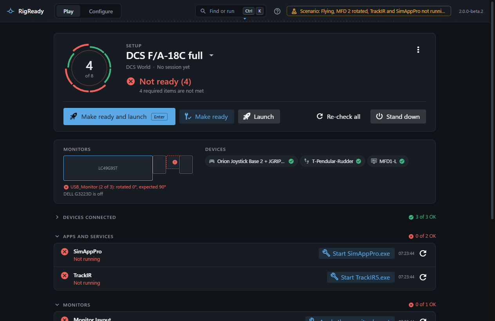

Most trouble shows up on the Play screen as a failing check, and most failing checks say in their own words what is wrong and offer the fix next to it. This section is for the rest: the problems that come from the PC, from Windows, from a game being open, or from a damaged file.

Each page names the symptom as RigReady shows it, the cause, and what to do.

## Reading a failing check

Every check on the Play screen has a summary line and, when you open it, details in plain words. A **red** item is required and not met: the rig is **Not ready**. A **yellow** item is optional and not met: the rig is **Ready**, with a warning. A check that could not be run at all, for example because the controllers could not be read, says so rather than pretending to fail.

Next to a failing item there is its fix, when RigReady has one (start the app, apply the layout, restore the file), and a re-check. **Re-check all** runs every check again. Items RigReady cannot fix by itself are listed under **Needs you**, with what to do. Launch is never blocked by a failing check; it only asks first. See [make ready and launch](../play/make-ready-and-launch.md) and [checks](../setups/checks.md).

## Reporting a problem

When a page here does not solve it, open **Configure > Diagnostics**, press **Copy diagnostics**, and paste the result into a report on the project's issues page (the **Report a problem** link in the About panel). The report has personal details removed; read it first if you like. Say what you did, what you expected, and what happened instead. See [diagnostics](../app/diagnostics.md).

## Pages in this section

- [Game controllers could not be read](controllers-not-read.md): the input reader did not start.
- [A device is not found](device-not-found.md): unplugged, on another port, hidden by HidHide, or renamed by Windows.
- [The monitor layout went back by itself](monitor-layout-reverted.md): the countdown, a dark screen, and the question at the next start.
- [RigReady will not write DCS files](dcs-files-refused.md): DCS is running.
- [A setup file cannot be read](setup-file-cannot-be-read.md): damaged YAML, and files from RigReady 1.
- [Start with Windows is off](start-with-windows-off.md): Task Manager's startup apps.
- [Windows SmartScreen warns about the installer](smartscreen-warning.md).
- [RigReady will not start, or a data file is damaged](app-will-not-start-or-data-folder.md).
- [Questions and answers](faq.md).
