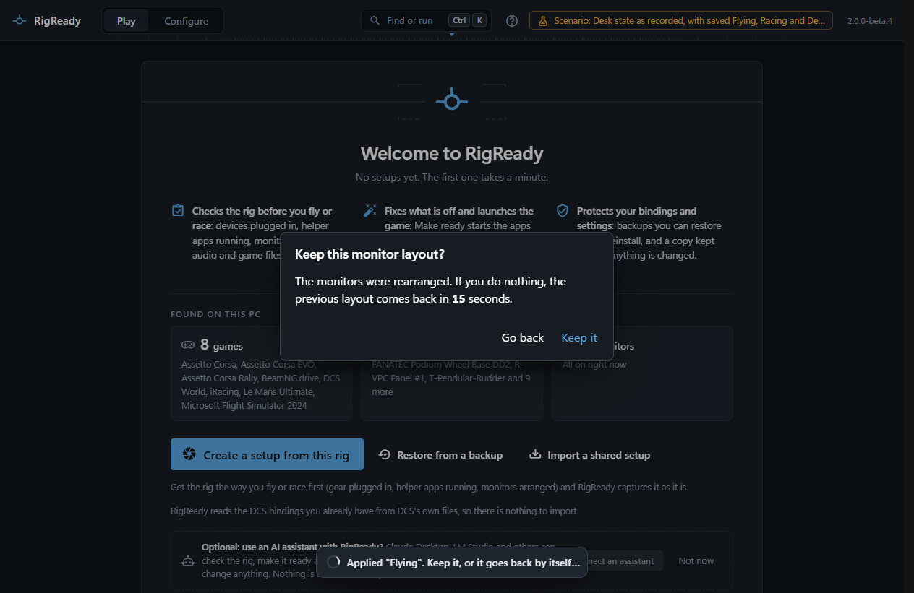
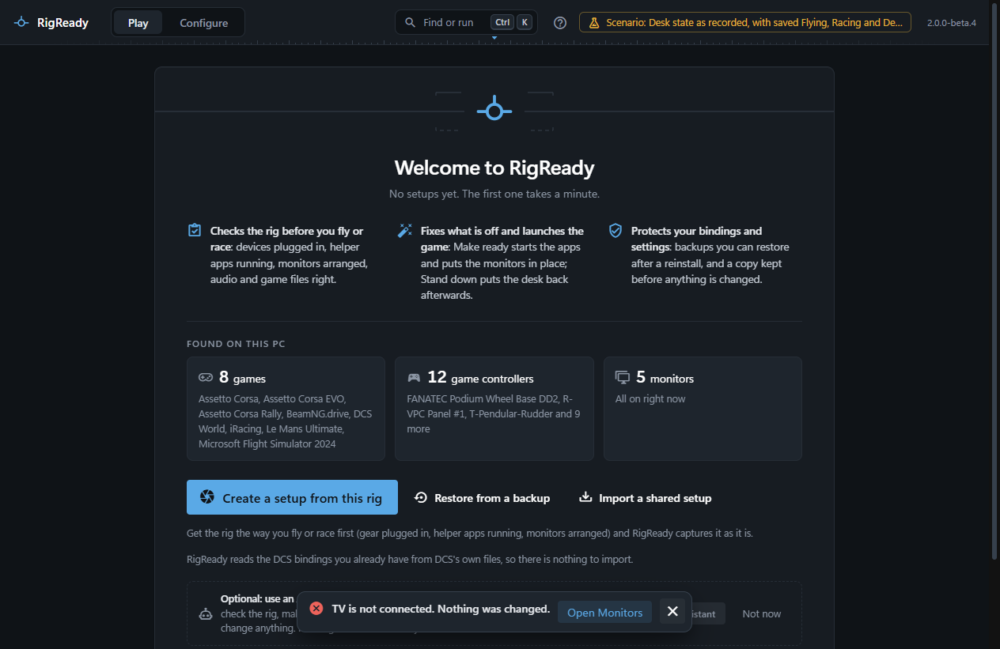

Every monitor layout RigReady applies is on probation. A question appears, a countdown runs, and if nobody answers, the previous arrangement comes back by itself. This is what saves you when the new arrangement leaves you looking at a dark screen.

## The countdown

After a layout is applied, on the Monitors page, from the [command palette](../app/command-palette.md), by a fix on the Play screen, by **Make ready** or by **Stand down**, a dialog asks **Keep this monitor layout?** and counts down: **Keep it** keeps it, **Go back** reverts at once, and no answer puts the previous arrangement back when the countdown ends. The time is the **Monitor layout revert timer** in [Settings](../app/settings.md), 15 seconds by default. The prompt, and why it is there, are described under [Keep it or go back](../monitors-and-audio/layouts.md#keep-it-or-go-back).

A layout that was kept is still a layout you can leave: [Stand down](../play/stand-down.md) returns to the desk layout, and the Monitors page can apply any saved layout.

## A screen went dark

If the new layout switched off the screen you were looking at, or put the window somewhere you cannot see, do nothing. When the countdown ends the earlier layout comes back. If the earlier layout cannot be put back, RigReady reports "There is no earlier monitor layout to go back to" or the error Windows gave.

## Make ready stops at the question

**Make ready** and **Make ready and launch** apply the setup's layout as one of their steps and then wait for your answer. Nothing else happens until you keep it or go back; if you do not answer, the layout goes back and the run says so. Answer the question and run Make ready again.

## "Put the earlier monitor layout back?"

The arrangement from before a change is written to disk before the change is made. If RigReady was closed, or crashed, or the PC was shut down while the question was still open, RigReady asks once at the next start: **Put the earlier monitor layout back?**, listing how the monitors were arranged before and when. Choose to put it back or to leave the monitors as they are; either way the question is not asked again. See [If RigReady is closed during the countdown](../monitors-and-audio/layouts.md#if-rigready-is-closed-during-the-countdown).

## Nothing changed when the layout was applied

When the layout asked for is the one the monitors already have, there is nothing to apply and no countdown: "The monitors already match "Flying". Nothing was changed." A layout refused by Windows, for example a resolution a monitor does not support, is reported with the reason, and the monitors stay as they were.

