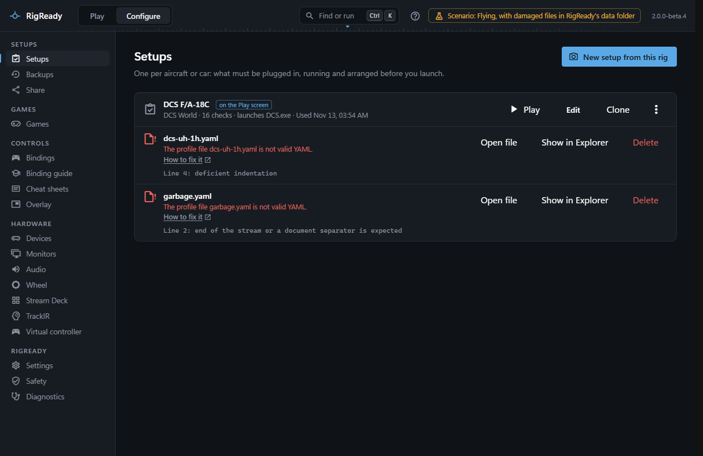

Setups are YAML files in `profiles` under RigReady's data folder, and you may edit them by hand. A file that no longer reads as a setup does not take the others down: it is listed apart on **Configure > Setups** with what is wrong, and every other setup works as before.

## Symptoms

- At start, a notice at the top of the window: "Some setup files could not be read: ... They are listed under Configure > Setups, where each can be fixed or deleted."
- On **Configure > Setups**, the file appears in red with one of:
  - "The profile file <name>.yaml is not valid YAML." with the line and the reason, for example a missing colon or wrong indentation.
  - "The profile file <name>.yaml is not valid." with which value is wrong, for example a check without a type.
  - "Its id "..." does not match the file name; rename one to match the other."
- **Diagnostics** lists the file under RigReady's own files: "3 setups; 1 file cannot be read (...)".

## What to do

The row has three buttons: **Open file** opens it in your editor for YAML, **Show in Explorer** selects it, **Delete** removes it.

To fix it, open the file, go to the line named, and correct it; the error message is the YAML reader's own. A value error names the field. Save the file and open the Setups page again; RigReady reads the files each time the page loads. If the file is beyond repair, delete it and create the setup again from the rig, or restore the setup from a backup (see [restore](../protect/restore.md)).

A broken setup is not edited by RigReady while it is broken, so nothing in it is lost by waiting.

The YAML format is described under [setups as YAML](../setups/yaml.md).

## Files from RigReady 1

RigReady 1 kept its setups in the same folder, in a format this version does not read. Such a file is not a damaged setup: it is listed under **From RigReady 1** on the Setups page, with its name, and the note "This version starts from scratch and does not read setups made by RigReady 1. Create them again with New setup from this rig. The old files stay where they are until you delete them." **Show in Explorer** and **Delete** are offered; nothing is converted. See [Files from RigReady 1](../setups/yaml.md#files-from-rigready-1) and [Creating a setup from the rig](../setups/capture.md).
